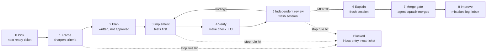

# 05 — AI Agent Playbook: Autonomous Build → Review → Explain → Merge

Agents build every ticket end to end and merge it themselves; no step waits for a human
([ADR-0014](./adr/0014-autonomous-agent-workflow.md)). James does not check tickets one by one, and audits
asynchronously instead, through three things the loop always leaves behind:

- an **explanation** per ticket in [explanations/](./explanations/): the decisions, how it is implemented,
  and the code
- the **[HUMAN_INBOX.md](./HUMAN_INBOX.md)**: what is blocked on James, and every decision made without James
- the **phase recaps** in [recaps/](./recaps/), with the exit-gate evidence

Without a human gate, correctness rests on three things this playbook makes non-negotiable: **CI and fitness
tests** (they never agree with the author), **independent review by a fresh session** (the implementer never
reviews itself), and **hard stop rules** (the agent escalates instead of guessing on anything it cannot undo).

## The loop (one ticket)



One ticket = one branch = one PR. A **session** here means a context: the implementer is one session, and the
reviewer and the explainer are each a **fresh** one (a subagent or a new terminal) that never saw the
implementation conversation. Commands: [`/build-next`](../.claude/commands/build-next.md) picks a ticket and
runs [`/build-ticket`](../.claude/commands/build-ticket.md), which runs steps 1–8 and spawns the fresh
sessions itself.

### Step 0 — Pick (orchestrator)

1. Read [HUMAN_INBOX.md](./HUMAN_INBOX.md). If `Run state` is `paused`, stop. If James answered a blocked
   item, set that ticket back to `todo` and move the item to "Resolved".
2. Pick from [tickets/README.md](./tickets/README.md) a `todo` ticket whose dependencies are all `done`.
   Prefer the critical path, then the lowest ID. Skip tickets that touch a hot file another running agent
   holds (see [parallel agents](#running-agents-in-parallel)).
3. If the ticket is a backlog stub, draft it first with `/draft-ticket` (a docs PR through this same loop).

### Step 1 — Frame (implementer, no code yet)

Command: [`/frame-ticket`](../.claude/commands/frame-ticket.md). This is the step a human used to do; the
agent now does it against the same yardstick.

1. Read the ticket, its linked ADRs, `CLAUDE.md`, [PRODUCT_SCOPE.md](./PRODUCT_SCOPE.md) and the current code.
2. Make every acceptance criterion precise and testable. Add the rows of the
   [10-case tenant table](./ENGINEERING_PRACTICES.md#7-testing-standards) that apply, and at least one case
   the ticket missed.
3. Resolve open questions with the [decision rules](#decision-rules). Hit a [stop rule](#stop-rules)? Block.
4. If it won't fit in ≤ ~400 non-test lines, split it (`P3-04a`, `P3-04b`), dividing the criteria, and add
   the rows to the ticket index.
5. Record what changed in the ticket's "Frame notes" and commit the ticket file **as the branch's first
   commit**, so the reviewer can diff it.

**Framing may add or sharpen criteria; it never deletes or loosens one** unless the reason is recorded in the
Frame notes and listed in the inbox for audit. The reviewer checks this.

### Step 2 — Plan (implementer, written down, no approval)

Write the plan into the PR description draft: files to change, interfaces and schemas, the migration, each
acceptance criterion mapped to a test, risks, and the decisions taken. It replaces the human's design
prediction: the explainer and the reviewer compare the code against it, and a large gap between plan and code
is a review finding.

### Step 3 — Implement (implementer)

Command: [`/implement-ticket`](../.claude/commands/implement-ticket.md).

- Work in a dedicated worktree on branch `<ticket-id lowercase>-<slug>`.
- **Tests first** for each acceptance criterion: show them red, then green.
- Small commits, Conventional Commit messages ending with `[<ticket-id>]`.
- `make gen-api` if the API changed; `make revision` if models changed, then read and fix the migration.
- **≤ ~400 non-test lines.** Tests don't count; never cut tests to fit. Over the limit means split.
- Stay in scope. Unrelated improvements become follow-up notes in the PR, not code.
- **Record decisions when you make them**, in the PR's "Decisions and alternatives" (see
  [recording a decision](#recording-a-decision)). Don't reconstruct them from memory at the end.
- **Evidence, not claims:** real command output goes in the PR. Never claim a command ran if it didn't.
- Never weaken a [protected gate](#protected-gates) to get green.

### Step 4 — Verify (CI)

`make check` locally, then push and wait for CI: lint, types, tests against Postgres, `alembic check`, fitness
tests, OpenAPI drift, the Base44 ratchet, `prodlike` smoke, E2E, `docs`. A failure is fixed at its cause. A
failure unrelated to the ticket (flaky test, broken `main`) gets **two** retries; after that, fix it in its
own small PR first if it is in the repo, or block if it is external.

**Tier 1–2 tickets that change behaviour a user can reach** also run the journey on the stack (`make up` or
`make prodlike`) and paste the transcript (curl sequence or Playwright output) in the PR. This replaces "the
reviewer ran it locally".

### Step 5 — Independent review (fresh session; the merge path's only judge)

Command: [`/review-ticket`](../.claude/commands/review-ticket.md), run as a **subagent or new session**, using
[templates/REVIEW_PROMPT.md](./templates/REVIEW_PROMPT.md).

- Isolated from the implementation *conversation*, not from the code: it reads any file it needs, read-only.
- Adversarial; the ticket's acceptance criteria and `CLAUDE.md` are the yardstick. Every finding needs a
  concrete failure scenario and, where possible, a failing proof test.
- It also checks the frame diff (criteria not loosened) and the [protected gates](#protected-gates).
- It ends with a verdict: **`MERGE`** (no open Critical or High) or **`BLOCK`** (with the findings).

| Tier | Reviewers |
|---|---|
| 1 | Fresh Claude reviewer **with the security pass**, **plus** Codex (`codex-review` skill, `gpt-6-astra-medium`). If Codex is unavailable, a second fresh Claude reviewer with only the security pass. Both must say `MERGE`. |
| 2 | One fresh Claude reviewer |
| 3 | One fresh Claude reviewer, short pass (scope, accuracy, nothing broken) |

**Fix loop.** The implementer reproduces each finding (a failing test first) before fixing it, and records
dismissed findings with a reason in the PR. For each fix, the PR's "Independent review" section keeps the
concrete failure that motivated it and the evidence for the final approach (the test that failed and now
passes); a fix that chose between approaches also gets a decision record. Then a **new** fresh reviewer re-reviews the whole diff, not just
the fixes. At most **3 rounds**: an open Critical or High after round 3 blocks the ticket. Medium and Low
findings that are not fixed go to the PR's follow-ups and the explanation's "Not verified" section.

### Step 6 — Explain (fresh session)

Command: [`/explain-ticket`](../.claude/commands/explain-ticket.md), run as a **subagent or new session**,
writing `docs/explanations/<ticket>-<slug>.md` from [templates/EXPLANATION.md](./templates/EXPLANATION.md).
It is committed to the PR as its last code commit.

A fresh session explains the code that exists, not what the implementer intended. Its inputs are the ticket
(with its Frame notes), the ADRs it links or adds, the PR description (the plan, "Decisions and
alternatives", the review rounds, follow-ups), the PR's comments and reviews, the diff and the repo. The aim:
a later session, without the implementation conversation, can explain what was built, how it works, why each
consequential choice was made and what was rejected, what shaped it, and what was and wasn't verified.

| Rule | Why |
|---|---|
| Three core parts: **decisions** (with rejected alternatives), **how it is implemented** (one walkthrough), **the code** (annotated excerpts of what was written) | What James asked for: it is read instead of reviewing the PR |
| Plus the **review log** (with the failure behind each fix) and **what was not verified**, accepted risks and open follow-ups | With no human review, this is where James sees what the gates did and did not prove |
| Opens with a brief overview. **Full form** for Tier 1–2, aiming at about 400 lines including code; **short form** by default for Tier 3 (about 60 lines), with full-form sections when the change needs them. These are editing guidelines, not limits | Length goes to consequential decisions, behaviour, failure scenarios and "Must explain" questions, never padding, repetition, whole files or generic tutorials. A long one stays one file, with sections and collapsed deeper material |
| Each "why" is labelled: **recorded** (ticket, ADR, PR, review), **established by code and tests**, or **inferred**. Unknown motivation is stated as unknown | A later reader must tell a record from a guess. Never invent alternatives, experiments, decisions or verification results |
| Walkthrough variant matches the ticket: **A** API request, **B** UI interaction, **C** process/pipeline | An invented request walkthrough is worse than none |
| Prose references are `path::symbol`; code excerpts are fenced blocks headed by their `path::symbol`; immutable permalinks where exact lines matter | They survive later edits and are checked by `scripts/check-explanation-refs.py` (which skips fenced code) |
| Answers the ticket's "Must explain" questions, then a 5-question quiz with collapsed answers | James's self-study material |
| If the code contradicts the PR description or the plan, or a consequential decision has no recorded rationale, the explainer reports it and **does not paper over it** | A mismatch goes back to step 5 as a finding; a missing rationale goes into the PR's decisions |
| It's a snapshot. The header names the PR and the pre-merge **source revision** it was written from; the merge commit is recorded after the merge (handoff block, phase recap) | The explanation is committed before the merge, so it can't name the merge SHA. Later changes get a new explanation, which says which revision it describes; lasting decisions live in ADRs |

### Step 7 — Merge gate (agent merges)

The PR's last commit also sets the ticket's status to `done` in the index and adds any decisions to audit to
the inbox, so all three land atomically. The agent merges only when **all** of these hold:

- [ ] Every required CI check is green on the PR head.
- [ ] Rebased onto the latest `main`.
- [ ] The final review round returned `MERGE` from every required reviewer, with no open Critical or High.
- [ ] Every acceptance criterion maps to a passing test or recorded evidence in the PR.
- [ ] The explanation exists and `scripts/check-explanation-refs.py` passes.
- [ ] Nothing after the explanation changes what it describes: `git diff <explanation commit> HEAD` touches
      only bookkeeping files, and a rebase after it resolved no conflict in the ticket's files (git doesn't record that: the
      merging session confirms it). Otherwise a
      fresh explainer updates the explanation first.
- [ ] No protected gate was loosened.

Then: `gh pr merge <N> --squash --delete-branch`, remove the worktree, and return to step 0.

GitHub enforces most of this: `main` is protected (P0-04b). A PR is required, the three CI jobs must be
green and the branch up to date, history is linear, and the rules apply to admins. Never use
`gh pr merge --admin` or change the protection to get a merge through; that is loosening a protected gate.
The required checks are matched by the CI jobs' `name:`: renaming a job, or adding a job that must block
merges (P1-08 `prodlike`, P4-09 `e2e`), needs the protection's check list updated in the same PR.

**Bookkeeping PRs** only touch `docs/tickets/README.md`, `docs/HUMAN_INBOX.md` or
`docs/AGENT_MISTAKES_LOG.md` (blocking a ticket, logging). They need green CI only: no review, no explanation.

### Step 8 — Improve (agent)

- Log every finding the reviewers confirmed in [AGENT_MISTAKES_LOG.md](./AGENT_MISTAKES_LOG.md): it measures
  what the implementer gets wrong.
- When a pattern appears **twice**, promote it: a fitness test (preferred, because tests enforce) or a line
  in `CLAUDE.md`'s "Lessons learned", in the next PR. The agent may **add** rules and tests; removing or
  softening one is a stop rule.
- If a command keeps needing the same correction, fix the command file.

## Decision rules

The agent decides alone, in this order, and records every decision in the PR's "Decisions and alternatives"
section when it makes it (from there it reaches the explanation):

1. **The ticket, an accepted ADR, [PRODUCT_SCOPE.md](./PRODUCT_SCOPE.md) or `CLAUDE.md` decides it.** Follow it.
2. **A default is written down** (a stub's "Decide while framing" default, a product default): take it.
3. **Otherwise choose the simplest option that is reversible and matches the existing code patterns.**
   - Affects only this ticket: record it in the PR.
   - Lasting (other tickets will build on it: a convention, a table shape, a library): write an ADR with
     `Deciders: agent (autonomous) in <ticket>`, and add it to the inbox's "Decisions to audit".
4. **A stop rule applies:** block.

### Recording a decision

A decision is **consequential** if a later reader would ask "why this way?": it shapes behaviour, data,
security, an interface or a gate, trades one property for another, or a reviewer questioned it. Routine
syntax and choices that simply follow the convention need no record. For each consequential one, write:

- **Problem or constraint** it answers
- **Chosen** approach
- **Alternatives** actually considered, and why each lost (none considered: say so; never invent one)
- **Tradeoffs and accepted limitations**
- **Basis:** ticket requirement, ADR, existing convention, experiment, test result, review finding, or
  autonomous judgment, with the evidence

Review-driven decisions keep the concrete failure that motivated the fix and the evidence for the final
approach. Context outlives the PR only in the repo: the explanation carries the ticket's decisions, accepted
risks and open follow-ups; a follow-up that needs action also goes to the ticket it belongs to, the index or
the inbox. ADRs are for **lasting** decisions only (rule 3 above), not every implementation detail.

## Stop rules

Stop the ticket, set it to `blocked` in the index, add an entry to the inbox's "Blocked — needs James"
section (one bookkeeping PR), and move to the next ready ticket that does not depend on it, when:

1. **A human-only resource is needed:** an account, a credential or secret, a domain, payment, legal or
   privacy input, real (non-seed) data.
2. **The work contradicts an accepted ADR, the product scope or a `CLAUDE.md` non-negotiable**, or needs new
   infrastructure (`CLAUDE.md` rule 13). Superseding an ADR is James's call.
3. **Getting green needs weakening a protected gate** or editing a merged migration.
4. **The review does not converge:** a Critical or High is still open after 3 rounds, or the reviewers
   disagree on one and the implementer cannot prove either side with a test.
5. **The action is irreversible or outward-facing and the ticket's scope doesn't name it:** touching
   staging (milestone D tickets name it), anything in production, sending real email, publishing, deleting
   remote branches or data.

A blocked entry says what is needed, the options the agent sees with a recommendation, and what is blocked
behind it. When James writes an answer, step 0 picks it up.

## Protected gates

The agent is judged by these, so it may not loosen them. It may **add** to them or make them stricter,
and change them when its ticket's scope says so; loosening them in any way is stop rule 3.

- `.github/workflows/*` (removing or skipping a job, `continue-on-error`, narrower triggers)
- Lint, type and test configuration: ruff rule sets, mypy strictness, ESLint rules, `tsconfig` strictness,
  pytest markers that skip tests, the Base44 ratchet
- Fitness tests, the tenant test helpers, and any existing test (deleting, skipping or weakening assertions)
- `docs/templates/REVIEW_PROMPT.md`, `scripts/check-*.py`, `CLAUDE.md` non-negotiables, this playbook's
  stop rules and merge gate
- Branch protection and required checks

## Risk tiers

| Tier | Areas | Frame | Review | Run on stack | Explanation |
|---|---|---|---|---|---|
| **1** | Auth, sessions, tenancy, permissions, migrations on existing data, file/S3 security, deletion/retention, deploy/backup, money | Full; extra negative cases | Claude + security pass, **plus** Codex (or a second reviewer) | Yes, transcript in PR | Full form |
| **2** | Domain features, APIs, UI with logic | Full | One fresh reviewer | If user-reachable | Full form |
| **3** | Docs, config, copy, styling, tooling | Light | One fresh reviewer, short pass | No | Short form |

## Phase gates (automated)

When the last ticket of a phase merges, the agent:

1. Runs the phase's exit gate from the [roadmap](./ROADMAP.md) on the stack and in CI, and records the
   evidence.
2. Drafts the recap with `/milestone-recap` ([template](./templates/MILESTONE_RECAP.md)): demo script,
   architecture delta, agent performance, open risks, gate evidence. James's own sections stay empty.
3. Gate red: writes fix tickets (`P2-fix-01`…) into the index and does them before starting the next phase.
   Gate green: starts the next phase without waiting.

## Running agents in parallel

- **At most two agents at once, one per lane.** Lanes A and B are now two agent tracks, chosen to avoid file
  conflicts. More agents add merge conflicts, not throughput.
- **One worktree per agent:** `git worktree add ../bw-<ticket> -b <ticket-lowercase>-<slug>`.
- **Hot files, one agent at a time:** `app/main.py`, `migrations/versions/` (one open migration PR at a
  time; the second rebases and re-points `down_revision`), `frontend/src/api/schema.d.ts`,
  `docker-compose.yml`, `compose.prodlike.yml`, `.github/workflows/*`.
- **Contract first across lanes:** if lane B's UI needs lane A's endpoint, lane A merges the schema and route
  stub first.

## What James does (asynchronous, never blocking)

| When | What |
|---|---|
| Whenever there's an inbox notice | Answer "Blocked — needs James" items in [HUMAN_INBOX.md](./HUMAN_INBOX.md) |
| Weekly, ~30 min | Skim "Decisions to audit". Overturn one by writing an ADR or a ticket (the agent builds it like any other) |
| Per phase | Read the recap; try the demo script yourself if you want to |
| To learn | Read the explanations; `/quiz-me <ticket>`; your own notes in `learnings/`; one hand-written change. The ticket index's "Learned" column is your tracker; nothing waits on it |
| To pause | Set `Run state: paused` in the inbox. Agents finish the current step, then stop at step 0 |

## Context for agents

- **`CLAUDE.md`** at the repo root: ≤ 150 lines of commands, layout, rules and links.
- **Project commands** in [`.claude/commands/`](../.claude/README.md) encode this loop.
- **Give an agent** the ticket file plus whatever `CLAUDE.md` links to. Do not paste whole design documents.
- **Never let an agent:**
  - run commands against staging or production data
  - edit merged migrations
  - loosen a protected gate
  - touch secrets, or commit `.env` files with real values
  - merge without the merge gate

## Handoff format (end of every ticket, in the PR and the session output)

```markdown
## Handoff — <ticket>
Status: merged (PR #N, merge commit <sha>) | blocked (inbox item) | split (into …)
Changed files: <list>
Interfaces changed: <endpoints/schemas/tables>
Migrations: <revision id + summary>
Env vars / secrets: <added/changed>
Evidence: <commands run + results>
Review: <rounds, verdicts, findings fixed / dismissed>
Decisions to audit: <lines added to the inbox, ADRs written>
Known gaps / follow-ups: <list>
```
