# 05 — AI Agent Playbook: Build → Review → Explain → Learn

You decided that AI agents implement the work while you review it and learn from it. This playbook makes that
loop produce **correct code** and **real understanding**. Right now it risks producing neither.

## Why the current loop needs upgrading

Current flow: *the AI implements a whole milestone → the AI reviews it → the AI writes an explanation.*

| Problem | Consequence | Upgrade |
|---|---|---|
| Milestone-sized changes | Thousands of lines per review; errors in ticket 2 are built on by ticket 6 | **One ticket = one agent session = one PR.** A milestone is a set of tickets plus a gate. |
| Same AI reviews its own work | Its blind spots are correlated with the author's: it "agrees with itself" | **A fresh session reviews with no implementation context**, guided by a checklist. CI and fitness tests act as objective reviewers. |
| "Correct" is never written down first | Review has no yardstick; agents fill gaps with guesses | **Frame step:** a human edits the acceptance criteria and test list *before* coding |
| Long explanations written before the code (`Process/` guides, ~1,000 lines) | They describe intended code, not actual code; reading them feels like learning but isn't | **Short explanations after the code**, written by a fresh session, anchored to `path::symbol` in a PR |
| Passive reading | The illusion of competence: you recognise it but cannot reproduce it | **Active recall:** quiz, explain-back in your own words, one hand-written change, bug hunts |
| Agent mistakes repeat | The same corrections every week | A **mistakes log** that becomes `CLAUDE.md` rules |

## The loop (one ticket)

```mermaid
flowchart LR
    F[1 Frame<br/>human] --> P[2 Plan<br/>agent → human approves]
    P --> I[3 Implement<br/>agent, tests first]
    I --> V[4 Verify<br/>CI + fitness tests]
    V --> R[5 Independent review<br/>fresh agent]
    R --> H[6 Human review<br/>reviewer runs it; explain-back gate]
    H --> E[7 Explain<br/>fresh agent drafts]
    E --> M[8 Merge + improve<br/>mistakes log → CLAUDE.md]
    M -.->|within 2 working days| L[9 Learn<br/>driver: quiz, note, hand change]
```



Steps 1–8 are on the merge path and should take as little calendar time as possible, because the lane-A
tickets form a serial critical path (P2-01 → P2-02 → P2-03 → P2-04 must merge one after another). Step 9 is
off the merge path but not optional: it is tracked in the ticket index ("Learned" column) and checked at the
phase gate.

### Who does what

| Person | Steps |
|---|---|
| **Driver** (the dev who ran the agent) | 1 Frame, 2 approve the plan, 3 supervise implementation, 7 check the explanation, 8 merge, 9 Learn |
| **Reviewer** (the other dev, via CODEOWNERS) | 6 Human review, including the explain-back gate |
| **Both** | Phase cross-teach, which covers each person's gaps on the tickets they didn't drive |

### Review deadline

A PR waiting half a day for review costs more than any learning step. Once CI is green and the independent AI
review is addressed, the reviewer starts:
- **Tier 1:** within ~4 working hours
- **Tier 2:** within 1 working day
- **Tier 3:** whenever convenient; skim + CI is enough

If you can't make the deadline, say so in chat so the driver can pick up other work.

### Step 1 — Frame (human, 15–30 min)

1. Read the ticket. Edit its **acceptance criteria** and **test list** until you would bet money that passing
   them means the feature is right. Add at least one case the ticket missed.
2. Write a **3–5 line design prediction** in the PR draft or a scratch note:
   - which files change
   - which tables and columns
   - the request flow
   - the trickiest part
3. Set or confirm the **risk tier**.

Command: [`/frame-ticket P2-03`](../.claude/commands/frame-ticket.md). The agent drafts improvements to
the criteria and asks you questions. You decide.

### Step 2 — Plan (agent in plan mode, human approves)

The agent reads `CLAUDE.md`, the ticket, the linked ADRs and the actual code, then proposes:
- the files to change
- interfaces and schemas
- the migration
- tests mapped to each acceptance criterion
- risks and open questions

**Compare it with your prediction.** Every difference is either a bug in the plan, a gap in your
understanding, or a better idea. Write down which one in one line; this is the most valuable learning moment
in the loop.

### Step 3 — Implement (agent)

Command: [`/implement-ticket P2-03`](../.claude/commands/implement-ticket.md).

- **Tests first** for each acceptance criterion: red, then green.
- Small commits. Run `make check` (lint, types, tests) before declaring done.
- **Evidence, not claims:** paste real command output in the PR.
- **ADR candidates:** any non-trivial choice not covered by the ticket or an ADR is *flagged* in the PR as
  "ADR candidate: …", not silently decided.
- Stay in scope. Unrelated improvements become follow-up notes.
- **≤ ~400 non-test lines.** Tests don't count toward the limit; never cut tests to fit. Over the limit means
  split the ticket, not trim the tests.
- **Rebase onto the latest `main`** before asking for review, and write the PR's "Decisions and alternatives"
  section for a reader who wasn't in the conversation (the explainer in step 7 is that reader).

### Step 4 — Verify (CI)

Lint, types, tests against Postgres, `alembic check`, fitness tests (tenant guard, auth allowlist,
commit-only-in-services), OpenAPI drift, the Base44 ratchet, and E2E. These checks never get tired and never
"agree with the author".

### Step 5 — Independent AI review (fresh session)

Command: [`/review-ticket P2-03`](../.claude/commands/review-ticket.md), run in a **new session**
(or a separate subagent or worktree) that has *not* seen the implementation conversation.

It uses [templates/REVIEW_PROMPT.md](./templates/REVIEW_PROMPT.md):
- Isolated from the implementation *conversation*, not from the code: it may read any file in the repo, and
  must open the helpers a diff calls before judging them.
- Adversarial stance; the ticket's acceptance criteria as the yardstick.
- Every finding needs a **concrete failure scenario** (inputs → wrong outcome). No style nitpicks.
- **Tier 1** tickets also get a dedicated security pass (`/security-review` or the security section of the
  prompt).

**Codex as the reviewer (optional):** a different model family has fewer blind spots in common with the author
than a fresh Claude session. Add `use gpt-6-astra-high` (any `gpt-<model>-<effort>`) to a prompt in the
implementation session. Claude then runs the Codex CLI with this review prompt; Codex reviews, runs the
checks and writes failing proof tests in `codex_proofs/` without editing existing files. Claude reproduces
each finding before fixing it. Use it always for Tier 1, and when useful for Tier 2. Personal setup: a
`codex-review` skill and hook in `~/.claude/`, plus [`AGENTS.md`](../AGENTS.md) in the repo.

Fix confirmed findings in the implementation session, and re-run CI. Record dismissed findings in the PR with
the reason.

### Step 6 — Human review (reviewer; depth by tier; see the review deadline above)

1. Read the PR description, then the tests (they describe behaviour), then the code.
2. **Run it yourself:** `make up`, call the endpoint or click through the page. Try one thing the tests don't
   cover.
3. **Explain-back gate:** you may approve only if you can explain what every changed file does and why. If
   you can't, ask the driver or the agent. This gate stays **before** merge.

### Step 7 — Explain (fresh agent session drafts; driver checks)

Command: [`/explain-ticket P2-03`](../.claude/commands/explain-ticket.md), run in a **new session**,
producing `docs/explanations/P2-03-tenant-context.md` from [templates/EXPLANATION.md](./templates/EXPLANATION.md)
and committed to the PR as its last commit.

A fresh session explains the code that exists, not what the implementer intended: the same reasoning as the
independent review. Its inputs are the ticket, the diff, the repo, and the **PR description** (the "why" and
the rejected alternatives the implementing session knew).

| Rule | Why |
|---|---|
| **Full form** for Tier 1–2 (≤ 250 lines); **short form** for Tier 3 (≤ 40 lines) | A long explanation does not get read; a config change doesn't need a walkthrough |
| Walkthrough variant matches the ticket: **A** API request, **B** UI interaction, **C** process/pipeline (infra, CI, worker, schema) | An invented request walkthrough is worse than none |
| Header names the PR number; the branch is rebased onto the latest `main` before the squash merge | The squashed tree then equals the PR head; PR commits stay reachable at `refs/pull/N/head` |
| References are `path::symbol`, not bare line numbers | They survive later edits and can be checked mechanically |
| `scripts/check-explanation-refs.py` checks the explanation files **changed in the PR** only | Explanations are snapshots; checking old ones against current code would fail as soon as the code moves on |
| Includes decisions *and the alternatives rejected*, failure modes and how they are tested | These are the parts interviews probe |
| Full form ends with 5 quiz questions, answers in a collapsed block | Feeds step 9 |
| It's a snapshot | When code changes later, write a new explanation; don't maintain old ones. Lasting decisions belong in ADRs |

### Step 8 — Merge and improve

- Squash merge and update [tickets/README.md](./tickets/README.md): status `done`, Learned `—`.
- If the agent made a mistake that you or the reviewer caught, add a line to `docs/AGENT_MISTAKES_LOG.md`
  ([template](./templates/AGENT_MISTAKES_LOG.md)).
- When a mistake appears **twice**, convert it into a rule in `CLAUDE.md` or a fitness test. Prefer the test,
  because tests enforce and rules only remind.

### Step 9 — Learn (driver, after merge, within 2 working days; 20–40 min)

The driver does this on `main`, while the next ticket's agent works. It never blocks a merge, but the phase
gate does not pass until every ticket in the phase is "learned ✓".

1. **Quiz:** run [`/quiz-me P2-03`](../.claude/commands/quiz-me.md). The agent asks questions one at a
   time, and you answer **without looking**. It grades, explains what you missed, and asks a follow-up "what
   would break if…?".
2. **Explain-back note:** write 5–10 lines **in your own words** in `learnings/<you>_<yyyy-mm>.md`:
   - what it does
   - why it is built this way
   - one thing that surprised you
   - one question still open

   Writing it yourself is what makes it stick.
3. **Hand-written change:** make one small change yourself, without the agent. Examples:
   - add a field
   - add a validation
   - add a test case from the 10-case table
   - change an error code

   Run the tests. If you are stuck for more than 20 minutes, ask the agent for a *hint*, not the code.
4. **Bug hunt (Tier 1, optional but recommended):** on a throwaway branch, the agent plants one realistic bug
   without telling you where. Examples:
   - drops the `building_id` filter
   - forgets to revoke sessions
   - an off-by-one on expiry

   Find it using the tests, logs and the debugger. If the tests don't catch it, **that is a missing test**:
   add it for real.
5. **Mark it:** set the ticket's Learned column to `✓` in [tickets/README.md](./tickets/README.md) (a one-line
   docs commit, or batch several in the next PR).

## Risk tiers

| Tier | Areas | Frame | AI review | Human review | Explanation | Learn step (after merge) |
|---|---|---|---|---|---|---|
| **1** | Auth, sessions, tenancy, permissions, migrations on existing data, file/S3 security, deletion/retention, deploy/backup, money | Full; write extra negative cases | Standard + security pass | Line by line; run locally; try to break it | Full form | Quiz + note + hand change + bug hunt |
| **2** | Domain features, APIs, UI with logic | Full | Standard | Read tests + code; run the journey | Full form | Quiz + note + hand change |
| **3** | Docs, config, copy, styling, tooling | Light | Optional | Skim + CI | Short form | Note only |

## Per milestone (phase gate)

0. **Learning check:** every ticket in the phase is `done` and "learned ✓". Finish any stragglers first.
1. **Live demo:** each dev performs the phase's journey by hand on the local prod-like stack
   (`make prodlike`), and on staging once milestone D is done.
2. **Cross-teach (30 min):** the dev who did *not* own most of the phase explains it to the one who did, at
   the whiteboard, without notes. The owner corrects. This is the strongest single learning technique here.
3. **Milestone recap** ([templates/MILESTONE_RECAP.md](./templates/MILESTONE_RECAP.md)):
   - the architecture delta (diagram)
   - what we learned
   - open risks
   - one STAR interview story
   - three interview questions answered in your own words
4. **Retro (20 min):** what slowed us down, which agent mistakes repeated, and what to change in this
   playbook or `CLAUDE.md`.

## Running agents in parallel (two devs, several agents)

- **One worktree per agent:** `git worktree add ../bw-<ticket> -b <ticket-lowercase>-<slug>` (for example
  `git worktree add ../bw-p2-03 -b p2-03-tenant-context`).
- **Do not run two agents on tickets that touch the same file at the same time.** Hot files:
  - `app/main.py` (router includes)
  - `migrations/versions/` (one migration head at a time)
  - `frontend/src/api/schema.d.ts`
  - `docker-compose.yml`
  - `.github/workflows/*`
- **Sequence migrations:** only one open PR with a migration per lane at a time. The second rebases and
  re-points `down_revision`.
- **Contract first across lanes:** if lane B's UI needs lane A's endpoint, lane A merges the schema and route
  stub (OpenAPI) first. Lane B then generates types and builds against it.
- **Review is the real bottleneck.** Two agents per dev at most. A third adds unreviewed code, not throughput.

## Context for agents

- **`CLAUDE.md`** at the repo root ([draft](../CLAUDE.md)): ≤ 150 lines of commands, layout, rules
  and links. It replaces `AI_PROJECT_CONTEXT.md`.
- **Project commands** in `.claude/commands/` ([drafts](../.claude/commands/)) encode this loop so both
  devs run it the same way.
- **Give an agent:** the ticket file plus whatever `CLAUDE.md` links to. Do not paste whole design documents;
  the ticket links the ADR sections it needs.
- **Never let an agent:**
  - run commands against staging or production data
  - edit applied migrations
  - change CI or branch protection without a ticket
  - touch secrets
  - commit `.env` files with real values

## Handoff format (end of every implementation session)

```markdown
## Handoff — <ticket>
Status: done | partially done (what's left) | blocked (on what)
Changed files: <list>
Interfaces changed: <endpoints/schemas/tables>
Migrations: <revision id + summary>
Env vars / secrets: <added/changed>
Evidence: <commands run + results>
ADR candidates: <decisions made that need human confirmation>
Known gaps / follow-ups: <list>
```
