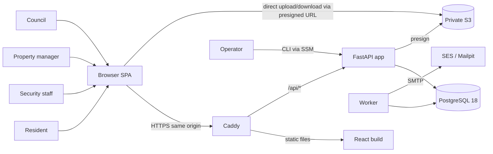
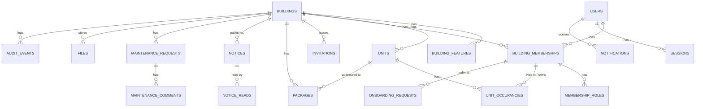
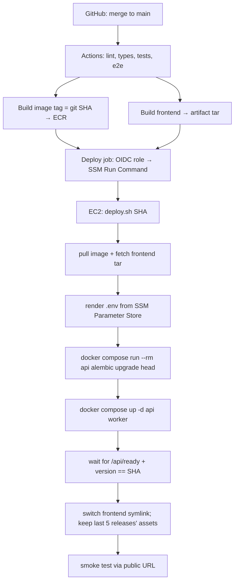

# 02 — Architecture

This is the single technical reference. Decisions and their reasons are in [adr/](./adr/); this file describes
**how the system fits together**. Code snippets show the intended shape. Each ticket defines the exact
implementation.

## 1. System context



This is the deployed shape (staging from milestone D, production at the pilot). Until milestone D, the same
pieces run locally ([ADR-0013](./adr/0013-local-first-deployment-milestone.md)). Caddy is a container in the
prod-like stack (or the Vite proxy in dev), S3 is the emulator, email goes to Mailpit, and the operator runs
the CLI with `docker compose exec`.

## 2. Runtime topology

| Component | Local dev (`make up`) | Local prod-like (`make prodlike`, P1-08) | Staging (EC2, milestone D) | Production (pilot) |
|---|---|---|---|---|
| Reverse proxy | Vite dev server proxies `/api` | Caddy container, same `deploy/Caddyfile`, plain http on `localhost:8080` | Caddy on host (TLS, SPA, `/api` proxy, headers) | Same as staging |
| API | `api` container, uvicorn `--reload`, source mounted | the production image, gunicorn, 1 process, no mounts | `api` container from ECR, 1 process | Same |
| Worker | `worker` container (`python -m app.worker`) | `worker` from the same image | `worker` container | Same |
| Database | `db` postgres:18 container + volume | postgres:18 container, no published port | postgres:18 container on separate encrypted EBS | Same, plus PITR ([ADR-0009](./adr/0009-backups-staged.md)) |
| Files | S3 emulator container | S3 emulator container | S3 bucket `…-staging-files` | Separate bucket |
| Email | Mailpit (SMTP + web UI on :8025) | Mailpit | SES SMTP, restricted to verified recipients | SES production access |
| Errors | console | console (JSON logs) | Sentry project `staging` | Sentry project `production` |

The demo (week 8) runs on the local prod-like stack. Staging hosts it after milestone D. Both local stacks
use plain http, so the `Secure`/`__Host-` cookie, real S3 and SES are first exercised on staging, and are
listed as checks in [D-06](./tickets/D-06-staging-verification-gate.md).

Same origin everywhere: the browser always calls the relative path `/api/...`, so no CORS is needed in any
environment. The current `CORSMiddleware` in `app/main.py` can be removed once the Vite proxy lands (P0-03).

## 3. Backend layout (modular monolith, package by feature)

```text
backend/app/
  main.py                 app factory: middleware, exception handlers, router mounting
  core/                   config, database (engine/session), errors (problem+json), pagination,
                          security (hashing, tokens), csrf, rate_limit, clock
  models/                 Base, NAMING_CONVENTION, mixins (UUID7 PK, timestamps), types (database_enum)
  auth/                   sessions, login/logout, me, password reset; deps: current_session/current_user
  tenancy/                TenantContext, get_tenant_context, require_roles, require_feature
  buildings/ units/       models, schemas, service, router
  memberships/            memberships, roles, invitations, onboarding requests, occupancies
  audit/                  AuditEvent model + record_audit()
  jobs/                   Job model, enqueue(), worker loop, handler registry
  email/                  templates + send handler (SMTP)
  notifications/          Notification model, notify(), list/summary/mark-read router
  files/                  File model, presign/complete/download, storage adapter (boto3)
  packages/ notices/ maintenance/ dashboard/
  cli.py                  operator commands: bootstrap-building, seed, audit, create-invite
  worker.py               entrypoint for the worker process
```

**Each feature module contains:**
- `models.py`: SQLAlchemy models.
- `schemas.py`: Pydantic request/response models. Never return ORM objects directly.
- `service.py`: use-cases. This is where business rules, authorization detail and transactions live.
- `router.py`: thin HTTP layer that parses input, calls the service and maps the result.

There is no repository layer: SQLAlchemy *is* the data-access layer. Add one only if a module grows enough
query logic to need it.

**Layering rules (checked in review):**
1. Routers never touch `AsyncSession` query APIs directly, except trivial reads.
2. Services never import FastAPI `Request`/`Response`. They raise domain errors (`NotFound`, `Conflict`,
   `Forbidden`), and `core/errors.py` maps those to HTTP.
3. **Only write use-cases in `service.py` call `await db.commit()`, exactly once.** Helpers such as
   `record_audit`, `notify`, `enqueue` and `attach_file` add rows to the session and never commit. This is
   what makes "business row + audit + notification + email job" atomic. A fitness test greps for `.commit(`
   outside `*/service.py`.

**Reuse what exists:**
- `app/models/base.py` (`Base`, `NAMING_CONVENTION`)
- `app/models/mixins.py` (`UUIDPrimaryKeyMixin` with uuid7, `TimestampMixin`)
- `app/models/types.py` (`database_enum`)
- `app/core/dependencies.py` (`get_db_session`)
- `app/middleware/request_logging.py` (request ID + JSON logs)
- `app/routers/health.py`

## 4. Request lifecycle

```mermaid
sequenceDiagram
    participant B as Browser
    participant MW as Middleware (request id, logging, CSRF)
    participant A as get_current_session
    participant T as get_tenant_context
    participant SV as service
    participant DB as PostgreSQL
    B->>MW: POST /api/buildings/{b}/packages/{p}/pickup (cookie, X-Requested-With)
    MW->>MW: assign request_id; unsafe method → check Origin + custom header
    MW->>A: resolve session cookie
    A->>DB: SELECT session JOIN user WHERE token_hash=? AND not revoked/expired
    A->>T: user_id
    T->>DB: SELECT membership+roles+features WHERE building_id=b AND user_id=? AND status='active'
    T-->>SV: TenantContext(building_id, membership_id, roles, features)
    SV->>DB: UPDATE packages SET status='picked_up' WHERE id=p AND building_id=b AND status='received' RETURNING *
    SV->>DB: INSERT audit_events, notifications, jobs
    SV->>DB: COMMIT (once)
    SV-->>B: 200 PackageOut   (409 problem+json if already picked up)
```

## 5. Data model (demo scope)



| Table | Key columns (beyond `id` uuid7, `created_at`, `updated_at`) | Notable constraints |
|---|---|---|
| `buildings` | `slug`, `name`, `address`, `timezone` (IANA), `locale`, `join_code`, `is_active` | `slug` unique; `join_code` unique |
| `building_features` | `building_id`, `feature`, `enabled`, `config` jsonb | PK `(building_id, feature)` |
| `units` | `building_id`, `tower` (nullable), `label`, `floor`, `is_active` | unique `(building_id, tower, label)` **NULLS NOT DISTINCT**; unique `(building_id, id)` |
| `users` | `email`, `password_hash` (nullable until set), `full_name`, `phone`, `locale`, `is_active`, `email_verified_at` | unique index on `lower(email)` |
| `building_memberships` | `building_id`, `user_id`, `status` (pending/active/denied/suspended/deactivated), `status_changed_at`, `status_changed_by` | unique `(building_id, user_id)`; unique `(building_id, id)` |
| `membership_roles` | `building_id`, `membership_id`, `role` | PK `(membership_id, role)`; FK `(building_id, membership_id)` |
| `unit_occupancies` | `building_id`, `unit_id`, `membership_id`, `relationship` (owner/tenant/household), `started_at`, `ended_at` (timestamptz) | composite FKs to units and memberships; partial unique `(membership_id) WHERE ended_at IS NULL`; check `ended_at >= started_at` |
| `onboarding_requests` | `building_id`, `membership_id`, `unit_id`, `relationship`, `status`, `decided_by`, `decided_at`, `decision_reason` | partial unique: one `pending` per membership |
| `invitations` | `building_id`, `email`, `roles` (array), `unit_id`, `relationship`, `token_hash`, `expires_at`, `accepted_at`, `revoked_at`, `created_by` | `token_hash` unique |
| `sessions` | `user_id`, `token_hash`, `expires_at`, `idle_expires_at`, `last_seen_at`, `revoked_at`, `user_agent`, `ip` | `token_hash` unique |
| `password_reset_tokens` | `user_id`, `token_hash`, `expires_at`, `used_at` | `token_hash` unique |
| `rate_limits` | `key`, `window_start`, `count` | PK `(key, window_start)` |
| `audit_events` | `building_id` (nullable for identity events), `actor_user_id`, `action`, `entity_type`, `entity_id`, `request_id`, `metadata` jsonb | index `(building_id, created_at)`, `(entity_type, entity_id)` |
| `jobs` | `kind`, `payload` jsonb, `status`, `run_at`, `attempts`, `max_attempts`, `locked_by`, `locked_until`, `last_error`, `dedupe_key` | partial index on due jobs; `dedupe_key` unique |
| `notifications` | `building_id`, `recipient_user_id`, `kind`, `title`, `body`, `link`, `entity_type`, `entity_id`, `read_at` | index `(recipient_user_id, building_id, read_at, id)` |
| `files` | `building_id`, `uploaded_by`, `purpose`, `s3_key`, `s3_version_id`, `content_type`, `size_bytes`, `original_name`, `status` (pending/ready) | unique `(building_id, id)` |
| `packages` | `building_id`, `unit_id`, `recipient_membership_id`, `carrier`, `description`, `photo_file_id`, `status` (received/picked_up/returned), `received_by`, `picked_up_at`, `picked_up_by_membership_id`, `handed_out_by`, `idempotency_key`, `request_hash` | composite FKs; unique `(building_id, idempotency_key)` |
| `notices`, `notice_reads` | title, body, `priority` (normal/urgent), `status` (draft/published/archived), `published_at`, `expires_at`; reads `(notice_id, user_id, read_at)` | PK reads `(notice_id, user_id)` |
| `maintenance_requests`, `maintenance_comments` | category, description, location, `status` (submitted/in_progress/on_hold/resolved/cancelled), `assignee_membership_id`; comments have `is_internal` | composite FKs |

### Tenant integrity pattern ([ADR-0005](./adr/0005-tenant-integrity-in-the-database.md))

Every tenant-owned table carries `building_id`. Every reference to another tenant-owned row includes it, so
the database itself rejects a building-B unit on a building-A package:

```python
class Unit(UUIDPrimaryKeyMixin, TimestampMixin, Base):
    __tablename__ = "units"
    __table_args__ = (
        UniqueConstraint("building_id", "id"),                     # target for composite FKs
        UniqueConstraint("building_id", "tower", "label",
                         postgresql_nulls_not_distinct=True),      # PG15+; verify autogenerate output
    )

class Package(UUIDPrimaryKeyMixin, TimestampMixin, Base):
    __tablename__ = "packages"
    __table_args__ = (
        ForeignKeyConstraint(["building_id", "unit_id"], ["units.building_id", "units.id"]),
        ForeignKeyConstraint(["building_id", "photo_file_id"], ["files.building_id", "files.id"]),
        UniqueConstraint("building_id", "idempotency_key"),
    )
```

### Occupancy and history

- A resident's link to a unit is a dated `unit_occupancies` row.
- **A transfer** closes the current row (`ended_at`) and opens a new one.
- **Move-out** closes the row and deactivates the membership.
- Domain records point at the **person** (`recipient_membership_id`), and at the unit for addressing.
- "My packages" means packages whose recipient is me, or which are addressed to my unit and were received
  during *my* occupancy period. A new occupant therefore never sees a previous occupant's history.
- Windows are half-open (`started_at <= T < ended_at`) on the database's clock, and occupancy writes for one
  membership serialize on its row ([ADR-0016](./adr/0016-occupancy-windows-and-writes.md)). The filter is
  `occupancy_window_clause` in `app/memberships/occupancy.py`.

## 6. Identity and sessions ([ADR-0003](./adr/0003-same-origin-server-side-sessions.md))

- **Passwords:** argon2id (via `pwdlib[argon2]` or `argon2-cffi`), with a minimum length of 12 and a
  common-password check against a small embedded list.
- **Login** (`POST /api/auth/login`):
  - Verifies the credentials with a constant-time path for unknown emails.
  - Creates a session with a random 32-byte token (`secrets.token_urlsafe(32)`).
  - Stores `sha256(token)`.
  - Sets the cookie.
- **Cookie:**
  - `__Host-session` in staging/prod: `Secure; HttpOnly; Path=/; SameSite=Lax`, no `Domain`.
  - `session` without `Secure` locally over http.
  - The name comes from settings.
- **Expiry:**
  - absolute 30 days
  - idle 7 days for residents, 12 hours if the user has any staff role
  - `last_seen_at` and the idle expiry are refreshed at most once every 5 minutes, to limit writes
- **Logout** revokes the current session. **Logout-all** and **password reset** revoke every session of the user.
- **Account state is checked on every request.** Deactivating a user, or changing a role or membership,
  applies on the next request because nothing is cached in a token.
- **CSRF** (`core/csrf.py` middleware) applies to `POST/PUT/PATCH/DELETE` under `/api/`. It rejects with 403
  unless:
  - `Origin` is in `settings.trusted_origins` (or absent with `Sec-Fetch-Site: same-origin`), **and**
  - the `X-Requested-With: fetch` header is present.

  Cross-site forms cannot set custom headers, and cross-site `fetch` with a custom header needs a CORS
  preflight that the API never approves.
- **`GET /api/auth/me`** returns the user plus the list of memberships (building id/name/timezone, status,
  roles, occupancy summary). That is enough to render every shell: no membership, pending, denied or active.
- **Staff MFA (TOTP + recovery codes)** is a pilot-readiness item. The session table gets an
  `mfa_verified_at` column then.

## 7. Tenancy and authorization ([ADR-0004](./adr/0004-path-scoped-tenancy.md))

All building-scoped endpoints live under one router prefix with a router-level dependency:

```python
building_router = APIRouter(
    prefix="/api/buildings/{building_id}",
    dependencies=[Depends(get_tenant_context)],
)

@dataclass(frozen=True, slots=True)
class TenantContext:
    user_id: UUID
    building_id: UUID
    membership_id: UUID
    roles: frozenset[Role]
    features: frozenset[str]

    def has_any(self, *roles: Role) -> bool: ...
```

- **`get_tenant_context(building_id, user=Depends(get_current_user), db=...)`** loads the *active*
  membership for `(user, building_id)` with its roles and the enabled features, in one query. If there is no
  active membership it returns **404** (`building_not_found`), so it never reveals that the building exists.
- **`require_roles(*roles)`** is a dependency factory that returns **403** (`forbidden_role`).
  **`require_feature(slug)`** returns **403** (`feature_disabled`).
- **Record-level rules live in the service.** For example, `visible_packages(ctx)` returns a `select()` already
  filtered for the caller:
  - security and management see the whole building
  - residents see only their own packages
- Every lookup by ID uses `WHERE id = :id AND building_id = :ctx.building_id`. A row from another building is
  a **404**, never a 403.
- **Pending onboarding** uses separate, narrower dependencies: `get_current_user` plus
  `get_own_membership(building_id)`, which allows a pending status. Only the onboarding endpoints use them.

**Fitness tests** (P2-03) run on every PR. They make the architecture self-enforcing:
1. Every route whose path starts with `/api/buildings/{building_id}` has `get_tenant_context` (or the explicit
   onboarding dependency) in its dependency tree.
2. Every `/api/*` route requires an authenticated session, except an explicit allowlist: health, ready,
   version, login, password-reset request/confirm, invitation lookup/accept, and join-code lookup.
3. A generated test calls every building route as a member of building B and expects 404.

## 8. API conventions

| Topic | Convention |
|---|---|
| Paths | `/api/...`; building data under `/api/buildings/{building_id}/...`; plural nouns; actions as `POST /…/{id}/{verb}` (`/pickup`, `/approve`, `/deny`, `/publish`) |
| JSON | `snake_case`; enums as lowercase strings; ids as UUID strings |
| Time | Instants are `TIMESTAMPTZ` and serialized as ISO-8601 UTC (`Z`). Date-only values are `YYYY-MM-DD`. The UI renders instants in the building's IANA timezone (`Intl.DateTimeFormat`). |
| Errors | RFC 9457 `application/problem+json`: `{type, title, status, detail, code, request_id, errors?}`. `code` is a stable snake_case identifier for frontend logic. Validation errors use `code: "validation_error"` with `errors: [{loc, msg, type}]`. |
| Status codes | 400 malformed; 401 no/expired session; 403 role, feature or CSRF; 404 not found **or other building**; 409 state/idempotency conflict; 422 validation; 429 rate limited (with `Retry-After`) |
| Pagination | Keyset: `?limit=` (default 25, max 100) and `&cursor=` (opaque). Response `{items: [...], next_cursor: str \| null}`. The order is `id DESC`, which is time-ordered because ids are uuid7. |
| Idempotency | `Idempotency-Key` header is **required** on creates where a duplicate causes harm (packages; later bookings). Same key + same body → original result. Same key + different body → 409 `idempotency_key_reused`. |
| State transitions | Conditional update: `UPDATE … WHERE id=? AND building_id=? AND status IN (allowed) RETURNING *`. Zero rows → re-read to return 404 or 409 `invalid_transition`. No `PATCH status`. |
| OpenAPI | Every route sets `operation_id` (`packages_create`, `packages_pickup`), `response_model` and documented error responses. The frontend types are generated from `/api/openapi.json` (P1-07). |

## 9. Background jobs and email ([ADR-0006](./adr/0006-postgres-job-queue.md))

**Enqueue.** Enqueue inside the business transaction:

```python
await enqueue(db, kind="email.send",
              payload={"template": "package_arrived", "to": email, "context": {...}},
              dedupe_key=f"package_arrived:{package.id}:{user_id}")
```

`enqueue` does `INSERT … ON CONFLICT (dedupe_key) DO NOTHING` and never commits.

**Claim.** The worker (`python -m app.worker`) claims due jobs:

```sql
UPDATE jobs
SET status = 'running', attempts = attempts + 1,
    locked_by = :worker_id, locked_until = now() + interval '60 seconds'
WHERE id IN (
    SELECT id FROM jobs
    WHERE (status = 'queued' AND run_at <= now())
       OR (status = 'running' AND locked_until < now())     -- recover crashed workers
    ORDER BY run_at
    LIMIT :batch
    FOR UPDATE SKIP LOCKED
)
RETURNING *;
```

**Process.**
- Dispatch to `HANDLERS[kind]`.
- On success, set `status='succeeded'` and scrub sensitive payload fields (reset links).
- On failure:
  - if `attempts < max_attempts`, set `status='queued'` and `run_at = now() + backoff`, where the backoff is
    `min(2^attempts · 10 s, 1 h)` plus jitter
  - otherwise set `status='dead'`
  - in both cases store `last_error`, truncated and redacted
- **Delivery is at-least-once.** A crash after SMTP accepted the message but before the row was updated means a
  resend can happen. Handlers must be idempotent where possible, and the docs promise "no lost email", not
  "exactly once".
- **Shutdown.** On SIGTERM the worker finishes the current job, then exits.
- **Health.** The worker logs `worker_heartbeat` every 30 s. The operator CLI `jobs-status` prints counts by
  status and the age of the oldest due job.

**Recurring work** (nightly cleanup, reminders) is enqueued by a tiny scheduler loop inside the worker. It
uses `dedupe_key = "<kind>:<yyyy-mm-dd>"` so that a restart cannot double-schedule.

**Email:**
- Jinja2 templates with text + HTML parts, sent with `aiosmtplib`.
- Local: Mailpit. Cloud (from milestone D): the SES SMTP endpoint (credentials from SSM).
- Staging restricts recipients with SES sandbox verified identities.

## 10. Notifications

- `notify(db, building_id, recipient_user_ids, kind, title, body, link, entity)` bulk-inserts one row per
  recipient. It also enqueues `email.send` for recipients whose events are email-enabled (default map in
  code; preference UI later).
- Endpoints under the building router:
  - `GET /notifications?cursor=`
  - `GET /notifications/summary` → `{unread_count}`
  - `POST /notifications/{id}/read`
  - `POST /notifications/read-all`
- The frontend polls the summary every 30 s with React Query `refetchInterval`. Polling pauses in background
  tabs (`refetchIntervalInBackground: false`), and mutations invalidate it.
- Urgent notices are fetched with the same polling. The UI promises "within about a minute while the app is
  open", not emergency alerting.

## 11. Files ([ADR-0007](./adr/0007-private-s3-presigned-uploads.md))

```mermaid
sequenceDiagram
    participant B as Browser
    participant API
    participant S3
    B->>API: POST /api/buildings/{b}/files {purpose, filename, content_type, size}
    API->>API: validate purpose/type/size; INSERT files(status=pending, s3_key=b/{b}/{purpose}/{file_id})
    API-->>B: {file_id, upload: presigned POST (url, fields), expires 5 min}
    B->>S3: POST form upload (content-length-range + content-type enforced by policy)
    B->>API: POST /files/{id}/complete
    API->>S3: HEAD object (size, type, VersionId) + ranged GET first bytes (magic number)
    API->>API: UPDATE files SET status=ready, s3_version_id=…
    B->>API: POST /packages {…, photo_file_id}
    API->>API: file must be same building, ready, purpose=package_photo, uploaded by caller, unattached
    B->>API: GET /files/{id}/download-url
    API->>API: authorize through the owning record's visibility
    API-->>B: presigned GET (60 s, pinned VersionId)
```

- **Presigned POST** (rather than PUT) lets the S3 policy enforce `content-length-range`.
- **The bucket** is private: Block Public Access, versioning on, SSE-S3 encryption, and a CORS rule allowing
  only the app origin.
- **Cleanup.** Files still pending after 24 h, and ready-but-unattached files after 7 days, are deleted by a
  nightly job.

## 12. Audit

- `record_audit(db, ctx_or_user, action, entity_type, entity_id, metadata)` writes in the same transaction.
- Action names use the pattern `<domain>.<past_verb>`: `membership.approved`, `package.picked_up`,
  `session.revoked_all`, `role.granted`.
- **Never** store passwords, tokens, file contents or full request bodies in `metadata`. Store IDs and
  changed field names.
- Retrieval: `python -m app.cli audit --building <slug> [--entity package:<id>] [--since 7d]`. A UI comes later.

## 13. Frontend architecture ([ADR-0011](./adr/0011-frontend-strangler-typescript.md))

```text
frontend/src/
  api/client.ts           openapi-fetch client: baseUrl "/api", X-Requested-With header,
                          problem+json → ApiError, 401 → auth reset
  api/schema.d.ts         GENERATED from OpenAPI (never edited by hand)
  app/                    providers (QueryClient, Auth, Building), routes.tsx, guards
  features/<domain>/      api.ts (React Query hooks), components/, pages/   ← migrated code lives here (TS)
  pages/ components/      legacy Base44 JSX, shrinking over time
```

- **Query keys:** `['me']`, `['b', buildingId, 'packages', params]`. On a building switch, remove
  `['b', oldId]` queries. On logout, `queryClient.clear()`.
- **Building context:** the selected building is kept per tab in `sessionStorage` and defaults to the first
  active membership. It is part of every building API path and query key, so a late response from the old
  building can never fill the new building's view.
- **Guards:** `<RequireAuth>`, `<RequireActiveMembership>`, `<RequireRole roles>` and `<RequireFeature>` are UX
  only. The server enforces everything again.
- **Migration:**
  - one page per slice
  - a migrated page moves to `features/<domain>/pages/*.tsx`
  - `eslint no-restricted-imports` forbids `@base44/*` and `@/api/base44Client` under `features/`
  - CI ratchet `scripts/base44-count.sh`: the count of `base44.` references may only go down

## 14. Testing architecture

| Layer | Tooling | What it proves | Share |
|---|---|---|---|
| Unit | pytest | Pure logic: token hashing, backoff, state-transition tables, validators | ~20% |
| Integration (API + DB) | pytest + httpx `ASGITransport` + **real Postgres** | Endpoints, authz, tenant isolation, constraints, transactions, idempotency, concurrency | ~65% |
| Fitness | pytest over `app.routes` / source | Every building route is tenant-guarded; auth allowlist; commit only in services; OpenAPI types fresh | always on |
| E2E | Playwright (Chromium) against compose stack + Mailpit API | The 8 demo journeys through the real UI | ~10% |
| Frontend unit | Vitest + Testing Library | Hooks/components with non-trivial logic | as needed |

- **One transaction per test.** Tests share a connection with an outer transaction. The app's session joins it
  with `join_transaction_mode="create_savepoint"`, so service `commit()` calls release savepoints, and
  everything rolls back at test end.
- **Migrations.** The schema is built once per test session with `alembic upgrade head`. That way migrations
  are tested on every run.
- **Concurrency tests** (pickup, idempotency) use *separate* sessions and connections, with
  `asyncio.gather`. They clean up explicitly.
- **The world fixture** (P1-05) creates:
  - Building A: manager, security, resident A1 (unit 101), resident A2 (unit 102), council, a pending
    resident, and a former occupant of 101
  - Building B: manager and resident B1
  - a user with memberships in both buildings

  It also provides an `as_user(user)` client factory.

## 15. Deployment architecture ([ADR-0008](./adr/0008-single-ec2-compose-caddy.md))

Built in milestone D, after the week-8 local demo ([ADR-0013](./adr/0013-local-first-deployment-milestone.md)).
From week 2, CI already builds the same image (tag = SHA) and SPA on every PR. It runs them behind the same
`deploy/Caddyfile` in `compose.prodlike.yml`, with the migrate-then-start order `deploy.sh` will use, and
checks them with `scripts/smoke.sh`, which the deploy job reuses (P1-08).



- **Host:** Ubuntu 24.04 on `t3a.small`; Docker Engine + compose plugin; Caddy as a systemd unit; Postgres
  data on a separate encrypted gp3 EBS volume mounted at `/srv/app/pgdata`.
- **Admin access:** only SSM Session Manager. No inbound SSH.
- **Migrations** must stay compatible with the previous release, using expand/contract. That makes rollback
  simply "deploy the previous SHA".
- **Downgrades** are never run automatically.
- **Pilot additions:** a maintenance page during migrations, a deploy lock, and a rollback drill
  ([PILOT_READINESS.md](./PILOT_READINESS.md)).
- **Caddy** handles automatic TLS and serves the SPA with `try_files {path} /index.html`, plus security headers:
  - HSTS
  - `Content-Security-Policy` (self + S3 bucket host + Sentry)
  - `X-Content-Type-Options`
  - `Referrer-Policy`
  - `frame-ancestors 'none'`

## 16. Observability

- **Logs:** JSON lines with `request_id`, `user_id`, `building_id`, route, status and duration (extend the
  existing `RequestLoggingMiddleware`). Locally, read them with `docker compose logs`. From milestone D, the
  Docker `awslogs` driver ships them to CloudWatch Logs, with 30-day retention in staging.
- **Errors (milestone D):** Sentry for FastAPI and React, with the release set to the git SHA and PII
  scrubbing on.
- **Uptime (milestone D):** an external check on `https://<domain>/api/health` every 5 minutes, alerting by
  email.
- **Key signals** to watch in the demo:
  - p95 latency per route (from logs)
  - 5xx rate
  - oldest due job age
  - dead jobs count
  - disk usage on the data volume

## 17. Configuration and secrets

- Configuration lives in `app/core/config.py` (pydantic-settings). Every new setting is added to `.env.example`
  in the same PR.
- **Committed env files contain no secrets.** `backend/.env.dev` has local-only values.
- **Cloud secrets** (from milestone D) live in SSM Parameter Store (`/condo/<env>/<NAME>`, SecureString):
  `SECRET_KEY`, SMTP credentials, Sentry DSN. `deploy.sh` renders them into `/srv/app/.env` (mode 600) using
  the instance role. Until then, mark each secret in `.env.example` so the SSM list is easy to build.
- **Production startup fails fast** on unsafe values. Extend the existing `validate_production_settings`.
