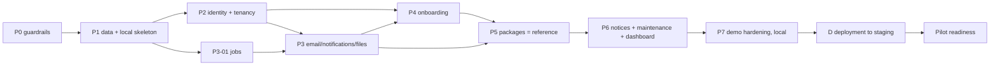

# 03 — Roadmap

## Planning principles

1. **Local first, with a walking skeleton.** Weeks 1–8 need no AWS account, domain or server
   ([ADR-0013](./adr/0013-local-first-deployment-milestone.md)). By the end of week 2, every PR builds the
   production image and the SPA, and CI runs them behind Caddy and smoke-tests them (P1-08). Every later
   feature ships into that pipeline. Deployment to AWS is its own milestone (D) after the week-8 demo. D stays
   small because it ships artifacts CI has already built and tested on every merge.
2. **Vertical slices.** Each slice runs from database to UI to E2E test. Packages is the *reference slice*:
   later slices copy its patterns.
3. **Rolling-wave detail.** Only the next ~3 weeks are detailed tickets. Later work stays as stubs and is
   detailed during the week before it starts. A detailed plan for month 4 is waste, because it goes stale
   first.
4. **Small work in progress.** At most two agents run at once, one per lane, each with one ticket in
   flight. Finish (merge or block) before starting the next.
5. **Gates are checks, not documents.** A phase is done when its exit gate runs green on the stack and in CI
   and the agent has written the recap with the evidence
   ([automated phase gates](./AI_AGENT_PLAYBOOK.md#phase-gates-automated)). Nothing waits on a human.
6. **Agents build autonomously; James audits asynchronously**
   ([ADR-0014](./adr/0014-autonomous-agent-workflow.md)). No ticket waits for human review. What can stop
   the line is a [stop rule](./AI_AGENT_PLAYBOOK.md#stop-rules): those land in
   [HUMAN_INBOX.md](./HUMAN_INBOX.md), and the agent moves on to other ready work.

## Timeline (8 local weeks + about 2 weeks of deployment; two agent tracks merging autonomously)

| Week | Lane A (backend / platform) | Lane B (frontend / QA / ops) | End-of-week demo |
|---|---|---|---|
| 1 | **P0-01 first (day 1)**, then P0-02, P0-05, P1-01, P1-02 | P0-03, P0-04, P1-04 | CI blocks on lint/types/tests against real Postgres; `make up` starts the local stack; core tables migrate |
| 2 | P1-03, P1-05, P1-06, start P2-01 | P1-07, P1-08, P3-01 | **Local walking skeleton:** `make prodlike` serves the built SPA and `/api/version` = SHA through Caddy; CI runs the same smoke on every PR |
| 3 | P2-01, P2-02, P2-03, P2-04 | P2-05, P2-06, P3-02 | Log in locally (dev and prod-like stacks) with seeded users; non-members get 404 everywhere |
| 4 | P3-03, P3-04, P4-01 | P3-05, P3-06, P4-04, P4-09 (harness part) | Email lands in Mailpit; upload round-trip through the S3 emulator; notification badge polls |
| 5 | P4-02, P4-03, P4-05, P4-06 | P4-07, P4-08, P4-09 | **Onboarding E2E green in CI:** bootstrap → invite → join → approve → reset |
| 6 | P5-01, P5-02a, P5-02b | P5-03, P5-04, P5-05 | **Reference slice gate:** packages E2E + concurrency tests, in CI and on the prod-like stack |
| 7 | P6-03, P6-04 (maintenance), P6-05 (dashboard) | P6-01, P6-02 (notices), P6-06, P6-07 | Journeys 5, 6 and 8 green |
| 8 | P7-01, P7-02, P7-03 | P7-04, P7-05, P7-06, P7-07 | **Demo-ready bar met (local)**; recorded walkthrough; retro; milestone D scheduled |
| 9–10 | D-04, D-05 (coded locally, verified on staging), then D-06 | D-01, D-02, D-03, then D-06 | **Deployed:** merge → staging URL; staging smoke and the staging-only checks pass |

**Buffer rule:** if a gate slips, cut in this order:
1. stretch (amenities)
2. profile/contacts polish
3. dashboard cards beyond counts

**Never** cut tenant-isolation tests, the E2E gate, or backups.

**Schedule risks.**
- **Weeks 1–8: the lane A critical path.** No gate waits on cloud infrastructure any more, so the
  data-and-identity chain sets the pace. Without human review latency, what slows it is CI time, review
  rounds that don't converge, and blocked tickets waiting on the inbox (see the
  [ticket index](./tickets/README.md#critical-path)).
- **Milestone D: late deployment surprises.** Some behaviour only shows up on real infrastructure:
  HTTPS-only cookies, the client IP behind the proxy, real S3 CORS, the SES sandbox, and memory on a small
  host. Three things keep this small:
  - The prod-like stack (P1-08) runs the production image and SPA behind the shared Caddyfile, and CI
    smoke-tests them on every PR from week 2.
  - The rules that protect deployments apply from day one: expand/contract migrations, no edits to merged
    migrations, and every setting in `.env.example`.
  - D-06 lists every staging-only check and names the ticket that built each behaviour.

  Start D's human prerequisites (AWS account, domain, SES) about a week before D, because they involve real
  waiting time. D does not block the week-8 demo, but it blocks pilot readiness. If D runs past 2 weeks, make
  it the top priority for both agent tracks before any new feature.

**Lanes are two parallel agent tracks**, split to avoid file conflicts. Two agents may run at once, one per
lane; a hot file (`app/main.py`, `migrations/versions/`, `api/schema.d.ts`, `docker-compose.yml`,
`compose.prodlike.yml`) is held by one agent at a time
([parallel agents](./AI_AGENT_PLAYBOOK.md#running-agents-in-parallel)). With one agent, run lane A first,
then lane B, unless a dependency says otherwise.

## Phases, tickets and exit gates

Ticket files live in [tickets/](./tickets/). Tier = review depth
([AI_AGENT_PLAYBOOK.md](./AI_AGENT_PLAYBOOK.md#risk-tiers)).

### P0 — Reset and guardrails (week 1)

| ID | Title | Lane | Tier |
|---|---|---|---|
| [P0-01](./tickets/P0-01-adopt-plan-into-repo.md) | Adopt the new plan into the repo | A | 3 |
| [P0-02](./tickets/P0-02-backend-quality-gates.md) | Backend quality gates | A | 3 |
| [P0-03](./tickets/P0-03-frontend-quality-gates.md) | Frontend quality gates | B | 3 |
| [P0-04](./tickets/P0-04-repo-workflow-and-local-stack.md) | Repo workflow and local stack | B | 2 |
| [P0-05](./tickets/P0-05-database-test-infrastructure.md) | Database test infrastructure | A | 2 |

**Exit gate:**
- CI fails on ruff, mypy, eslint, tsc, pytest (against Postgres) and `alembic check` violations.
- `make up` starts api, db, mailpit and the S3 emulator.
- The old docs are archived.

### P1 — Data foundation and local walking skeleton (weeks 1–2)

| ID | Title | Lane | Tier |
|---|---|---|---|
| [P1-01](./tickets/P1-01-buildings-features-units-schema.md) | Buildings, features and units schema | A | 2 |
| [P1-02](./tickets/P1-02-users-memberships-roles-schema.md) | Users, memberships and roles schema | A | 1 |
| [P1-03](./tickets/P1-03-unit-occupancies-schema.md) | Unit occupancies schema | A | 1 |
| [P1-04](./tickets/P1-04-api-conventions.md) | API conventions: errors, pagination, schemas | B | 2 |
| [P1-05](./tickets/P1-05-test-world-and-isolation-helpers.md) | Test world fixtures and tenant-isolation helpers | A | 1 |
| [P1-06](./tickets/P1-06-seed-and-cli.md) | Seed data and operator CLI skeleton | A | 3 |
| [P1-07](./tickets/P1-07-openapi-types-and-api-client.md) | OpenAPI → TypeScript types and API client | B | 2 |
| [P1-08](./tickets/P1-08-production-like-local-stack.md) | Production-like local stack (local walking skeleton) | B | 2 |

**Exit gate:**
- Migrations run from empty to head.
- Constraint tests prove cross-building references are rejected by the database.
- `make seed` creates a realistic building.
- `make prodlike` serves the built SPA through Caddy, and `/api/version` returns the current SHA.
- CI's required `prodlike` job builds the image and runs the same smoke test on every PR.

### P2 — Identity, sessions and tenancy (week 3)

| ID | Title | Lane | Tier |
|---|---|---|---|
| [P2-01](./tickets/P2-01-sessions-login-logout-csrf.md) | Password hashing, sessions, login/logout and CSRF | A | 1 |
| [P2-02](./tickets/P2-02-me-and-session-management.md) | Current-user API and session management | A | 1 |
| [P2-03](./tickets/P2-03-tenant-context-guards-fitness.md) | Tenant context, guards and fitness tests | A | 1 |
| [P2-04](./tickets/P2-04-audit-events.md) | Audit events | A | 1 |
| [P2-05](./tickets/P2-05-rate-limiting.md) | Rate limiting | B | 1 |
| [P2-06](./tickets/P2-06-frontend-auth-shell.md) | Frontend auth shell, guards and building picker | B | 1 |

**Exit gate:**
- Seeded users log in on the local stack (dev and prod-like) and see their role shell.
- Fitness tests pass.
- A building-B member gets 404 on every building-A route.
- Login, logout and logout-all write audit rows.
- The 6th failed login within the window gets 429.

### P3 — Platform services (weeks 3–4)

| ID | Title | Lane | Tier |
|---|---|---|---|
| [P3-01](./tickets/P3-01-job-queue-and-worker.md) | Job queue and worker | B | 1 |
| [P3-02](./tickets/P3-02-transactional-email.md) | Transactional email | B | 2 |
| [P3-03](./tickets/P3-03-notifications-api.md) | In-app notifications API | A | 2 |
| [P3-04](./tickets/P3-04-private-file-uploads.md) | Private file uploads | A | 1 |
| [P3-05](./tickets/P3-05-frontend-notification-center.md) | Frontend notification center with polling | B | 2 |
| [P3-06](./tickets/P3-06-frontend-upload-component.md) | Frontend upload component | B | 2 |

**Exit gate:**
- A test event produces a notification row and an email visible in Mailpit.
- Killing the worker mid-job and restarting it completes the job.
- Uploading an image from the browser and fetching it back works through presigned URLs against the S3
  emulator, on both the dev and prod-like stacks.

### P4 — Account and onboarding journeys (weeks 4–5)

| ID | Title | Lane | Tier |
|---|---|---|---|
| [P4-01](./tickets/P4-01-units-api.md) | Units API | A | 2 |
| [P4-02](./tickets/P4-02-staff-invitations.md) | Staff invitations | A | 1 |
| [P4-03](./tickets/P4-03-bootstrap-building-command.md) | Bootstrap-building operator command | A | 1 |
| [P4-04](./tickets/P4-04-password-reset.md) | Password reset | B | 1 |
| [P4-05](./tickets/P4-05-resident-join-onboarding-approval.md) | Resident join, onboarding and approval | A | 1 |
| [P4-06](./tickets/P4-06-membership-administration.md) | Membership administration | A | 1 |
| [P4-07](./tickets/P4-07-frontend-account-screens.md) | Frontend account screens | B | 2 |
| [P4-08](./tickets/P4-08-frontend-onboarding-approval-screens.md) | Frontend onboarding and approval screens | B | 2 |
| [P4-09](./tickets/P4-09-playwright-harness-onboarding-e2e.md) | Playwright harness and onboarding E2E | B | 2 |

**Exit gate:** demo journeys 1, 2, 3 and 7 pass as Playwright tests locally and in CI (against the
prod-like stack).

### P5 — Packages reference slice (week 6)

| ID | Title | Lane | Tier |
|---|---|---|---|
| [P5-01](./tickets/P5-01-package-schema-state-machine.md) | Package schema and state machine | A | 1 |
| [P5-02a](./tickets/P5-02a-package-create-and-read.md) | Package create and read | A | 1 |
| [P5-02b](./tickets/P5-02b-package-pickup-and-return.md) | Package pickup and return | A | 1 |
| [P5-03](./tickets/P5-03-security-packages-page.md) | Security packages page | B | 2 |
| [P5-04](./tickets/P5-04-resident-packages-page.md) | Resident packages page | B | 2 |
| [P5-05](./tickets/P5-05-packages-e2e-and-slice-gate.md) | Packages E2E and reference-slice gate | B | 1 |

**Exit gate (the reference slice gate):**
- Journey 4 passes end to end in CI and on the prod-like stack.
- The idempotency-replay and concurrent-pickup tests pass.
- Same-building and cross-building privacy tests pass.
- A **slice recipe** (`docs/SLICE_RECIPE.md`, written in P5-05) records how to build the next slice.

### P6 — Notices, maintenance, dashboard (week 7)

Stubs in [tickets/P6-P7-backlog.md](./tickets/P6-P7-backlog.md). Detail them during week 5 with
[`/draft-ticket`](../.claude/commands/draft-ticket.md), which turns a stub into a full ticket from the
template and the slice recipe.

- **P6-01 / P6-02** Notices backend / frontend: staff authoring, publish/archive, urgent banner, per-user read.
- **P6-03 / P6-04** Maintenance backend / frontend: resident submit with photo; manager transitions;
  public vs internal comments.
- **P6-05** Dashboard summary API and role landing pages.
- **P6-06** Minimal profile (name, phone, language) and staff contact directory.
- **P6-07** E2E for journeys 5, 6 and 8.

**Exit gate:** journeys 5, 6 and 8 pass.

### P7 — Demo hardening (week 8)

- **P7-01** Backup and restore scripts (to the S3 emulator) plus an automated restore test in CI. The nightly
  schedule on a real host is D-05.
- **P7-02** Security pass:
  - headers, checked on the prod-like stack
  - dependency, secret and image scans
  - OWASP ASVS L1 checklist
  - a one-page threat model
- **P7-03** k6 load baseline at the planning workload (100 virtual users) against the prod-like stack,
  with p95 recorded. This is a laptop baseline; D-06 re-runs it on staging.
- **P7-04** Accessibility and mobile pass on the demo journeys.
- **P7-05** Demo dataset, script and a walkthrough recorded on the prod-like stack.
- **P7-06** Portfolio README, architecture diagram, ADR index.
- **P7-07** Retro, milestone D kickoff (start its human prerequisites), and the detailed pilot-readiness
  plan.

**Stretch (only if P6 finished early):**
- **S-01 / S-02** Amenity booking with `EXCLUDE USING gist` overlap protection.

**Exit gate:** the demo-ready bar (local) in [ENGINEERING_PRACTICES.md](./ENGINEERING_PRACTICES.md#quality-bars).

### D — Deployment to staging (after week 8, about 2 weeks)

Deployment is a separate milestone ([ADR-0013](./adr/0013-local-first-deployment-milestone.md)). It builds
the single-host staging environment from [ADR-0008](./adr/0008-single-ec2-compose-caddy.md) and re-verifies
the demo there. The default is weeks 9–10, straight after the demo. Pull it forward if a hosted demo is
needed sooner (it can start once P1-08 and P3-01 are merged). It must finish before pilot readiness starts.

**Before it starts** (James, about a week ahead; by default during week 8 as part of P7-07; agents list it
in the inbox's "Prerequisites coming up"):
- an AWS account with MFA and budget alerts
- a domain
- SES domain verification

See the prerequisites in [D-01](./tickets/D-01-terraform-base.md).

| ID | Title | Lane | Tier |
|---|---|---|---|
| [D-01](./tickets/D-01-terraform-base.md) | Terraform base infrastructure | B | 1 |
| [D-02](./tickets/D-02-host-bootstrap-caddy-compose.md) | Host bootstrap, Caddy and staging compose | B | 1 |
| [D-03](./tickets/D-03-cicd-deploy-staging.md) | CI/CD: build, push and deploy to staging | B | 1 |
| [D-04](./tickets/D-04-logs-errors-uptime.md) | Logs, error tracking and uptime | A | 2 |
| [D-05](./tickets/D-05-nightly-backups-to-s3.md) | Nightly backups to S3 and the staging restore test | A | 1 |
| [D-06](./tickets/D-06-staging-verification-gate.md) | Staging verification gate | both | 1 |

**Exit gate:** the deployed bar in
[ENGINEERING_PRACTICES.md](./ENGINEERING_PRACTICES.md#deployed-milestone-d):
- A merge to `main` reaches staging with no manual steps, and a rollback by SHA has been rehearsed.
- The staging smoke passes after every deploy, and every staging-only check in D-06 has evidence.
- Nightly backups reach S3, and a restore from S3 has been tested.
- Sentry, CloudWatch logs and uptime alerts reach James.

## Dependency overview

The full ticket-level dependency list is in [tickets/README.md](./tickets/README.md).

## After week 8: deployment, then toward the pilot (months 3–6)

Milestone D (above) comes first. The pilot is planned 6–12 months out. Once a building and date are named,
run the pilot-readiness phase:
- **Duration:** about 3–4 weeks of focused work.
- **Contents:**
  - the checklist in [PILOT_READINESS.md](./PILOT_READINESS.md)
  - plus the pilot-option epics the building selects (amenities, moves, visitors, reports, SMS)

Each epic is detailed into tickets with the same template when it is selected, never before.

Suggested order of pilot options by learning and product value:
1. **Amenity booking.** Concurrency, exclusion constraints, timezones and DST.
2. **Visitor passes.** Secure tokens, hashing, single-use atomic consumption, rate limiting.
3. **Move requests.** Scheduling, resource conflicts, occupancy changes.
4. **Security reports.** Plain CRUD with files and access rules. Good for a newcomer.
5. **SMS.** Add an SNS adapter to the existing job queue.

## Weekly rhythm

| When | Who | What |
|---|---|---|
| Continuously | Agents | `/build-next` → the autonomous loop ([05](./AI_AGENT_PLAYBOOK.md)), one ticket per lane at a time |
| Week 5 (rolling wave) | Agents | Draft P6–P7 stubs into tickets with `/draft-ticket`, through the same loop |
| End of phase | Agents | Run the exit gate, write the recap ([template](./templates/MILESTONE_RECAP.md)) |
| When the inbox has a blocked item | James | Answer it in [HUMAN_INBOX.md](./HUMAN_INBOX.md) |
| Weekly, ~30 min | James | Skim "Decisions to audit"; read the week's explanations and recap; add lessons to the change log below |

## How to change this plan

- **Reorder** tickets freely within a phase. Update the ticket index.
- **Scope change or new decision:** write an ADR (or edit the scope doc) **first**, then change tickets.
- **Lessons:** add a retro note to the roadmap's change log below.

## Change log

| Date | Change | Why |
|---|---|---|
| 2026-10-13 | Plan created from the review of `Recent_Plan/` | Replace the 170-ticket backlog with a phased, rolling-wave plan |
| 2026-10-13 | P0-01 first; P2-05, P3-02, P4-04 moved to lane B; P5-02 split into P5-02a/P5-02b; learn step after merge with a "Learned" column checked at phase gates; review deadline; staging named as the top schedule risk | Second review: lane A is a serial critical path, so calendar time matters more than total hours; P5-02 was too big for one PR even excluding tests; the loop commands need P0-01 to exist |
| 2026-10-13 | **Local first** ([ADR-0013](./adr/0013-local-first-deployment-milestone.md)): weeks 1–8 need no AWS, domain or server. The deploy chain (old P1-08…P1-11) moved to milestone D (D-01…D-04) after week 8, plus new D-05 (nightly backups to S3) and D-06 (staging verification gate). New P1-08 is a production-like local stack smoke-tested in CI. Phase gates are local and CI checks; P5-05 renamed "reference-slice gate"; P1-04 moved to lane B; P3-01, P3-02 and P4-04 start a week earlier; three quality bars (demo-ready local, deployed, pilot-ready) | The team wants to build and test the application locally first. It also takes the plan's top schedule risk (staging in weeks 1–2) off the early critical weeks |
| 2026-10-14 | **Autonomous agents** ([ADR-0014](./adr/0014-autonomous-agent-workflow.md)): agents frame, build, review (fresh session; plus Codex on Tier 1), explain and merge every ticket with no human step on the merge path. New [HUMAN_INBOX.md](./HUMAN_INBOX.md) for stop-rule escalations and decisions to audit. Phase gates automated; learning no longer gates anything. Lanes become two parallel agent tracks. Branch protection needs no approval (P0-04). Supersedes the "self-review" note in the entry below | James chose to let agents build without a per-ticket human check, keeping a full explanation per ticket. It removes review latency from the critical path |
| 2026-10-14 | **Solo:** Khoi left on 2026-10-13; James continues alone. `CLAUDE.md` and `docs/README.md` updated. Lanes A and B now run in sequence, and "the other dev reviews" means a self-review after the fresh-session AI review | Follow-up (not yet done): re-plan the week-by-week table and the week-8 date for one developer; drop Khoi from CODEOWNERS (P0-04), alert emails (D-01, D-04, D-05) and the recap template (all done 2026-10-14 with ADR-0014; the week-by-week re-plan is still open) |
| 2026-10-15 | **Explanations keep the rationale** (James's instruction): the explanation length limits (≤ 400 lines for Tier 1–2, ≤ 60 for Tier 3, ~150 lines and 3–6 code excerpts) become editing guidelines. Consequential decisions are recorded when made, with problem, alternatives, tradeoffs and basis, including review-driven fixes. Explanations label each "why" as recorded, established by code and tests, or inferred, and name the PR, the pre-merge source revision and (after merge, in the handoff and the phase recap) the merge commit. New merge-gate item: nothing after the explanation changes what it describes. The ~400 non-test-line PR limit is unchanged. A branch cut before this change (P1-03's, in progress) follows the old explain command unless it rebases before step 6 | A future session must be able to explain a ticket's design without the implementation conversation. P0-06, P1-01 and P1-02 explanations all stopped at exactly 400 lines, and the old header assumed the merged tree equals the PR head |
