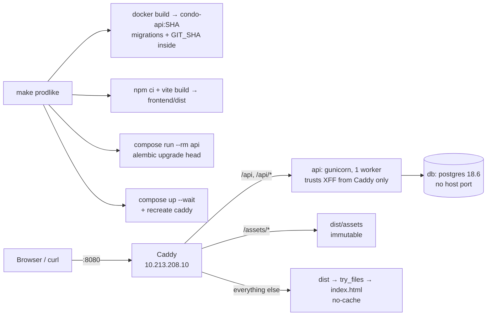

# Explanation — P1-08 Production-like local stack (local walking skeleton)

> **PR:** #54 · **Source revision:** `9b358ab` (pre-merge), the PR head this explanation was written from and
> checked against. **Reviewed:** the final review round (2, a new fresh Claude reviewer) reviewed this commit.
> **Merge commit:** not known when written; after the merge, `gh pr view 54 --json mergeCommit` gives it.
> Built and merged autonomously ([ADR-0014](../adr/0014-autonomous-agent-workflow.md)); no human reviewed it
> before merge. This describes the PR's changes at the source revision. Commits after it (bookkeeping) and
> the squash merge are not described here, and a rebase after it gives the same changes new SHAs. The branch
> is rebased onto `origin/main` (`git merge-base --is-ancestor origin/main HEAD` succeeds).
> **Updated** (pre-merge, same code): after the bookkeeping commit `3819f74` was read. It changes docs and
> CLAUDE.md only (`git diff f305d47 3819f74 --stat`: tickets, inbox, mistakes log), so the code described is
> still `9b358ab`. The update rewords §3 step 3, which cited a build output path that a clean checkout doesn't
> have (the CI reference check failed on it).
> This is a snapshot: before the merge it is edited to match the PR head; once merged, write a new
> explanation for later changes and do not update this one. Lasting decisions live in ADRs.
> **Reality check:** at `9b358ab`, re-read the following from disk:
> - `git diff origin/main...HEAD` in full: Dockerfile, Caddyfile, compose file, Makefile, CI job, both scripts, the request-logging change and its test, the pin check and the README
> - the PR description (Plan, D1–D7, both review rounds)
>
> Ran:
> - `pytest tests/test_request_logging.py tests/test_health.py`: 6 passed
> - against the running stack built from `9b358ab` (`/api/version` → `git_sha 9b358ab…`), `make prodlike-smoke`: 33 smoke checks and 11 wiring checks all `ok`
> - `python3 scripts/check-version-pins.py`: pins agree
>
> The mutation probes cited in §5 come from the PR's evidence; I did not re-run them in this pass.
> Differences from the plan: one deliberate deviation (D3, noted in the PR below the Plan), plus the round 1 fixes (§2, §6).
> Written by the implementing session after that check ([ADR-0017](../adr/0017-implementer-writes-the-explanation.md)).
> Form: full. Tier: 2. Walkthrough variant: C (one `make prodlike` run, and the same run in CI).

## 1. What was built and why

`make prodlike` runs the artifacts staging will run, on one machine with no AWS. The pieces:
- the API **image** tagged with the git commit, with migrations inside
- the **built** SPA (`frontend/dist`)
- `deploy/Caddyfile`, the reverse proxy config staging will reuse unchanged, on `http://localhost:8080`

The `api` and `db` containers can't be reached from the host. A new required CI job, **`Prod-like stack smoke`**, runs the same make target on every PR. It then runs two check scripts:
- `scripts/smoke.sh`, the outside view: version, SPA routes, caching, headers. D-03 will rerun it after every staging deploy.
- `scripts/prodlike-checks.sh`, the inside view: ports, mounts, workers, forwarded-header trust and settings.

Two decisions matter most:
- **The API trusts `X-Forwarded-For` only from Caddy's exact address** (D1). This led to fixing the request log, which used to believe any client's header (D3).
- **The CSP stays strict** (D4). It was measured in a browser rather than loosened.

Building it surfaced a bug that only built artifacts show: a stale Caddy bind mount after a rebuild (D6).

## 2. Decisions

All decisions below are recorded in PR #54's "Decisions and alternatives" (D1–D7) unless marked otherwise.
Autonomous ones also reach the inbox's "Decisions to audit" in the bookkeeping commit.

### D1. Caddy has a fixed address, and only that address may set forwarded headers

- **Problem or constraint:** gunicorn/uvicorn replace the request's client address and scheme with `X-Forwarded-For`/`-Proto` only for peers listed in `FORWARDED_ALLOW_IPS`. On staging the proxy is host Caddy at `127.0.0.1` (ADR-0008). In compose, Docker assigns Caddy's IP dynamically.
- **Chosen:**
  - `compose.prodlike.yml::prodlike_net` gets a fixed subnet `10.213.208.0/24`, and Caddy is pinned to `10.213.208.10`.
  - The `api` service sets `FORWARDED_ALLOW_IPS: 10.213.208.10`.
  - The image defaults to `FORWARDED_ALLOW_IPS=127.0.0.1` (`backend/Dockerfile::FORWARDED_ALLOW_IPS`), which is the staging value.
- **Alternatives rejected:**
  - `'*'`, on the grounds that `api` has no published port. It would let every container on the network forge the client address: db, s3, mailpit, and later the P3-01 worker. Probe P4a shows exactly that.
  - Trusting the whole subnet: the same weakness, smaller.
  - A hostname: uvicorn compares the peer IP literally and never resolves names.
- **Tradeoffs and accepted limitations:** a fixed subnet can clash with a local network or VPN. The comment in `compose.prodlike.yml::prodlike_net` says to change both addresses if it does.
- **Basis:** autonomous, with ADR-0008 (single proxy). Gunicorn 26 and uvicorn 0.48 accept IPs and CIDRs.
- **Source:** recorded (PR D1).

### D2. The prod-like API environment is written inline, not loaded from `backend/.env.dev`

- **Problem or constraint:** `.env.dev` sets `GIT_SHA=local`, `IMAGE_TAG=local` and `BUILD_TIME=local`. Compose's environment overrides the image's `ENV`, so `/api/version` would report `local` and criterion 1 would fail.
- **Chosen:** an explicit `environment:` block in `compose.prodlike.yml::environment:`. It includes `TRUSTED_ORIGINS=["http://localhost:8080","http://127.0.0.1:8080"]`, carried from P1-04 for the CSRF check that P2-01 adds.
- **Alternatives rejected:**
  - Loading `.env.dev` and overriding three keys: two sources of truth.
  - A third env file: one more file to keep in step, for about 12 values.
- **Tradeoffs:** a new setting needs adding to both `.env.dev` and this block.
- **Basis:** autonomous.
- **Source:** recorded (PR D2; ticket Frame notes).

### D3. The request log's `client_ip` is the server-resolved peer, not the raw header

- **Problem or constraint:** `_get_client_ip` used to return the first `X-Forwarded-For` entry, whoever sent it. While verifying criterion 9, a container that sent `X-Forwarded-For: 203.0.113.10` straight to `api:8000` was logged as `203.0.113.10`, although gunicorn did not trust it. Rate limiting (P2-05) and D-06's real-client-IP check depend on this value.
- **Chosen:** `backend/app/middleware/request_logging.py::_get_client_ip` returns `request.client.host` only. The server has already rewritten it from the forwarded header, and only when the peer is trusted.
- **Alternatives rejected:**
  - A probe endpoint exposing `request.client`: test code in the production image.
  - Re-implementing trust in the middleware: it duplicates the server's logic.
- **Tradeoffs:** under `make up`, logs now show the Docker gateway address rather than a header the browser sent. That is the true peer there.
- **Basis:** test result.
- **Source:** recorded (PR D3, noted below the Plan as a deviation).

### D4. The CSP is the ticket's strict policy, measured and not widened

- **Problem or constraint:** the legacy Base44 frontend loads some images from other hosts, and libraries inject `<style>` elements at runtime.
- **Chosen:** the policy in `deploy/Caddyfile::security_headers` has `default-src 'self'`, with only the S3 origin added for images and fetches, plus `frame-ancestors 'none'`.
- **What was measured** (headless Chromium, recorded in the PR): every demo route rendered with 0 page errors. Blocked were:
  - the Base44 favicon
  - the Supabase-hosted logo, plus one more Supabase image on `/ResidentSetup`
  - sonner's injected toast stylesheet
  - an empty `<style>`
- **Alternatives rejected:**
  - `style-src 'unsafe-inline'`: loosens the ticket's policy for a cosmetic gain.
  - Allow-listing Base44/Supabase: the platform is being removed (ADR-0011).
  - Style hashes: they break on library updates.
- **Tradeoffs and accepted limitations:** a broken logo image and unstyled toasts on prod-like and staging until the follow-ups land (§7).
- **Basis:** ticket, autonomous.
- **Source:** recorded (PR D4).

### D5. Error responses: `no-store` and the same security headers

- **Problem or constraint:** the `header Cache-Control "…immutable"` in the assets block was also sent on the 404 for a missing file (probe P3). After a deploy prunes an asset, a browser or CDN could keep that 404 for a year. Caddy's `handle_errors` also drops the headers set before the error. Round 1 found the 404 and 502 had no CSP or `nosniff`.
- **Chosen:**
  - `deploy/Caddyfile::handle_errors` imports the `(security_headers)` snippet, sets `Cache-Control "no-store"` and responds with a plain status line.
  - The site block imports the same snippet, so the headers are defined once.
- **Alternatives rejected:** per-status header matchers, which add more config for the same result. (Recorded in PR D5; the snippet is from round 1, L4.)
- **Basis:** test result and review finding (round 1).
- **Source:** recorded.

### D6. `make prodlike` force-recreates the Caddy container

- **Problem or constraint:** `vite build` deletes and recreates `frontend/dist/assets`. Caddy's bind mount of that directory kept pointing at the deleted one, and `up -d` leaves an unchanged container alone. On the second `make prodlike`, smoke failed: `FAIL /assets/index-c5-CGxSK.js is 200`.
- **Chosen:**
  - In the `Makefile::prodlike:` recipe, `up -d --wait --no-deps --force-recreate caddy` runs after the normal `up`.
  - Round 1 M2 added a hint in `Makefile::prodlike-smoke:` for the remaining case, an `npm run build` after `make prodlike`.
- **Alternatives rejected:**
  - Serving assets from `current/assets`: it changes the Caddyfile away from staging's shared-assets layout (D-03 keeps the last releases' assets in `/srv/app/frontend/assets`).
  - Recreating every service: it restarts the DB and wipes the in-memory S3.
- **Basis:** test result.
- **Source:** recorded (PR D6; review round 1, M2).

### D7. Wiring checks are a script run both locally and in CI

- **Problem or constraint:** criteria 4, 9 and 11 are about the stack's insides, which a URL can't show. `smoke.sh` must also work against staging, where the containers aren't reachable.
- **Chosen:** `scripts/prodlike-checks.sh`, run by `make prodlike-smoke` and by the CI job.
- **Alternatives rejected:** CI-only `jq` steps, which local runs would never execute, so local and CI would drift.
- **Basis:** autonomous.
- **Source:** recorded (PR D7).

Smaller decisions (all recorded in the PR's table unless marked):

| Decision | Alternative rejected | Why | Basis | Source |
|---|---|---|---|---|
| Caddy matches `/api` and `/api/*` | `/api/*` only | `/api` served the SPA (probe P3b); this matches the Vite proxy of P0-03b | convention | recorded |
| `no-cache` on everything the SPA fallback serves | only `index.html` | unhashed files must revalidate too | autonomous | recorded |
| Image tag `<sha>`, or `<sha>-dirty` with uncommitted changes; `GIT_SHA` stays HEAD | always `<sha>` | an image of uncommitted code shouldn't claim to be the commit | autonomous | recorded |
| `pull_policy: never` on `api` | default pull | a missing image must fail, not pull someone's public `condo-api` | autonomous | recorded |
| CI runs `make prodlike`, then smoke with `$GITHUB_SHA` | separate CI build steps | one build path; the expected SHA comes from GitHub | ticket + autonomous | recorded |
| `make prodlike` runs `npm ci` | assume deps are installed | a clean checkout failed (round 1, M1) | review finding | recorded |
| Build-metadata `ARG`/`ENV` after the dependency layers | at the top | a new commit would rebuild the `uv sync` layer | convention | recorded |
| Pins `caddy:2.11.7`, `postgres:18.6` | floating tags | the ticket asks for pinned images | ticket | recorded |
| `check-version-pins.py` also checks the new compose file's Postgres major | no check | the dev, prod-like and CI majors must agree | autonomous (adds to a gate) | recorded (Frame notes) |

**Framing changes:** the agent added these criteria in step 1:
- 7: a missing hashed asset is a plain 404
- 8: `/api` path matching, including the bare `/api`
- 9: forwarded headers trusted from Caddy only
- 10: the smoke test is shown to fail
- 11: `TRUSTED_ORIGINS` and build metadata

The tenant table does not apply, because the ticket adds no endpoint. Nothing was loosened.

**Plan versus final code:** I compared the PR's Plan with the diff at `9b358ab`. The differences:
- D3, the request-logging change: not in the Plan, recorded below it as a deviation.
- Round 1 changes:
  - `npm ci` inside `make prodlike`, and CI's own `npm ci` step removed
  - the `(security_headers)` snippet now also used in `handle_errors`
  - the stale-mount hint in `prodlike-smoke`

Everything else matches the Plan's file list and criterion map.

## 3. How it is implemented

### Overview



- **`backend/Dockerfile`** ships `alembic.ini` and `migrations/`, defaults to one worker, bakes in the build metadata, and passes `--forwarded-allow-ips` to gunicorn.
- **`deploy/Caddyfile`** routes three ways (API, hashed assets, SPA fallback) and adds the security headers to every response, including errors.
- **`compose.prodlike.yml`** is standalone. `api` and `db` have no `ports:` and no bind mounts. Caddy mounts the build at the paths staging will use.
- **`Makefile`** has `prodlike`, `prodlike-smoke` and `prodlike-down`. CI's `prodlike` job calls the same target.

### Walkthrough (variant C): one `make prodlike && make prodlike-smoke`

1. **Trigger.** `make prodlike` in a checkout with Docker (CI: the `prodlike` job after checkout and Node setup).
   - `GIT_SHA ?= $(shell git rev-parse HEAD)`.
   - `API_IMAGE_TAG` is the SHA, plus `-dirty` if `git status --porcelain` shows anything.
   - CI sets both to `${{ github.sha }}` in `.github/workflows/ci.yml::prodlike:`.
2. **Image.** `docker build -t condo-api:$(API_IMAGE_TAG) --build-arg GIT_SHA=… IMAGE_TAG=… BUILD_TIME=… backend`. The Dockerfile turns the args into `ENV`, and `backend/app/core/config.py::Settings` reads them as `git_sha`, `image_tag` and `build_time`, which `/api/version` reports.
3. **SPA.** `cd frontend && npm ci && VITE_RELEASE=$(GIT_SHA) npm run build` writes `index.html` and the hashed `assets/*` into `frontend/dist`. Nothing in the frontend reads `VITE_RELEASE` yet; D-04 (Sentry release) will.
4. **Migrate.** `docker compose -f compose.prodlike.yml run --rm api alembic upgrade head` starts `db`, `mailpit` and `s3` (the `depends_on` of `api`), then runs Alembic from the image. This is the order `deploy.sh` will use (D-03).
   - On an empty volume it applies all four revisions, from `989e5bd83064` to `8887ac143e98` (PR evidence, clean run and CI log).
   - **Fails** if the image lacks the migrations: `FAILED: No 'script_location' key found in configuration.` (CI probe run 38967396917).
5. **Start.** `up -d --wait --remove-orphans` waits for every healthcheck:
   - `api` on `/api/ready`, which checks the DB because `READINESS_CHECK_DATABASE=true`
   - Caddy via `wget --spider :8080/`

   Then `up -d --wait --no-deps --force-recreate caddy` re-resolves the `dist` mounts (D6).
   - **Fails** on a broken Caddyfile: the container exits, so `--wait` fails. In CI the earlier "Validate the Caddyfile" step fails first (CI probe run 38967662510).
6. **Smoke.** `make prodlike-smoke` runs `scripts/smoke.sh http://localhost:8080 $(GIT_SHA)` (in CI with `$GITHUB_SHA`), then `scripts/prodlike-checks.sh`. Each prints `ok`/`FAIL` per check and exits 1 if any check failed.
7. **Recover or re-run.**
   - `make prodlike` is idempotent: Alembic skips applied revisions, and compose recreates only what changed, plus Caddy.
   - `make prodlike-down` stops the stack and keeps the DB volume.
   - To start from empty, also run `docker volume rm building-website-prodlike_prodlike_pgdata`.

### Data model changes

None.

## 4. The code

**Files changed** (`git diff --stat origin/main...HEAD` at the source revision, excluding this file)

| File | Change | Lines (+/−) |
|---|---|---|
| `compose.prodlike.yml` | new standalone stack | +147 |
| `deploy/Caddyfile` | new, shared with staging | +59 |
| `scripts/smoke.sh` | new outside-in smoke test | +98 |
| `scripts/prodlike-checks.sh` | new wiring checks | +82 |
| `.github/workflows/ci.yml` | `prodlike` job | +49 |
| `Makefile` | three targets | +30/−2 |
| `backend/Dockerfile` | migrations, args, one worker, forwarded IPs | +14/−2 |
| `backend/app/middleware/request_logging.py` | `client_ip` from `request.client` (D3) | +3/−4 |
| `backend/tests/test_request_logging.py` | new test | +19 |
| `scripts/check-version-pins.py` | prod-like Postgres major | +3/−1 |
| `README.md` | `make prodlike` paragraph | +5 |
| `docs/tickets/P1-08-…md`, `docs/tickets/README.md` | framing, status | +37/−4 |

**`deploy/Caddyfile::handle_path /assets/*`** and the SPA fallback

```caddyfile
	# The same paths the Vite dev proxy forwards (P0-03b): /api, /api/… and /api?…, not /apifoo.
	@api path /api /api/*
	handle @api {
		reverse_proxy {$API_UPSTREAM}
	}

	handle_path /assets/* {
		root * /srv/app/frontend/assets
		header Cache-Control "public, max-age=31536000, immutable"
		file_server
	}

	handle {
		root * /srv/app/frontend/current
		header Cache-Control "no-cache"
		try_files {path} /index.html
		file_server
	}

	handle_errors {
		import security_headers
		header Cache-Control "no-store"
		respond "{err.status_code} {err.status_text}"
	}
```

- **What it does.** `handle` blocks are mutually exclusive, and the first match wins.
  - `handle_path` strips `/assets` before the lookup, so `/assets/index-x.js` reads `/srv/app/frontend/assets/index-x.js`.
  - The final `handle` serves a real file or falls back to `index.html`, which is how a deep link like `/packages` reaches the SPA's router.
- **Why.** The ticket's layout. D5 for the errors, and the `/api` matcher row in §2.
- **What breaks without each part:**
  - Without the bare `/api` in `@api`, `/api` returns the SPA (probe P3b).
  - Without `handle_errors`, a missing asset's 404 carries `immutable` (probe P3) and loses the security headers (round 1, L4).
  - Without `try_files`, `/packages` is a 404.

**`backend/Dockerfile::FORWARDED_ALLOW_IPS`** and the CMD

```dockerfile
COPY --chown=app:app app ./app
# Migrations ship in the image: deploy runs `alembic upgrade head` from it before starting the API (P1-08).
COPY --chown=app:app alembic.ini ./
COPY --chown=app:app migrations ./migrations

ARG GIT_SHA=local IMAGE_TAG=local BUILD_TIME=local
ENV GIT_SHA=$GIT_SHA IMAGE_TAG=$IMAGE_TAG BUILD_TIME=$BUILD_TIME
# ...
CMD ["sh", "-c", "exec gunicorn app.main:app --worker-class uvicorn.workers.UvicornWorker --workers ${WEB_CONCURRENCY:-1} --bind 0.0.0.0:${PORT:-8000} --forwarded-allow-ips \"${FORWARDED_ALLOW_IPS:-127.0.0.1}\" --access-logfile - --error-logfile - --timeout 60"]
```

- **What it does:**
  - The image can migrate itself.
  - `/api/version` reports the build args.
  - Gunicorn passes `--forwarded-allow-ips` to the uvicorn worker, which applies proxy headers only for those peers.
- **Why.** D1 and ADR-0008 (one process). The `ARG`s come after the dependency layers so they don't invalidate the cache.
- **What breaks:**
  - Without the two `COPY` lines, step 4 of the walkthrough fails (CI probe).
  - With `FORWARDED_ALLOW_IPS='*'`, any container can set the client IP (probe P4a).

**`backend/app/middleware/request_logging.py::_get_client_ip`** and its test

```python
def _get_client_ip(request: Request) -> str | None:
    # Not the X-Forwarded-For header: any client can send one. The server (gunicorn/uvicorn) already
    # replaced request.client with the forwarded address when, and only when, the peer is a trusted
    # proxy (FORWARDED_ALLOW_IPS, P1-08).
    if request.client:
        return request.client.host

    return None
```

```python
@pytest.mark.anyio
async def test_request_log_ignores_a_client_supplied_x_forwarded_for(client, caplog):
    # ...
    with caplog.at_level(logging.INFO, logger="app.request"):
        response = await client.get("/api/health", headers={"X-Forwarded-For": "203.0.113.9"})

    assert response.status_code == 200
    [record] = [r for r in caplog.records if r.getMessage() == "request_completed"]
    assert record.client_ip == "127.0.0.1"
```

- **What it does.** The logged `client_ip` is whatever the server decided the peer is.
- **Why.** D3.
- **What breaks.** Put the header lookup back, and the test fails with `assert '203.0.113.9' == '127.0.0.1'`. That is exactly how it failed before the fix (PR D3). On the stack, the "around Caddy" check fails the same way.

**`scripts/prodlike-checks.sh::client_of`**, the forwarded-header check (criterion 9)

```bash
caddy_ip=10.213.208.10
marker="xff-probe-$$-$RANDOM"
curl -sS -o /dev/null -A "$marker-caddy" -H "X-Forwarded-For: 203.0.113.9" "$base/api/health"
s3_ip="$("${compose[@]}" exec -T s3 hostname -i | tr -d '\r' | awk '{print $1}')"
"${compose[@]}" exec -T s3 curl -sS -o /dev/null -A "$marker-direct" -H "X-Forwarded-For: 203.0.113.10" \
  http://api:8000/api/health
# ...
check "through Caddy, the client is not Caddy (forwarded header trusted)" test "$via_caddy" != "$caddy_ip"
check "through Caddy, a spoofed X-Forwarded-For is not the client" test "$via_caddy" != 203.0.113.9
check "around Caddy, X-Forwarded-For is ignored (client is the sender)" test "$direct" = "$s3_ip"
```

- **What it does.** It tags two requests with unique User-Agents and reads the `client_ip` the API logged for each.
  - Through Caddy, the client must be neither Caddy (that would mean the forwarded header was ignored) nor the spoofed value. Caddy, not trusting the curl client, overwrites `X-Forwarded-For` with the real peer.
  - Sent straight from the `s3` container, the client must be `s3`'s own IP.
- **Why.** D1 and D7. The request log has no query string, so the User-Agent is the marker.
- **What breaks.** Each of the three assertions has a mutation that fails it (§5).

**`scripts/smoke.sh::check`**: the shape of every smoke check

```bash
asset="$(grep -oE '/assets/[^"]+\.js' "$tmp/root.body" | head -n1 || :)"
check "index.html references a hashed /assets/*.js" test -n "$asset"
fetch asset "${asset:-/assets/none.js}"
check "$asset is 200" status_is asset 200
check "$asset is immutable for a year" header_has asset cache-control "public, max-age=31536000, immutable"
fetch missing /assets/smoke-missing-0000.js
check "a missing asset is 404" status_is missing 404
check "a missing asset is not index.html" not_spa missing
check "a missing asset is not cached as immutable" header_lacks missing cache-control immutable
```

- **What it does.** It fetches once and saves the status, the headers (names lowercased) and the body. Then it runs every check without stopping, and exits 1 if any failed, so one run shows all regressions.
- **Why.** D-03 will run the same script after every staging deploy, so it reads only HTTP: no Docker, nothing but `curl` and `python3`.

## 5. Edge cases and tests

| What could go wrong | What the code does | Test that proves it |
|---|---|---|
| The image lacks migrations | `alembic upgrade head` fails before the stack starts | CI probe `6cc73a6` (run 38967396917 failed); local probe P6 |
| The Caddyfile is invalid | the "Validate the Caddyfile" CI step fails | CI probe `9d8dafb` (run 38967662510); local probe P2 |
| The image is not this commit | smoke compares `git_sha` | `smoke.sh` "/api/version reports git_sha"; probe P1 (wrong SHA → exit 1) |
| A deep link 404s, or serves stale HTML | `try_files` + `no-cache` | smoke "/packages serves index.html", "has Cache-Control: no-cache" |
| A missing asset gets HTML, or a year-long cache | `handle_errors` → 404 `no-store` | smoke "a missing asset is 404 / not index.html / not cached as immutable"; probe P3 |
| `/api` or an unknown `/api/x` is served by the SPA | the `@api` matcher | smoke "/api (no slash) is the API's", "/api/smoke-does-not-exist is problem+json", "/apifoo is an SPA route"; probe P3b |
| Error responses lack the security headers | the snippet is imported in `handle_errors` | smoke loop over `missing` (5 header checks); round 1 L4 red-then-green |
| Spoofed `X-Forwarded-For` through Caddy | Caddy overwrites it; gunicorn trusts Caddy | `prodlike-checks.sh` "through Caddy, a spoofed X-Forwarded-For is not the client" |
| Forwarded headers ignored for the real proxy | `FORWARDED_ALLOW_IPS=10.213.208.10` | "through Caddy, the client is not Caddy"; probe P4b fails it |
| Another container forges the client IP | not in `FORWARDED_ALLOW_IPS` | "around Caddy, X-Forwarded-For is ignored"; probe P4a fails it |
| The app logs a client-sent header as the client | `_get_client_ip` uses `request.client` | `backend/tests/test_request_logging.py::test_request_log_ignores_a_client_supplied_x_forwarded_for` (ran: passes) |
| `api`/`db` are reachable from the host, or mount source | no `ports:`, named volume only | `prodlike-checks.sh` "api/db publishes no port and mounts no source"; probes P5 and P5b |
| More than one worker | `WEB_CONCURRENCY=1` | "api runs one gunicorn worker (master + 1)", counted from `/proc`; probe P5 |
| `.env.dev` metadata leaks in | inline env (D2) | "image_tag is not 'local'", "build_time is not 'local'" |
| The Postgres major drifts between files | the pin check | `check-version-pins.py`; a probe with `postgres:17.6` exits 1 |
| `npm run build` after `make prodlike` | Caddy serves a deleted dir; smoke fails with a hint | Round 1 M2 reproduction. No automatic fix: see §7 |
| A clean checkout without `node_modules` | `npm ci` in the recipe | Round 1 M1: fresh clone `make prodlike` exit 0, smoke green |

**Acceptance criteria → tests**

1. Smoke "/api/version reports git_sha" plus "/ is the SPA's index.html". Clean run, fresh-clone run, and CI.
2. Smoke "/packages serves index.html", "/packages has Cache-Control: no-cache", "… is immutable for a year".
3. Smoke security-header checks on `/`, `/api/version` and the 404.
4. `prodlike-checks.sh` "no port and mounts no source" (api, db) and "one gunicorn worker".
5. `make prodlike` on an empty volume: four `Running upgrade` lines (PR evidence, CI log). CI probe `6cc73a6`.
6. The CI job runs on every PR, and the two CI probes failed it. "Required" depends on the branch-protection change at merge (round 1, M3); it is not done at the source revision.
7. Smoke missing-asset checks.
8. Smoke `/api/smoke-does-not-exist`, `/api`, `/apifoo` checks.
9. The three `prodlike-checks.sh` forwarded-header checks, plus the unit test.
10. Probe P1 (wrong SHA → `FAIL`, exit 1); also reproduced independently by reviewer round 2.
11. `prodlike-checks.sh` "TRUSTED_ORIGINS contains http://localhost:8080", "image_tag/build_time is not 'local'".

The mutation probes (P1–P6, pins) were run once each; their outputs are in the PR. None is a committed regression test. What keeps them from regressing is the committed checks they proved.

## 6. Review log

| Round | Reviewer | Commit reviewed | Verdict | Findings | Outcome |
|---|---|---|---|---|---|
| 1 | fresh Claude (Sonnet 5.5, high) | `e630cf2` (tree = `c1c27af`) | MERGE | M1 clean checkout can't build the SPA; M2 `npm run build` breaks a running stack; M3 job not required yet; L4 error responses lack headers; L5 `form-action`; L6 case-insensitive `/API`; L7 README length, inexact-peer check | M1, M2 and L4 fixed in `838cb2b`/`9b358ab`; M3 merge-gate step; L5–L7 dismissed (reasons in PR) |
| 2 | new fresh Claude (Sonnet 5.5, high) | `9b358ab` | MERGE | L1 `npm ci` each run; L2 CLAUDE.md marker; L3 `/manifest.json` → index.html; L4 smoke stderr noise | L1 accepted as a follow-up; L2 in bookkeeping; L3 and L4 dismissed (reasons in PR) |

**Round 1, M1.** In a fresh clone of `e630cf2`, `make prodlike` failed with `sh: 1: vite: not found` (`Error 127`). Criterion 1 says "clean checkout", and CI hid this because it ran `npm ci` in its own step.
- Fix: `npm ci` inside the recipe, and the CI step removed.
- Evidence: a fresh clone of `838cb2b` without `node_modules` ran `make prodlike` with exit 0, then smoke and wiring were all green.

**Round 1, M2.** `npm run build` followed by `make prodlike-smoke` gave `FAIL /assets/index-c5-CGxSK.js is 200`, with no clue why.
- Fix: a hint on smoke failure. The root cause stays, because fixing it would change the staging layout (D6).
- Evidence: the same sequence now prints `prodlike-smoke: was frontend/dist rebuilt after make prodlike? Then re-run make prodlike`.

**Round 1, L4.** New smoke checks on the 404 gave 5 `FAIL`s (no `nosniff`, CSP, …).
- Fix: the `(security_headers)` snippet, imported in `handle_errors` (D5).
- Evidence: the smoke checks went green, and with `api` stopped, the 502 now carries the CSP, `nosniff` and `no-store`, with no `Server` header.

## 7. Not verified, accepted risks and follow-ups

**Not verified:**
- **Anything that needs HTTPS or AWS**, which is D-06's checklist:
  - HSTS taking effect, `Secure`/`__Host-` cookies
  - real S3 CORS and presigned URLs
  - the real client IP behind host Caddy on `127.0.0.1`
  - memory on `t3a.small`
  - cloud-init and certificates
- **The CSP browser measurement** was a one-off Chromium run, recorded in the PR. No committed test re-checks it, and round 2 did not re-measure it.
- **Swagger UI at `/api/docs`** is inferred blocked under the CSP (it loads from cdn.jsdelivr.net). Not opened in a browser.
- **Dependabot and `compose.prodlike.yml`.** Whether Dependabot scans this non-standard file name is unknown. The Mailpit pin is in two compose files, and PR #18 (opened before this file existed) bumps only `docker-compose.yml`.
- **Running `scripts/prodlike-checks.sh` by hand** needs `API_IMAGE_TAG` exported. Without it, compose stops with `required variable API_IMAGE_TAG is missing a value` and no check passes, so it fails closed. `make prodlike-smoke` and CI set it.
- **The exact peer address through Caddy** (`10.213.208.1`, the network gateway) depends on Docker's port forwarding. The checks prove it is neither Caddy nor spoofed, not that it equals a specific address.

**Accepted risks and follow-ups.** Each goes to the inbox or the named ticket in the bookkeeping commit:
1. The CSP blocks sonner's injected toast CSS, so toasts are unstyled. Fix in the frontend: a stylesheet file, or no injected styles. Goes to P2-06.
2. The CSP blocks legacy Base44/Supabase-hosted images (the logo, the favicon). They'll be replaced with local assets during the ADR-0011 migration.
3. On a 500, `uvicorn.error` logs a second JSON record with `request_id: null` and the full traceback, next to `request_failed`. Both include the exception text. This is the P1-04 carry-over, now verified; it goes to D-04.
4. `form-action 'self'` would block a native form POST to S3. Revisit with the upload UI (P3-06).
5. `make prodlike` runs `npm ci` every time, which can break a running `npm run dev` in the same checkout.
6. Any `npm run build` after `make prodlike` leaves Caddy on a deleted directory until `make prodlike` runs again (D6, M2).
7. The fixed subnet can clash with a VPN.
8. `/manifest.json` (linked by the legacy `index.html`, not built) is answered with `index.html`. This predates the ticket.

## 8. How to change this safely

- **A new header or CSP source** (Sentry in D-04): edit `deploy/Caddyfile::security_headers` only. It applies to errors too.
  - Add the new host through an env var, as `{$S3_PUBLIC_ORIGIN}` does, so staging and local differ only in environment.
  - Run `make prodlike && make prodlike-smoke`, and add a smoke check if staging must have it.
- **A new service** (the P3-01 worker): add it to `compose.prodlike.yml` with the same image and `pull_policy: never`, no `ports:`, and network `prodlike_net`.
  - Do **not** add its IP to `FORWARDED_ALLOW_IPS`.
  - Extend `scripts/prodlike-checks.sh::isolated` to cover it.
- **A new API setting:** add it to both `backend/.env.dev` and the inline `environment:` (D2).
- **Moving to staging (D-02):** keep the Caddyfile unchanged.
  - Set `SITE_ADDRESS=<domain>`, `API_UPSTREAM=127.0.0.1:8000` and `S3_PUBLIC_ORIGIN=<bucket origin>`, and leave the image's `FORWARDED_ALLOW_IPS` at `127.0.0.1`.
  - D-03 runs `scripts/smoke.sh https://<domain> <sha>`.
- **Anything in this stack:** the CI job `Prod-like stack smoke` and `make prodlike-smoke` tell you what broke, and every check has been shown to fail (§5).

## 9. Must explain, then quiz

**1. Why build the image once, tag it with the git SHA, and test *that* image?**
- What reaches staging must be exactly what was tested. The dev container runs code bind-mounted from the host with `--reload`, so it never proves the image contains what it needs. The migrations were missing from the image before this ticket, and probe P6 shows how that fails.
- Tagging with the SHA (`Makefile::prodlike:`, `backend/Dockerfile::GIT_SHA`) makes the running artifact identifiable. Smoke compares `/api/version`'s `git_sha` with the commit CI is testing.
- Rollback is "deploy the previous SHA" (ADR-0008), which works only if each SHA names one immutable image.

**2. Three differences between `make up` and `make prodlike` that can hide a bug in one but not the other.**
1. **Source.** `make up` bind-mounts `./backend`. A file missing from the image (the migrations) works in dev and fails in prod-like.
2. **Front end.** `make up` serves the SPA through Vite's dev server and proxy. Prod-like serves the built `dist` behind Caddy. Deep-link fallback, asset hashing and caching, CSP violations (sonner's injected CSS) and the stale-mount problem appear only in prod-like.
3. **Process and proxy.** One uvicorn `--reload` process with the API on a published port, versus gunicorn with one worker behind a proxy whose forwarded headers it must trust selectively. The forwarded-header bug in the request log (D3) showed up only with a real proxy and an unpublished API.

Also: `.env.dev` values versus the inline environment (D2), and a published versus unpublished DB.

**3. Why one-year immutable for `/assets/*` but `no-cache` for `index.html`?**
- Vite puts a content hash in each asset's file name, so a changed file gets a new URL, and a cached copy of an old URL is never wrong. `immutable` tells browsers not even to revalidate.
- `index.html` has a fixed URL and is what points to the current hashes. If it were cached, users would keep loading the old release after a deploy. `no-cache` means "revalidate every time" (an ETag check, usually a 304), not "don't store".
- A missing asset must not inherit the long cache (D5).

**4. Why do `api` and `db` publish no host ports, and why does that make trusting forwarded headers safe here?**
- Without published ports, the only way to reach `api` from outside Docker is through Caddy, which is how staging works: the security group opens only 80 and 443 to Caddy.
- Forwarded headers are then trusted only from Caddy's fixed address (`compose.prodlike.yml::FORWARDED_ALLOW_IPS`, D1). Caddy replaces a client's `X-Forwarded-For` with the real peer, because it doesn't trust the client.
- The remaining path is another container on the network. It is not trusted, and `prodlike-checks.sh` proves its header is ignored.
- "No published port" alone would not be enough with `'*'` (probe P4a).
- `db` has no port so nothing on the host can reach the prod-like data by accident. Tests use the dev DB.

**5. What does the prod-like stack still not prove about staging, and where is each checked?**
All of the following are in D-06's checklist:
- HTTPS and certificates, so HSTS and `Secure`/`__Host-` cookies
- the real client IP behind host Caddy (P2-05's rate-limit keys)
- real S3 CORS and presigned URLs on the real bucket
- the SES sandbox (email)
- memory and CPU on `t3a.small`
- cloud-init

Also, the CSP with real Sentry and bucket origins, and the shared-assets directory across real releases, are exercised only by D-03's deploys.

**Quiz**

1. A request comes through Caddy with `X-Forwarded-For: 1.2.3.4`. What `client_ip` does the API log, and which two mechanisms decide it?
2. Why does `make prodlike` recreate the Caddy container every time, and what fails if you remove that line?
3. Why can't `compose.prodlike.yml` just use `env_file: backend/.env.dev`?
4. What would break if `handle_errors` were removed from the Caddyfile? Name two observable effects.
5. How would you extend this to add Sentry's ingest host to the CSP for staging only, without changing the shared Caddyfile per environment?

<details><summary>Answers</summary>

1. The real peer (locally the network gateway, `10.213.208.1`), not `1.2.3.4`. Two things decide it:
   - Caddy doesn't trust the client, so it overwrites `X-Forwarded-For` with the peer address.
   - Gunicorn/uvicorn trust Caddy's address (`FORWARDED_ALLOW_IPS`), so they set `request.client` from that header. `_get_client_ip` logs `request.client.host`.
2. `vite build` replaces `frontend/dist/assets`, and a running container's bind mount still points at the deleted directory. Without the recreate, a second `make prodlike` serves an `index.html` whose hashed assets 404 (`FAIL … is 200`, D6).
3. It sets `GIT_SHA=local`, `IMAGE_TAG=local` and `BUILD_TIME=local`. Compose env overrides the image's `ENV`, so `/api/version` would say `local`: criterion 1 and the `image_tag` checks would fail (D2).
4. A missing `/assets/x.js` would return 404 **with** `Cache-Control: public, max-age=31536000, immutable` (probe P3). Error responses (404s, 502 while the API restarts) would also lose the CSP, `nosniff` and the other headers (round 1, L4).
5. Add an env placeholder, for example `{$SENTRY_ORIGIN}`, to `connect-src` in the `(security_headers)` snippet. Set it in the staging Caddy environment (D-02) and leave it empty locally, as `{$S3_PUBLIC_ORIGIN}` works now. Then add a smoke check that staging's CSP contains it.

</details>
