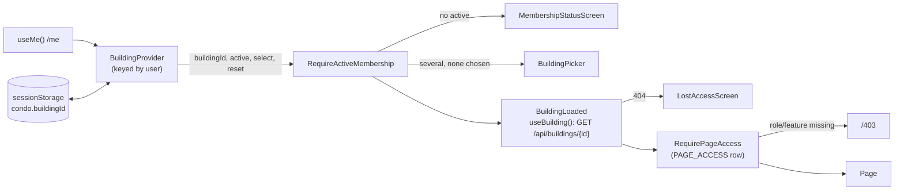

# Explanation — P2-06b Building context and membership guards

> **PR:** #64 · **Source revision:** `90c9083`. This is the pre-merge PR head this explanation was written from and checked against.
> **Reviewed:** the final review round (3) reviewed this commit.
> **Merge commit:** not known when this was written; after the merge, `gh pr view 64 --json mergeCommit` gives it.
>
> Built and merged autonomously ([ADR-0014](../adr/0014-autonomous-agent-workflow.md)); no human reviewed it before merge. This describes the PR's changes at the source revision. It does not describe commits after it (bookkeeping) or the squash merge, and a rebase after it gives the same changes new SHAs. It is a snapshot: before the merge it is edited to match the PR head; once merged, later changes get a new explanation and this one is not updated. Lasting decisions live in ADRs.
>
> **Reality check:** at `90c9083` I re-read from disk:
> - `git diff origin/main...HEAD` (22 files)
> - in full: `frontend/src/app/{BuildingProvider.tsx,buildingStorage.ts,pages.ts,routes.tsx,AppShell.tsx}`, `frontend/src/features/membership/MembershipScreens.tsx`, and the changed parts of `frontend/src/app/{guards.tsx,AuthProvider.tsx,screens.tsx}`, `frontend/src/features/auth/pages/LoginPage.tsx`, `backend/app/seed.py`
> - the assertions of the tests named in §5, all of `frontend/src/app/building.test.tsx`
> - the PR #64 description, with review rounds 1–3
>
> Ran `cd frontend && npx vitest run`: `Test Files 9 passed (9)`, `Tests 199 passed (199)` (42 in `building.test.tsx`). Ran `uv run pytest tests/test_cli_seed.py`: `48 passed`. `npm run lint` and `npm run typecheck`: clean. CI was green on `90c9083`. The prod-like browser journey (§5) ran on `90c9083`, 24/24; the dev-stack one at `bd09a22`, before the review fixes.
>
> Differences from the plan: see §2 "Plan versus final code". The old building's queries are removed by an effect, not inside `select()` (round 2). The provider is split in two to remount per user (round 1). `reset()` gained an `epoch` (round 2).
>
> Written by the implementing session after that check ([ADR-0017](../adr/0017-implementer-writes-the-explanation.md)). Form: full. Tier: 1. Walkthrough variant: B (a user switches building).

## 1. What was built and why

Inside the P2-06a shell, each browser tab now works in one building:

- **Where the choice lives.** The chosen building ID is stored in `sessionStorage`, so each tab has its own. It is trusted only while it is one of `/me`'s active memberships.
- **Cache keys.** Every building query is keyed `['b', buildingId, …]`. When the tab leaves a building, that building's queries are removed, which also aborts their requests. A slow answer from building A can never fill building B's view.
- **Users without an active membership** see why: pending, suspended, denied or no membership. The app sends them no `/api/buildings/` request at all.
- **One table of page rules.** `PAGE_ACCESS` gives each demo page the roles and the feature it needs. The routes guard on it and send a refused user to `/403`.
- **Seed.** A new seed user, `multi@example.test`, is a resident in Maple and security in Birch, so two tabs can be tested in two buildings.

The decisions that matter most:
- Roles and features come from `GET /api/buildings/{id}`, not from `/me` (D2).
- A stored ID is checked against `/me` on every render (D3).
- Both the "lost access" and "another user in `/me`" handling came out of review round 1 (§6).

The navigation, the header menu and council "view as" were split off to P2-06c while framing (D1).

## 2. Decisions

### D1. P2-06c was split off while framing

- **Problem or constraint:** as written, the ticket came to about 550 non-test lines against the ~400 guideline.
- **Chosen:** this PR covers the building context, the guards, `/403`, the page table, a plain switcher and the seed. P2-06c gets the navigation, the header menu, view-as, deleting `Layout.jsx` and the P2-06a auth follow-ups. P3-05, P4-07 and P4-08 now depend on P2-06c.
- **Alternatives rejected:** keeping it whole. Earlier tickets merged at about 460–507 lines, but each of them had no clean seam; this one splits cleanly at the metadata table.
- **Tradeoffs:** one more PR and review cycle. The resident-only navigation (the parent's AC1) lands later.
- **Basis:** playbook (~400 lines). **Source:** recorded (ticket Frame notes, PR D1).

### D2. The guards read roles and features from the building endpoint, not from `/me`

- **Problem or constraint:**
  - `/me` lists each membership's roles but no features.
  - `GET /api/buildings/{id}` returns `my_roles` and `features` for the selected building, computed by the same tenant context the API enforces.
- **Chosen:**
  - `/me` decides only which memberships are active. That drives the selection and the status screens.
  - `frontend/src/app/BuildingProvider.tsx::useBuilding` feeds `RequireRole` and `RequireFeature`.
- **Alternatives rejected:** roles from `/me` and features from the building. That makes two sources that can disagree after a role change, until both are refetched.
- **Tradeoffs:** one building request before any guarded page renders. It is cached for 30 s and shared by every page.
- **Basis:** autonomous. **Source:** recorded (PR D2). The test `role guard › takes roles from the building endpoint, not from /me` proves the source.

### D3. A stored building ID is re-checked against `/me` on every render

- **Problem or constraint:** anything on the origin can write `sessionStorage`, and the value outlives a logout in the same tab. A stale or foreign ID must never reach a URL.
- **Chosen:**
  - The effective ID is the stored one only if it equals an active membership's building ID. Otherwise the tab uses the only active membership, or `null`, which shows the picker.
  - The effective value is written back to storage.
  - Storage is also cleared at logout, at a 401 reset and at login.
- **Alternatives rejected:**
  - Check once at load: a membership suspended later would keep its stale ID until a reload.
  - Rely on the server's 404 alone: the request to the foreign building would still be sent.
- **Basis:** tenant table rows 3 and 6; autonomous. **Source:** recorded (PR D3).

### D4. Kept as one PR at 468 added non-test lines

The frame estimated about 355 lines. The first implementation came to 427, review round 1 took it to 453 and round 2 to 468. The provider, the guards and the screens can only be tested together. Basis: autonomous, as in P2-06a's D8. **Source:** recorded (PR D4).

### D5. When `/me` answers for another user, the tab drops that user's building data and selection

- **Problem or constraint:** tabs share the cookie. When another tab logs in as user B, this tab's next `/me` refetch answers B. Without action:
  - the cache still holds A's building data;
  - the stored building is still A's choice;
  - neither the 401 reset nor the login clear runs in this tab.

  This was review round 1, Claude M1.
- **Chosen:**
  - `frontend/src/app/AuthProvider.tsx::AuthProvider` subscribes to the query cache. When the `["me"]` query's user ID changes from a known one, it removes every query except `['me']` and clears the stored building.
  - `BuildingProvider` renders `UserBuildingProvider` keyed by the user ID, so the in-memory selection starts over too.
- **Alternatives rejected:**
  - `queryClient.clear()`: it would also drop the new `/me` that was just fetched.
  - A user ID in every building key: it would change the `['b', id, …]` convention that every slice uses.
- **Tradeoffs:** until this tab refetches `/me` (window focus, or the 30 s stale time), it still shows the previous user, while its API calls already carry the new cookie.
- **Basis:** review finding. **Source:** recorded (PR D5).

Smaller decisions:

| Decision | Alternative rejected | Why | Basis | Source |
|---|---|---|---|---|
| A picker when there are several active memberships | First active membership (ARCHITECTURE §13, now updated) | The ticket is the more specific text | ticket | recorded (Frame notes) |
| A role or feature refusal is `<Navigate to="/403" replace>` | Render the 403 page in place | The ticket names a route; `replace` keeps Back out of the redirect | ticket | recorded (PR) |
| A switch navigates to `/` | Stay on the current page | The page may be closed in the new building | autonomous | recorded (PR) |
| Status screen order: pending, then suspended, then denied, then none, shown only when no membership is active | Show every membership's status | One clear next step; an active membership always wins | autonomous | recorded (PR) |
| `/Onboarding` and `/ResidentSetup` sit outside `RequireActiveMembership` | Guard them too | They are for users without an active membership; P4-08 replaces them | autonomous | recorded (Frame notes) |
| `NoMembershipScreen` has no join-code field | Add the field now | The join route and lookup come with P4-05/P4-08; a field would lead to a 404 | autonomous | recorded (Frame notes) |
| Page roles follow P5-03/P5-04 and PRODUCT_SCOPE | — | Each owning slice may change its own row | tickets | recorded (PR) |
| Seed `multi` as resident in Maple and security in Birch | Resident in both | A different role in each building proves roles are read per building | autonomous | recorded (PR) |

**Framing changes:** the original four criteria became twelve. Parent AC1 (the navigation) and the baseline part of AC7 moved whole to P2-06c, and the join-code field moved to P4-08. During review, AC7's positive case was reworded to `/Maintenance` (Codex, round 1: the multi user is a resident in Maple, so a staff page would rightly be refused there), and AC8 was extended to cover a 404 after the page had loaded. Nothing was loosened.

**Plan versus final code:**

| Plan | Final code | Changed by |
|---|---|---|
| `select()` calls `removeQueries(['b', oldId])` | An effect removes the old building's queries whenever the effective building changes, whatever changed it | Round 2, Codex M1 |
| One `BuildingProvider` | An outer component keyed by user, plus `UserBuildingProvider` | Round 1, D5 |
| `BuildingLoaded` returns `children` when data is cached | It checks for a 401 or 404 first | Round 1, H1 |
| `reset()` as planned | It also bumps an `epoch` | Round 2, Claude M1 |

## 3. How it is implemented

### Overview



- `frontend/src/app/buildingStorage.ts` reads, writes and clears the tab's ID, and treats a storage that throws as empty.
- `frontend/src/app/BuildingProvider.tsx::UserBuildingProvider` computes the effective `buildingId` from `/me` and the stored value. It keeps storage in sync and drops a building's queries when the tab leaves it.
- `frontend/src/app/guards.tsx::RequireActiveMembership`, `BuildingLoaded`, `RequireRole`, `RequireFeature` and `RequirePageAccess` are the UX guards. The server checks everything again.
- `frontend/src/app/pages.ts::PAGE_ACCESS` is one row per demo page. `frontend/src/app/routes.tsx::AppRoutes` builds the routes from it.

### Walkthrough (variant B): Kim switches from Maple to Birch in the header

1. **The control.** `frontend/src/app/AppShell.tsx::BuildingSwitcher` renders a labelled `<select>` because Kim has two active memberships. Choosing Birch calls `select(BIRCH.id)`.
2. **The check.** `select` ignores an ID that isn't one of the active memberships. Because a building was already selected, it navigates to `/`. It then writes the ID to storage and sets the `stored` state.
3. **The new selection.** On the next render, `buildingId` is Birch, because it is in `active`.
4. **The old building's queries go.** The effect that tracks `previous` sees Maple → Birch and calls `queryClient.removeQueries({ queryKey: ['b', MAPLE] })`. React Query destroys those queries, and destroying a query cancels its fetch, which aborts the `signal` passed to `fetch`.
5. **The new building loads.** `BuildingLoaded` calls `useBuilding()` under the key `['b', BIRCH, 'building']`. That request is `GET /api/buildings/{BIRCH}` (operation `buildings_get`), with React Query's `signal`.
6. **The response.** On 200, the home placeholder shows "Birch Court". On 404, the lost-access screen appears, even if data is cached. On 401, `AuthProvider` sends Kim to the login page. On a 5xx or network error with cached data, the page keeps showing; with no data, a Try again screen appears.
7. **The guards.** On `/ManagementMaintenance`, `RequirePageAccess` wraps `RequireRole` (staff roles) around `RequireFeature` (maintenance). Birch has only packages, so Kim goes to `/403`.
8. **What a slow Maple answer can do.** Nothing. Its query is gone, its request is aborted, and Birch's view reads only `['b', BIRCH, …]` keys.

### Data model changes

None. The seed adds one user and two memberships (`backend/app/seed.py::MEMBERS`).

## 4. The code

**Files changed** (non-test)

| File | Change | Lines (+/−) |
|---|---|---|
| `frontend/src/app/BuildingProvider.tsx` | New: the provider, `useBuildingContext`, `useBuildingId`, `useBuilding` | +118 |
| `frontend/src/features/membership/MembershipScreens.tsx` | New: status screens, picker, lost access | +99 |
| `frontend/src/app/guards.tsx` | `RequireActiveMembership`, `BuildingLoaded`, `RequireRole`, `RequireFeature`, `RequirePageAccess` | +73 |
| `frontend/src/app/pages.ts` | New: `PAGE_ACCESS`, `hasRole`, `hasFeature` | +47 |
| `frontend/src/app/routes.tsx` | Provider, `/403`, onboarding and building pages | +41 −6 |
| `frontend/src/app/buildingStorage.ts` | New | +28 |
| `frontend/src/app/AppShell.tsx` | `BuildingSwitcher` | +22 −1 |
| `frontend/src/app/AuthProvider.tsx` | Clears on logout and 401; the user-change subscriber | +19 |
| `frontend/src/app/screens.tsx` | `ForbiddenPage`; the home placeholder names the building | +18 |
| `frontend/src/features/auth/pages/LoginPage.tsx`, `routeScope.ts`, `backend/app/seed.py` | Clear at login; `DemoPage` type; the multi user | small |

**Key excerpts**

`frontend/src/app/BuildingProvider.tsx::UserBuildingProvider`: the selection, and what happens when it changes

```tsx
  const [stored, setStored] = useState(readSelectedBuilding);

  const active = useMemo(() => (me?.memberships ?? []).filter((m) => m.status === 'active'), [me]);
  const buildingId = active.some((m) => m.building.id === stored)
    ? stored
    : active.length === 1
      ? active[0].building.id
      : null;

  // Keep the tab's storage equal to the effective selection: the default once chosen, nothing once invalid.
  useEffect(() => {
    // Re-run on `stored` too: after reset() the default can be the same building as before.
    if (readSelectedBuilding() !== buildingId) writeSelectedBuilding(buildingId);
  }, [buildingId, stored]);

  // Whatever moves the selection off a building (a switch, or a /me refresh that ends its membership)
  // drops that building's queries. ...
  const previous = useRef(buildingId);
  useEffect(() => {
    const old = previous.current;
    previous.current = buildingId;
    if (old !== null && old !== buildingId) queryClient.removeQueries({ queryKey: ['b', old] });
  }, [buildingId, queryClient]);
```

- **What it does.** `buildingId` is derived on every render. The stored value is trusted only if it is active (D3). The two effects mirror the result into storage and drop the queries of the building the tab left.
- **What breaks without it.**
  - Without the `active.some` check, a foreign or edited ID reaches the URL (mutation M1 in the PR: 4 tests fail).
  - Without the removal effect, a switch or a `/me` change keeps the old building's data (mutation M6: 4 tests fail).
- **Known gap.** `stored` is set only by `select()` and `reset()`. A default selection is never "kept", so a later `/me` change can move it. This is round 3's Codex Medium, unfixed (§7).

`frontend/src/app/guards.tsx::BuildingLoaded`: errors before cached data

```tsx
  const status = building.error instanceof ApiError ? building.error.status : null;
  // A 401 is AuthProvider's (it goes to the login page); until then, nothing to show.
  if (status === 401) return <LoadingScreen />;
  if (status === 404) {
    const chooseAgain = () => {
      reset();
      void queryClient.invalidateQueries({ queryKey: ['me'] });
    };
    return <LostAccessScreen onChooseAgain={chooseAgain} />;
  }
  if (building.data) return children;
  if (building.isPending) return <LoadingScreen />;
```

- **What it does.** A failed refetch keeps its old `data`, so the error has to be checked first. A 404 means the membership is gone, so nothing from the building may stay on screen. A 5xx falls through to the cached page.
- **What breaks without it.** With `if (building.data)` first (the round-1 code), a member removed mid-session kept seeing the building until a reload (§6, round 1).

`frontend/src/app/BuildingProvider.tsx::UserBuildingProvider` (`reset`): why "Choose again" asks again

```tsx
  const [epoch, setEpoch] = useState(0);
  const reset = useCallback(() => {
    queryClient.removeQueries({ queryKey: ['b'] });
    // The effect above then stores whatever is selected next (the default, or nothing: the picker).
    setStored(null);
    setEpoch((n) => n + 1);
  }, [queryClient]);
```

With one active membership, `stored` was already `null`, so `setStored(null)` alone changed nothing. React rendered nothing again, and the building was never asked again (§6, round 2). The `epoch` is part of the context value, so its consumers re-render. `useBuilding` then finds no query under its key and fetches one. Mutation M7 (no bump) fails 2 tests.

`frontend/src/app/AuthProvider.tsx::AuthProvider`: another user in `/me` (D5)

```tsx
  useEffect(() => {
    let userId = queryClient.getQueryData<Me>(['me'])?.user.id;
    return queryClient.getQueryCache().subscribe((event) => {
      if (event.type !== 'updated' || event.query.queryHash !== '["me"]') return;
      const next = (event.query.state.data as Me | undefined)?.user.id;
      if (next === undefined) return;
      if (userId !== undefined && next !== userId) {
        queryClient.removeQueries({ predicate: (query) => query.queryKey[0] !== 'me' });
        clearSelectedBuilding();
      }
      userId = next;
    });
  }, [queryClient]);
```

The subscriber runs inside React Query's cache notification, before the observers re-render. Storage is therefore already clear when the keyed `UserBuildingProvider` remounts and reads it. The round-3 Claude reviewer checked this ordering with a `MutationObserver` proof, which is not in the repo.

`frontend/src/app/pages.ts::PAGE_ACCESS`: one row per page

```ts
export const PAGE_ACCESS: Record<DemoPage, PageAccess> = {
  Home: {},
  Dashboard: {},
  Profile: {},
  Contacts: {},
  Onboarding: { onboarding: true },
  ResidentSetup: { onboarding: true },
  Residents: { roles: ['property_management'] },
  Packages: { roles: ['resident'], feature: 'packages' },
  SecurityPackages: { roles: ['security', 'property_management'], feature: 'packages' },
  ManagementNotices: { roles: STAFF, feature: 'notices' },
  Maintenance: { roles: ['resident'], feature: 'maintenance' },
  ManagementMaintenance: { roles: STAFF, feature: 'maintenance' },
};
```

It is typed `Record<DemoPage, …>`, so adding a page to `DEMO_PAGES` without a row is a type error. P2-06c builds the navigation from this same table.

## 5. Edge cases and tests

All of the tests below are in `frontend/src/app/building.test.tsx` unless noted. I ran them all at `90c9083`.

| What could go wrong | What the code does | Test that proves it |
|---|---|---|
| A pending, suspended or denied user, or one with no membership, triggers building calls | A status screen; zero `/api/buildings` requests | `membership screens, no building calls › shows the %s screen with Log out, and calls no building API` (4 cases) |
| Several non-active statuses at once | Pending first, then suspended, then denied | `› prefers pending over suspended and denied`, `› prefers suspended over denied` |
| A stored ID for another building, a now-pending building, or `../auth/me` | Discarded; never requested | `a stored selection is checked against /me › discards %s…` (3 cases) |
| A late answer from A after switching to B | A aborted, its queries gone, B shown | `switching buildings › aborts A's request, drops its queries and shows B even when A answers late` |
| A `/me` refresh moves the selection | The old building's queries are removed | `a /me refresh changes the selection › …` (2 tests) |
| A role held only in another building | `/403` | `role guard › does not count a role the user holds in another building` |
| Stale roles in `/me` | The building endpoint wins | `role guard › takes roles from the building endpoint, not from /me` |
| A feature off in the building | `/403` | `feature guard › sends the user to /403 when the building has the feature off` |
| 404 on first load, or on a later refetch | Lost-access screen; Choose again asks again | `lost access mid-session › shows the lost-access screen on a 404…`, `lost access after the building loaded › hides the page…`, `› asks the building again on Choose again with /me unchanged` (2 cases) |
| 5xx on a refetch | Cached page stays | `lost access after the building loaded › keeps showing the page when a background refetch fails with a server error` |
| The previous user's building after logout, a 401 or login | Cleared | `no selection outlives the user › …` (3 tests) |
| Another user in `/me` | Their cache and selection are dropped | `another user in /me › drops the previous user's building data and selection…` |
| A user who **picked** a building, then another user in `/me` | The `key` remount resets the pick | **No test** (round 3, Claude L1; §7) |
| A default selection, then a `/me` change | Should keep the default; doesn't | **No test; known defect** (round 3, Codex M; §7) |

**Acceptance criteria → tests**
- **AC1:** `membership screens…` (8 tests). Stack: `pending: no /api/buildings/ request at all [[]]`.
- **AC2:** `one building per tab › restores each tab's own selection after a reload`. Stack: two pages of one browser context, each still on its own building after reload, each requesting only its own.
- **AC3:** `switching buildings › aborts A's request…`.
- **AC4:** `default selection` (3 tests).
- **AC5:** `a stored selection is checked against /me` (4 tests).
- **AC6:** `role guard` (4 tests).
- **AC7:** `feature guard` (2 tests).
- **AC8:** `lost access mid-session` (3 tests) and `lost access after the building loaded` (6 tests).
- **AC9:** `no selection outlives the user` (3 tests).
- **AC10:** `backend/tests/test_cli_seed.py::test_multi_building_user_is_active_in_maple_and_birch`.
- **AC11:** `switching buildings › passes React Query's signal to the building request, under a [b, id] key`.
- **AC12:** `frontend/src/app/shellImports.test.ts`, lint, and the ratchet (354/354).

**Stack journeys.** A Playwright 1.57 script drove Chromium; the script is outside the repo and its transcript is in PR #64. On prod-like at `90c9083` it passed 24/24: favicon 200, no CSP violation, and the only console error was the expected pre-login `/me` 401. The dev stack passed 24/24 at `bd09a22`.

## 6. Review log

| Round | Reviewer | Commit reviewed | Verdict | Findings | Outcome |
|---|---|---|---|---|---|
| 1 | Claude (Sonnet 5.5, high, fresh) + security pass | `bd09a22` | BLOCK | H1: lost access hidden by cached data; M1: another user in `/me`; L1: Choose again re-selects | H1, M1 fixed in `92f1b54`; L1 accepted |
| 1 | Codex `gpt-6-astra-medium` | `bd09a22` | BLOCK | High: same as H1; AC7 wording | Fixed in `92f1b54`; AC7 reworded |
| 2 | Claude (new, fresh) | `92f1b54` | MERGE | M1: Choose again changed no state; L1: transcript predated the fixes; L2: size; L3: `select()` untested | M1 fixed in `90c9083`; L1 re-ran on `90c9083`; L2, L3 accepted |
| 2 | Codex | `92f1b54` | MERGE | M1: a `/me`-driven switch kept the old queries | Fixed in `90c9083` |
| 3 | Claude (new, fresh) | `90c9083` | MERGE | L1–L4 (untested `key`, two surviving mutations, default test route, D5 wording) | D5 reworded; the rest carried |
| 3 | Codex | `90c9083` | MERGE | M: a default selection isn't kept | Carried (final round) |

- **Round 1, H1 (both reviewers).**
  - Failure: the user is on `/Packages` with the building cached. Their membership is removed. Focusing the window refetches the building, which answers 404. React Query keeps the old `data`, so the page stayed on screen.
  - Evidence: Codex's proof failed (`1 failed`) on `bd09a22`. The new tests `hides the page when a background refetch answers 404` and `goes to the login page when a background refetch answers 401` failed before the fix and pass after.
- **Round 1, M1.** Another tab's login left this tab with the previous user's building cache and choice. This led to D5, with a test that was red before the fix.
- **Round 2, Codex M1.**
  - Failure: Maple was selected, then a `/me` refresh showed Maple suspended and Birch active. Two Maple queries stayed in the cache.
  - Fix: the removal effect, tested by `a /me refresh changes the selection` (2 tests).
- **Round 2, Claude M1.**
  - Failure: with one membership, the first load returned 404. After "Choose again", the only request was `/me`, the building was never asked again, and round 1's test passed vacuously.
  - Fix: `epoch`, tested by `asks the building again on Choose again with /me unchanged`, which checks one request per click and that the page returns once the building answers 200.

## 7. Not verified, accepted risks and follow-ups

- **Known defect (round 3, Codex Medium, unfixed because round 3 was the last):** a default selection is not kept as the tab's choice.
  - If only Maple is active and a `/me` refresh adds Birch, the picker comes back instead of keeping Maple.
  - If stored Maple was suspended, Birch was chosen by default, and Maple is then reactivated, the tab silently switches back to Maple.
  - This is UX only: IDs still come only from `/me`'s active list, and the old building's queries are removed on the change.
  - Tracked in P2-06c, first item.
- **Untested:**
  - the `key` remount for a user who picked a building (round 3 L1);
  - `BuildingLoaded`'s own 401 branch (it survives mutation because `AuthProvider` redirects anyway);
  - `select()`'s active check, which is defence in depth behind D3.

  Tracked in P2-06c.
- **Two tabs in Vitest** are simulated with storage snapshots, because jsdom has one `sessionStorage`. Only the stack transcript proves real tabs, and its script is not in the repo; P4-09 adds a Playwright harness.
- **Test helper:** `frontend/src/test/renderApp.tsx` answers Maple's building by default, so that one route never fails loudly. The AC1 tests check the request log instead.
- **"Choose again" while `/me` still lists the building** selects it again: one request per click, with no automatic loop. Tracked only here and in PR #64.
- **Window of the old identity:** a tab still shows the old user until its next `/me` (D5). This is inherent in the shared cookie, and P2-06c owns the cross-tab auth follow-ups.
- **The guards are UX only.** Every page is still a placeholder, so no slice's API enforcement is exercised yet.
- `LoadingScreen` covers the header while the building loads (P2-06a component).

## 8. How to change this safely

- **New building data:** write a hook in `src/features/<domain>/api.ts` keyed `['b', useBuildingId(), '<domain>', …]` that passes `signal`. The removal effect and the user-change subscriber then cover it with no extra code. `switching buildings › aborts A's request…` shows the pattern to test.
- **New page:** add it to `DEMO_PAGES` and give it a `PAGE_ACCESS` row (the type forces the row). The role and feature tests show how to prove its row.
- **A building ID anywhere new:** take it from `useBuildingId()`, never from storage or the URL. Changing how `buildingId` is derived breaks the `a stored selection is checked against /me` tests.
- **Fixing the round-3 Medium:** store the default choice as `stored` when it is first made, so it sticks. Start with Codex's two scenarios as tests (P2-06c).

## 9. Must explain, then quiz

**1. Why `sessionStorage` rather than `localStorage` or the server?**
- `sessionStorage` is per tab, so two tabs can work in two buildings. That is AC2, proven on the stack with two pages sharing one cookie.
- `localStorage` is shared by every tab of the origin, so a switch in one tab would silently change the other's building on reload.
- On the server, the choice would be per session, and the session is shared by all tabs.
- The value is only a preference: `frontend/src/app/BuildingProvider.tsx::UserBuildingProvider` uses it only if it is an active membership, so being writable by the page doesn't matter.

**2. How could a slow response from A appear in B's view, and how do the keys prevent it?** With a key like `['building']`:
1. A's request starts.
2. The user switches to B, and B's request starts under the same key.
3. A answers last, and React Query stores it under the shared key.
4. B's view now shows A's name and roles.

With `['b', A, 'building']` and `['b', B, 'building']` they are different queries. B's view reads only B's key, and A's query is removed and its request aborted when the tab leaves A. The test `switching buildings › aborts A's request, drops its queries and shows B even when A answers late` answers A after the switch and asserts B is still shown.

**3. Why are the guards "UX only", and what would a user who bypassed one get?** They run in the user's browser, which the user controls. Someone who edits the bundle, or calls the API with `curl`, skips them. The API checks again for every request: `get_tenant_context` returns 404 for a non-member or non-active member, and `require_roles` and `require_feature` return 403 (`backend/app/tenancy/deps.py::require_feature`). A bypass would show an empty page that fills only with errors. The guards exist so that honest users don't land on such pages.

**Quiz**

1. Kim's tab is in Birch. Another script writes Maple's ID into `sessionStorage`, and the page re-renders. Which building does the tab use?
2. Why must `BuildingLoaded` check `error` before `data`?
3. What would break if we removed the `previous` ref effect from `UserBuildingProvider`?
4. Why does "Choose again" need the `epoch`, when it already calls `setStored(null)`?
5. How would you extend this to a building-scoped notifications query (P3-05) so it is dropped on a switch and refetched in the new building?

<details><summary>Answers</summary>

1. Still Birch, until a reload. The provider reads storage only when it mounts (`useState(readSelectedBuilding)`); after that, the `stored` state set by Kim's last `select()` decides. On a reload, the tab reads Maple, and uses it because Kim is active in Maple. A non-member ID would be discarded (D3). Either way, only an active membership's ID reaches a URL.
2. A failed refetch keeps the old `data`. Checking `data` first renders the cached page even after a 404 that says access is gone (round 1, H1).
3. Leaving a building would keep its queries. That applies to a switch, and to a `/me` refresh that ends the membership. A late answer couldn't reach B's keys, but A's data would stay cached and the in-flight request wouldn't be aborted. Mutation M6 fails the two switch tests and the two `/me`-driven tests.
4. With one active membership, `stored` is already `null`, so setting it to `null` changes no state, React renders nothing again, and the removed building query is never fetched again (round 2, Claude M1).
5. Key the hook `['b', useBuildingId(), 'notifications']` and pass `signal`. The removal effect drops `['b', old]` with everything under it, and the new building's hook fetches its own key. Then add a switch test like the AC3 one for that key.

</details>
