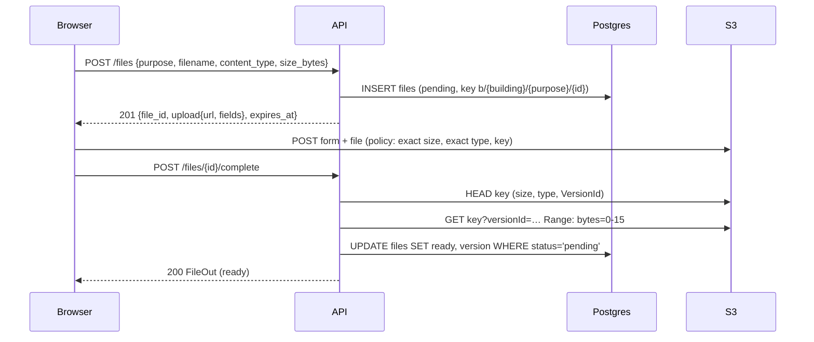

# Explanation — P3-04a File registry and direct uploads

> **PR:** #70 · **Source revision:** `5588637`, the pre-merge PR head this explanation was written from and
> checked against. **Reviewed:** the final review round (2) reviewed `7fe1a50`; `5588637` adds one test-only
> commit after it (an assertion on the signed policy's expiration, from round 2's note).
> **Merge commit:** not known when written; after the merge, `gh pr view 70 --json mergeCommit` gives it.
> Built and merged autonomously ([ADR-0014](../adr/0014-autonomous-agent-workflow.md)); no human reviewed it
> before merge. This describes the PR's changes at the source revision. Commits after it (bookkeeping) and
> the squash merge are not described here, and a rebase after it gives the same changes new SHAs.
> This is a snapshot: before the merge it is edited to match the PR head; once merged, write a new
> explanation for later changes and do not update this one. Lasting decisions live in ADRs.
> **Reality check:** re-read `git diff origin/main...HEAD`, `backend/app/files/{service,storage,purposes,schemas,router,models}.py`,
> the migration `478316869a1a`, `backend/tests/files/*` (assertions) and the PR body at `5588637`; compiled the
> completion UPDATE and the lookup SELECT with SQLAlchemy's Postgres dialect (pasted in §3); ran
> `pytest tests/files backend/tests/test_world.py tests/test_architecture.py`: 140 passed. Differences from the plan:
> see §2 "Plan versus final code".
> Written by the implementing session after that check ([ADR-0017](../adr/0017-implementer-writes-the-explanation.md)).
> Form: full. Tier: 1. Walkthrough variant: A.

## 1. What was built and why

A member can now upload a private file without its bytes passing through the API. `POST /files` writes a
`pending` row and returns a presigned POST form whose key, **exact** size and **exact** `Content-Type` the
server chose; the browser posts the file straight to S3. `POST /files/{id}/complete` then checks what S3
holds (size, type, and the magic number of the very version it found), and pins that `VersionId`. That is
the first part of [ADR-0007](../adr/0007-private-s3-presigned-uploads.md)'s flow. Downloads and
`claim_file` are P3-04b, and cleanup is P3-04c (split while framing).

The two decisions that matter most: the magic-number read is **pinned to the version HEAD returned**,
so the bytes checked are the bytes stored (D2). And completion is **idempotent and race-safe**: a second or
losing completion answers with the winner's file and never re-pins (D3).

## 2. Decisions

### D1. The POST policy pins the exact declared size

- **Problem or constraint:** `complete` requires the stored size to equal the declared size. P3-04 said
  the policy's `content-length-range` is `1..max`.
- **Chosen:** `["content-length-range", size_bytes, size_bytes]` in
  `backend/app/files/storage.py::presign_post`, plus `complete`'s equality check.
- **Alternatives rejected:** `1..max`: S3 would accept an upload of another size, refused only at
  `complete`, leaving a wrong object under the key until cleanup.
- **Tradeoffs and accepted limitations:** the browser must send exactly the size it declared (it knows
  it: `File.size`).
- **Basis:** autonomous, tighter than the ticket; experiment on LocalStack 4.14.0 before framing (exact
  100..100: 100 bytes → 204, 99 → `EntityTooSmall`, 101 → `EntityTooLarge`).
- **Source:** recorded (PR #70 D1; ticket Frame notes, criterion 3).

### D2. The magic-number read is pinned to the version HEAD returned

- **Problem or constraint:** the form stays valid for 5 minutes, so the uploader can POST again between
  `head` and the read of the first bytes.
- **Chosen:** `get_range(key, found.version_id, MAGIC_BYTES)`, and that same `version_id` is stored. A
  missing or `"null"` version (bucket versioning off) raises `UnversionedObjectError`, a 500, and the file
  is never marked `ready`.
- **Alternatives rejected:** reading the latest object: the checked bytes and the pinned version could
  differ (a PNG checked, a PDF served).
- **Tradeoffs and accepted limitations:** none recorded.
- **Basis:** ADR-0007 ("re-using an upload URL cannot change what an accepted `file_id` serves");
  criterion 15.
- **Source:** recorded (PR #70 D2).

### D3. Completion is idempotent and race-safe

- **Problem or constraint:** tenant rows 8–10; two completions can run at once (double click, retry).
- **Chosen:** a `ready` file returns 200 with its stored state and no S3 call. Otherwise the checks run,
  then a conditional `UPDATE … WHERE status = 'pending'`, and the row is re-read (ours or the winner's). Since
  review round 1, a check that fails (`UploadIncomplete`, `FileSizeMismatch`, `FileTypeMismatch`) also
  re-reads the row and returns it if another completion already made it `ready`.
- **Alternatives rejected:** 409 `invalid_transition` on a second completion (a client retry after a lost
  response would see an error for a success); an unconditional update (the loser could overwrite the
  winner's pinned version).
- **Tradeoffs and accepted limitations:** a second completion after a re-upload doesn't re-check: the pinned
  version stays, which is the point.
- **Basis:** CLAUDE.md rule 7; autonomous; review round 1 M1 for the failed-check path.
- **Source:** recorded (PR #70 D3, Independent review round 1).

### D4. Who may upload each purpose

- **Problem or constraint:** the ticket gives purposes but not roles.
- **Chosen:** `package_photo`: security and property_management. `maintenance_photo`: resident and
  property_management. `notice_attachment`: property_management only (PDF only). Otherwise 403
  `forbidden_role`, judged from the URL building's membership (`backend/app/files/purposes.py::PURPOSES`).
- **Alternatives rejected:** any active member for any purpose (lets a resident fill the bucket with
  "package photos" nobody can claim); `require_roles` on the route (the purpose is in the body, so a
  route-level dependency can't see it).
- **Tradeoffs and accepted limitations:** P5/P6 may need to widen a rule (one line in `PURPOSES`).
- **Basis:** PRODUCT_SCOPE.md roles table; autonomous.
- **Source:** recorded (PR #70 D4; ticket Frame notes).

### D5. Not split further at ~600 raw lines

- **Problem or constraint:** the ~400 non-test line guideline, for what is already the first of three parts.
- **Chosen:** one PR. That is 389 lines without blanks, comments and docstrings in `app/files` and the
  migration, plus about 40 of CI, Makefile, pyproject and wiring.
- **Alternatives rejected:** `create` and `complete` in separate PRs (that would merge a path that issues
  forms but never verifies anything).
- **Basis:** playbook step 1 point 4; precedent P3-01a (#69).
- **Source:** recorded (PR #70 D5).

Smaller decisions:

| Decision | Alternative rejected | Why | Basis | Source |
|---|---|---|---|---|
| The key and version are never returned to the client | return `s3_key` | the client never needs them; rule 9 | CLAUDE.md rule 9 | PR #70 table |
| No audit events on upload | `files.uploaded` | the claiming record's action is audited (P5+) | autonomous | PR #70 table |
| A missing key is HEAD `404`/`NoSuchKey`/`NotFound`; any other S3 error is a 500 | treat 403 as missing | hiding a permission error would answer "upload incomplete" forever; D-01 must grant `s3:ListBucket` | autonomous | PR #70 table |
| Exact, case-sensitive `content_type` match | normalise case and parameters | the policy and `complete` compare the same exact string | autonomous | PR #70 table |
| A test bucket per pytest session, created by the tests | the compose init script's bucket | concurrent suites would share objects, and CI has no init script | autonomous (as P2-07 D1) | PR #70 table |
| Files tests fail, not skip, without the emulator | skip | a skip marker is a protected gate | playbook | PR #70 table |
| `anyio.to_thread` | `asyncio.to_thread` | the ticket names anyio; it shares Starlette's thread limiter | ticket | PR #70 table |

**Framing changes:** P3-04 split into P3-04a/b/c (about 600 lines in total, and `files.cleanup` needs
P3-01b's scheduler). Criteria 1–5 sharpened: the exact key and null version, error codes, the exact-size
policy that also rejects smaller uploads, no version on a failed check, and the stored version checked
against S3. Criteria 9–16 added: tenant rows, the pinned magic read, mismatches and filename validation.
Nothing loosened. P5-01 and P3-06 now depend on P3-04b.

**Plan versus final code** (all listed in the PR below the Plan):
- The tests reach the emulator through `TEST_S3_ENDPOINT_URL`, not `S3_ENDPOINT_URL`: with the latter set,
  20 `backend/tests/test_config.py` cases that build production `Settings` failed.
- `backend/tests/test_world.py::EXPECTED_ROW_COUNTS` gained `"files": 0`.
- More magic-number, unversioned-object and filename tests than the plan's map listed.
- The migration's `down_revision` was repointed to `6155f8860fc1` on the rebase onto P3-01a.
- Review round 1 split the checks into `backend/app/files/service.py::_verify` and added the failed-check
  re-read (D3), and moved the filename check to `mode="before"`.
- The plan said "conditional `UPDATE … RETURNING`". The code runs the conditional UPDATE without
  `RETURNING` and then `db.refresh(file)`, which reads back either this request's update or the winner's.
  The effect is the same; noted in the PR.

## 3. How it is implemented

### Overview

- `backend/app/files/models.py::File`: the server-owned row; the constraints make "ready" mean "a version
  was pinned".
- `backend/app/files/purposes.py::PURPOSES`: types, size limit and uploader roles per purpose;
  `matches_magic` checks the first bytes.
- `backend/app/files/storage.py`: the only S3 code. boto3 calls run in anyio threads. There are two
  clients: the API's, and a presigning one that signs for the browser's host.
- `backend/app/files/service.py::create_file` and `::complete_file`: the two use-cases, each committing once.
- `backend/app/files/router.py::router`: a `building_router`, so the tenant guard runs on both routes.



### Walkthrough (variant A: `POST /api/buildings/{b}/files/{id}/complete`)

1. **HTTP** → `backend/app/files/router.py::complete`. The router comes from `building_router`, so
   `get_tenant_context` has already resolved the caller's active membership in `{b}` (or answered 404
   `building_not_found`). CSRF middleware has checked `Origin` (unsafe method).
2. **Lookup**, scoped three ways, in `backend/app/files/service.py::complete_file`:
   ```sql
   SELECT files.* FROM files
   WHERE files.id = :id AND files.building_id = :ctx_building AND files.uploaded_by_user_id = :ctx_user
   ```
   No row: 404 `file_not_found`, the same for a missing id, someone else's file and another building's file.
3. **Already ready?** Return it as is, with no S3 call.
4. **`_verify`**: `storage.head(key)` (missing → 409 `upload_incomplete`); size and `Content-Type` equal
   to the row's (else 422 `file_size_mismatch` / `file_type_mismatch`); a real version id (else
   `UnversionedObjectError`, 500); `storage.get_range(key, version, 16)` and `matches_magic` (else 422
   `file_type_mismatch`). It returns the checked version.
5. **If a check failed**: re-read the row (`populate_existing`); if a concurrent completion made it
   `ready`, return that; otherwise re-raise. Nothing is written, so the file stays `pending`.
6. **Pin**, conditionally (compiled with the Postgres dialect):
   ```sql
   UPDATE files SET s3_version_id=%(s3_version_id)s::VARCHAR, status=%(status)s, updated_at=now()
   WHERE files.id = %(id_1)s::UUID AND files.building_id = %(building_id_1)s::UUID
     AND files.status = %(status_1)s
   ```
   then `db.refresh(file)` and `db.commit()`, once. If zero rows matched, the refresh shows the winner's row.
7. **Response**: `backend/app/files/schemas.py::FileOut` (no key, no version).

`create` is shorter: role, type and size checks against `PURPOSES`, a `File` row with a server-built key,
`storage.presign_post` (local signing in a thread), one commit, and 201 `FileUploadOut`.

### Data model changes

Table `files` (migration `478316869a1a`, after `6155f8860fc1`):

| Constraint | Prevents |
|---|---|
| `ck_files_version_iff_ready`: `(status = 'ready') = (s3_version_id IS NOT NULL)` | a `ready` file with nothing pinned (serving "whatever is latest"), or a pending file that looks verified |
| `ck_files_attachment_complete`: both `attached_*` null or both set | a half-written attachment |
| `ck_files_attached_only_when_ready` | attaching an unverified file (P3-04b's `claim_file` relies on it) |
| `ck_files_size_positive` | a zero or negative size |
| `uq_files_s3_key` | two rows serving one object |
| `uq_files_building_id_id` | nothing by itself: the target of composite FKs `(building_id, file_id)` from domain tables (ADR-0005) |
| `fk_files_building_id_buildings`, `fk_files_uploaded_by_user_id_users` (RESTRICT) | orphans; deleting a building or user with files |
| `ck_files_file_purpose`, `ck_files_file_status` | values outside the enums |

## 4. The code

**Files changed** (from `git diff --stat origin/main...HEAD`)

| File | Change | Lines (+/−) |
|---|---|---|
| `backend/app/files/models.py` | `File`, `FilePurpose`, `FileStatus` | +57 |
| `backend/app/files/purposes.py` | rules and magic numbers | +59 |
| `backend/app/files/storage.py` | S3 adapter | +125 |
| `backend/app/files/service.py` | `create_file`, `complete_file`, `_verify`, errors | +153 |
| `backend/app/files/schemas.py`, `router.py` | API shapes, two routes | +54, +23 |
| `backend/migrations/versions/478316869a1a_files_p3_04a.py` | the table | +107 |
| `backend/app/core/errors.py` | `UnprocessableContent` | +6 |
| `backend/app/main.py`, `backend/app/models/registry.py` | wiring | +2, +1 |
| `backend/pyproject.toml`, `backend/uv.lock` | boto3, anyio, boto3-stubs | +6/−1 (pyproject) |
| `Makefile`, `.github/workflows/ci.yml` | test emulator env; CI `s3` service | +6/−2, +20 |
| `frontend/src/api/schema.d.ts` | regenerated | +234 |
| `backend/tests/files/*`, `backend/tests/test_world.py` | tests | |
| `docs/tickets/*` | framing and split | |

`backend/app/files/service.py::complete_file`

```python
    if file.status is FileStatus.READY:
        # Never re-checked: its version is pinned, whatever was uploaded since.
        return FileOut.model_validate(file)

    try:
        version_id = await _verify(file)
    except UploadIncomplete, FileSizeMismatch, FileTypeMismatch:
        # A completion that committed while this one checked wins, whatever was uploaded since:
        # answer with it instead of the failure (review round 1).
        current = await db.scalar(
            select(File).where(File.id == file.id).execution_options(populate_existing=True)
        )
        if current is not None and current.status is FileStatus.READY:
            return FileOut.model_validate(current)
        raise

    # Conditional: if a concurrent completion won, its pinned version stays and is returned.
    await db.execute(
        update(File)
        .where(
            File.id == file.id,
            File.building_id == ctx.building_id,
            File.status == FileStatus.PENDING,
        )
        .values(status=FileStatus.READY, s3_version_id=version_id)
    )
    await db.refresh(file)
    await db.commit()
    return FileOut.model_validate(file)
```

- It turns a verified upload into a pinned, `ready` file, at most once (D3). The `except` uses Python 3.14's
  unparenthesised form (PEP 758).
- Without `File.status == FileStatus.PENDING`, a loser could overwrite the winner's version (mutation probe
  M2 fails `test_losing_a_concurrent_completion_returns_the_winner`). Without the early `READY` return, a
  repeat call would hit S3 again (M8).

`backend/app/files/service.py::_verify`

```python
    found = await storage.head(file.s3_key)
    if found is None:
        raise UploadIncomplete(detail="Nothing has been uploaded for this file yet.")
    if found.size != file.size_bytes:
        raise FileSizeMismatch(detail="The uploaded file's size is not the declared size.")
    if found.content_type != file.content_type:
        raise FileTypeMismatch(detail="The uploaded file's type is not the declared type.")
    if not found.version_id or found.version_id == "null":
        raise UnversionedObjectError(f"no version for file {file.id}; is bucket versioning on?")
    # The version HEAD saw, not the latest: another POST with the same form may have landed since.
    first_bytes = await storage.get_range(file.s3_key, found.version_id, MAGIC_BYTES)
    if not matches_magic(file.content_type, first_bytes):
        raise FileTypeMismatch(detail="The uploaded file's content is not the declared type.")
    return found.version_id
```

- D2 in code: the version that `head` reported is read, checked and returned for pinning. Dropping
  `VersionId=` in `storage.get_range` (probe M1) fails `test_magic_check_reads_the_version_head_returned`.
- The size and type checks are reachable only for objects put outside the form (the policy refuses both),
  as `test_size_or_content_type_mismatch_is_422_and_stays_pending` does with `put_object`.

`backend/app/files/storage.py::presign_post`

```python
        post = _presigning_client().generate_presigned_post(
            Bucket=settings.s3_bucket_name,
            Key=key,
            Fields={"Content-Type": content_type},
            Conditions=[
                {"Content-Type": content_type},
                ["content-length-range", size_bytes, size_bytes],
            ],
            ExpiresIn=expires_in,
        )
```

- The policy S3 enforces: the key (boto3 adds it), the exact type and the exact size (D1). The client only
  receives the form; nothing it sends chooses the key (`FileCreate` is an `InputModel`, `extra="forbid"`).
- `_presigning_client` signs with `S3_PUBLIC_ENDPOINT_URL` when set, so the form's URL names a host the
  browser reaches (locally `localhost:4566`, not the container name `s3`).

`backend/app/files/purposes.py::matches_magic`

```python
    match content_type:
        case "image/jpeg":
            return head.startswith(b"\xff\xd8\xff")
        case "image/png":
            return head.startswith(b"\x89PNG\r\n\x1a\n")
        case "image/webp":
            return head[0:4] == b"RIFF" and head[8:12] == b"WEBP"
        case "image/heic":
            return head[4:8] == b"ftyp" and head[8:12] in _HEIF_BRANDS
        case "application/pdf":
            return head.startswith(b"%PDF-")
        case _:
            return False
```

- An unknown type is never a match (fail closed). `_HEIF_BRANDS` leaves out `avif` (AV1, not HEIC), and
  `test_bytes_of_another_type_fail_the_magic_check` covers an AVIF header.

`backend/tests/files/test_complete.py::test_magic_check_reads_the_version_head_returned` (the hardest criterion, 15)

```python
    async def reupload_after_head(key: str) -> storage.ObjectHead | None:
        found = await real_head(key)
        # A second POST with the same form lands between the HEAD and the read of the first bytes.
        assert (await post_form(resident_file.upload, pdf(64))).status_code == 204
        return found

    monkeypatch.setattr(storage, "head", reupload_after_head)

    r = await resident_file.client.post(resident_file.url)

    assert r.status_code == 200, r.text
    # ...
    assert stored != latest
    body = s3.get_object(Bucket=s3_bucket, Key=resident_file.key, VersionId=stored)["Body"]
    assert body.read() == png()
```

## 5. Edge cases and tests

| What could go wrong | What the code does | Test that proves it |
|---|---|---|
| Client picks the key | `extra="forbid"` → 422 | `backend/tests/files/test_create.py::test_create_refuses_a_client_key` |
| Upload larger or smaller than declared, or another type | S3 refuses (policy) | `backend/tests/files/test_create.py::test_presigned_form_enforces_the_exact_size_and_type` |
| Bytes of another type | 422 `file_type_mismatch`, stays `pending` | `backend/tests/files/test_complete.py::test_png_declared_with_pdf_bytes_is_rejected_and_stays_pending`, `::test_bytes_of_another_type_fail_the_magic_check` |
| Re-POST after completion | new version; the stored one still serves the original | `::test_complete_pins_the_version_and_a_reupload_does_not_change_it` |
| Re-POST between HEAD and the read | the HEAD version is read and stored | `::test_magic_check_reads_the_version_head_returned` |
| Concurrent completion | loser returns the winner, no overwrite | `::test_losing_a_concurrent_completion_returns_the_winner` |
| Loser's checks fail after a winner | returns the winner (round 1 M1) | `::test_a_failed_check_after_another_completion_won_returns_the_winner`, `::test_every_failed_check_after_a_winner_returns_the_winner` |
| Bucket unversioned | 500 (`UnversionedObjectError`), stays `pending` | `::test_an_unversioned_object_is_never_marked_ready` |
| Someone else's or another building's file | 404 `file_not_found`, same body as missing | `::test_someone_elses_file_is_404_like_a_missing_one`, `::test_another_buildings_file_through_this_building_is_404` |
| Wrong role / role from another building | 403 `forbidden_role` | `backend/tests/files/test_create.py::test_wrong_role_is_403`, `::test_multi_role_comes_from_this_buildings_membership` |
| Control characters at a filename's ends | 422 (round 1 L1) | `backend/tests/files/test_create.py::test_invalid_filename_or_size_is_422` |
| A `ready` row without a version, or an attached pending row | DB check refuses | `backend/tests/files/test_schema_files.py::test_ready_needs_a_version_and_pending_has_none`, `::test_attachment_columns_go_together_and_need_ready` |
| Real S3 differs from LocalStack | No test (D-06) | — |

Acceptance criteria → tests: 1 `test_create_returns_presigned_post_and_pending_row` (policy conditions and
signed expiration), `test_create_refuses_a_client_key`. 2 `test_create_refuses_a_file_over_the_purpose_limit`,
`test_create_refuses_a_type_the_purpose_does_not_allow`. 3 `test_presigned_form_enforces_the_exact_size_and_type`.
4 `test_complete_before_upload_is_409`, `test_png_declared_with_pdf_bytes_is_rejected_and_stays_pending`.
5 `test_complete_pins_the_version_and_a_reupload_does_not_change_it`. 9 `test_each_allowed_role_uploads_and_completes`.
10 `test_wrong_role_is_403`, `test_multi_role_comes_from_this_buildings_membership`. 11
`test_unauthenticated_is_401`, `test_non_member_pending_and_suspended_get_404`. 12
`test_someone_elses_file_is_404_like_a_missing_one`. 13 `test_another_buildings_file_through_this_building_is_404`.
14 `test_completing_twice_returns_the_same_file_without_s3`, `test_losing_a_concurrent_completion_returns_the_winner`.
15 `test_magic_check_reads_the_version_head_returned`. 16 `test_size_or_content_type_mismatch_is_422_and_stays_pending`,
`test_invalid_filename_or_size_is_422`. Mutation probes M1–M10 (PR #70) showed each key check is load-bearing.

## 6. Review log

| Round | Reviewer | Commit reviewed | Verdict | Findings | Outcome |
|---|---|---|---|---|---|
| 1 | Codex `gpt-6.1-sol` (high), fresh, Tier 1 security pass | `d09a7fa` | MERGE | Medium: a losing completion reported failure for a ready file. Low: control characters at a filename's ends passed | both fixed in `b518899` (+ `7fe1a50`, typing) |
| 2 | Codex `gpt-6.1-sol` (high), fresh, whole diff | `7fe1a50` | MERGE | none; note: AC1 didn't assert the signed policy's own expiration | assertion added in `5588637` (test only) |

James's instruction for this run replaced the playbook's Tier 1 pair with one fresh Codex `gpt-6.1-sol` at
high effort per round, and no Claude reviewer.

- **Round 1, Medium.** Failure: request A reads `pending`; B completes and commits; the uploader re-POSTs
  same-size PDF bytes with the valid form; A's checks see the PDF and answer 422, although the file is
  `ready` with its version intact. Fix: the failed-check re-read in `complete_file` (D3). Evidence:
  4 new tests failed before the fix and again with the re-read removed (probe at `b518899`), and pass with it.
- **Round 1, Low.** Failure: `"box.png\n"`, `"\tbox.png"`, `"box.png
"` → 201, because
  `APIModel`'s `str_strip_whitespace` ran before the validator. Fix: `FileCreate._no_control_characters` runs
  `mode="before"`. Evidence: 3 new cases failed before and pass after.

## 7. Not verified, accepted risks and follow-ups

- **Real S3** was not used: the exact-size policy, the 403 on another type, versioning and the HEAD 404
  were checked on LocalStack only. D-06 checks real S3 (its P3-04 line covers uploads).
- **IAM:** on AWS, a HEAD on a missing key without `s3:ListBucket` returns 403, which `complete` would
  answer as a 500 instead of 409. D-01's policy must grant `ListBucket`. To be added to D-01 in the
  bookkeeping commit.
- **The concurrency tests use one connection** (the harness): the simulated winner's update shares the
  request's transaction. Codex round 2 confirmed the race paths with separate committed sessions in its
  own proofs (not committed to the repo).
- **Abandoned `pending` files** (a form never used, or a failed check) stay until P3-04c's cleanup.
  Nothing reads them.
- **Malware scanning, quotas and per-user rate limits on `POST /files`**: out of scope (pilot). A member
  can create many pending rows and forms; each form only allows one object of the declared size. Tracked
  only here and in ADR-0007 "Revisit when".
- The stack journey ran the branch's API on the host against compose's db and emulator, not inside
  `make up` (another agent held the stack at the time); PR #70 has the transcript.

## 8. How to change this safely

- **A new purpose:** add it to `FilePurpose` (a migration, since the enum check changes), add its rule to
  `PURPOSES`, and add rows to the parametrized tests in `test_create.py` (allowed role, wrong role).
- **A new content type:** add it to the rule and a `case` in `matches_magic`, plus pass and fail samples in
  `test_each_image_type_passes_its_magic_check` and `test_bytes_of_another_type_fail_the_magic_check`.
- **Touching `complete_file`:** keep the `status = 'pending'` condition, the version-pinned `get_range`, and
  the single commit. The race, pinning and idempotency tests in `test_complete.py` fail if any goes.
- **S3 code** stays in `storage.py`. Tests reach the emulator only through `TEST_S3_ENDPOINT_URL`, so
  `backend/tests/test_config.py` never sees an endpoint.

## 9. Must explain, then quiz

**1. Why presigned POST instead of PUT?** A POST policy is a signed document of conditions that S3 enforces
on the upload: here the key, the exact `Content-Type` and `content-length-range`
(`backend/app/files/storage.py::presign_post`). A presigned PUT URL signs a request but cannot bound the
body's size, so a client could upload any size under the key (ADR-0007 "Alternatives"). With POST, S3
itself answers `EntityTooLarge`/`EntityTooSmall`
(`test_presigned_form_enforces_the_exact_size_and_type`).

**2. Without `s3_version_id`, how could someone change what an accepted `file_id` serves?** The form stays
valid for 5 minutes, and the bucket keeps every version. If the server read "the latest object", the
uploader could pass the check with a PNG, then POST other bytes with the same form, and every later read
would serve the new bytes. Storing the checked `VersionId`
(`backend/app/files/service.py::complete_file`), and reading by version, freezes what the file is. The
`ck_files_version_iff_ready` check makes a `ready` row without a version impossible.

**3. Why check magic bytes when S3 already has a `Content-Type`?** S3's `Content-Type` is whatever the
form sent. The policy forces it to equal the declared type, but nothing makes the bytes match it, so a PDF
or HTML file can be stored as `image/png`. The first 16 bytes show what the file actually is
(`backend/app/files/purposes.py::matches_magic`); `test_png_declared_with_pdf_bytes_is_rejected_and_stays_pending`
shows the difference.

1. Two completions run at once for the same file, and the uploader re-posts different bytes in between.
   What does each request return, and which version ends up stored?
2. Why does `complete_file`'s lookup filter on `uploaded_by_user_id`, and what answer does a manager get
   for a resident's pending file?
3. Why is the presigning client separate from the API's client?
4. What would break if `File.status == FileStatus.PENDING` were removed from the completion UPDATE?
5. How would you extend this so maintenance requests can also take PDF attachments up to 20 MiB?

<details><summary>Answers</summary>

1. The first to reach the conditional UPDATE pins the version its own HEAD saw (and checked). The other
   either matches zero rows and re-reads the winner, or fails a check on the new bytes and also re-reads the
   winner (round 1 fix). Both return the same `ready` file, and the stored version is the winner's.
2. Completion is the uploader's own confirmation of their upload. Anyone else gets 404 `file_not_found`,
   the same as a missing id (`test_someone_elses_file_is_404_like_a_missing_one` checks the manager too).
   Inferred: other roles act on a file through its owning record (P3-04b).
3. A presigned URL embeds its host; locally the API reaches S3 as `s3:4566` inside Docker but the browser
   needs `localhost:4566`. The presigning client signs for `S3_PUBLIC_ENDPOINT_URL`.
4. A loser that passed its checks after the winner committed would overwrite `s3_version_id` with the
   version it saw, possibly bytes uploaded after the winner's check: the pinned file would change.
   `test_losing_a_concurrent_completion_returns_the_winner` fails (probe M2).
5. Allow `application/pdf` in `maintenance_photo`'s rule (or a new `maintenance_attachment` purpose,
   better, since "photo" would lie) and give the rule a per-type size limit, because `max_bytes` is one
   number per purpose today. Then add the parametrized tests.

</details>
