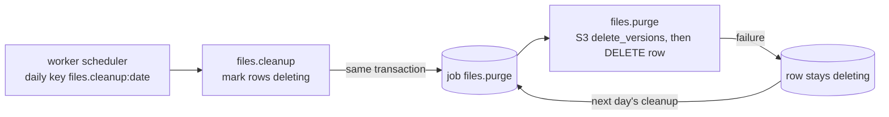

# Explanation — P3-04c File cleanup job

> **PR:** #78 · **Source revision:** `51d20f9` (pre-merge), the PR head this explanation was written from and
> checked against. **Reviewed:** the final review round (2) reviewed this commit.
> **Merge commit:** not known when written; after the merge, `gh pr view 78 --json mergeCommit` gives it.
> Built and merged autonomously ([ADR-0014](../adr/0014-autonomous-agent-workflow.md)); no human reviewed it
> before merge. This describes the PR's changes at the source revision. Commits after it (bookkeeping) and
> the squash merge are not described here, and a rebase after it gives the same changes new SHAs.
> This is a snapshot: before the merge it is edited to match the PR head; once merged, write a new
> explanation for later changes and do not update this one. Lasting decisions live in ADRs.
> **Reality check:** re-read at `51d20f9` the PR diff (`git diff origin/main...HEAD`, all 20 paths), in full
> `backend/app/files/jobs.py`, the migration, the changed functions of `service.py` and `storage.py`, and
> the tests cited below; ran `pytest tests/files/test_cleanup.py tests/files/test_migration_cleanup.py
> tests/files/test_schema_files.py tests/files/test_storage.py tests/jobs/test_scheduler.py
> tests/jobs/test_cleanup.py`: 62 passed. `make check` on `51d20f9`: green (1350 backend tests); CI green.
> Differences from the plan: yes, by review round 1 (see §2 "Plan versus final code").
> Written by the implementing session after that check ([ADR-0017](../adr/0017-implementer-writes-the-explanation.md)).
> Form: full. Tier: 1. Walkthrough variant: C (worker process).

## 1. What was built and why

Abandoned uploads used to stay in the private bucket forever. Now two worker jobs remove them
([ADR-0007](../adr/0007-private-s3-presigned-uploads.md) "Cleanup"):

- **`files.cleanup`** runs once a day. It marks `pending` files created more than 24 h ago, and `ready`
  files with no attachment created more than 7 days ago, with a new status, `deleting`. It deletes nothing.
- **`files.purge`**, which the cleanup enqueues in the same transaction, deletes every S3 version of each
  `deleting` file's key, then the row.

The decision that matters most is that `deleting` status, committed before any object is deleted
([ADR-0018](../adr/0018-file-deletion-state.md)). The first version of this PR deleted objects while only
a row lock protected the file. Review round 1 showed two ways that leaves a claimable file whose object is
gone. A `deleting` file is "not found" for every caller, so nothing a failed purge leaves behind can
reach a user.

## 2. Decisions

### D1. A committed `deleting` status between choosing a file and deleting it (ADR-0018)

- **Problem or constraint:** S3 deletes can't be rolled back with a database transaction, and a job handler
  never commits (CLAUDE.md rule 5): its writes commit with the job's `succeeded`. Review round 1 reproduced two
  High failures of the first design (lock the row, delete the objects, delete the row, all in one job):
  (1) the worker's 50 s timeout cancels the handler while boto3 keeps running in its thread; the rollback
  releases the row lock, a claim attaches the file, and the thread then deletes the object. (2) S3 deletes
  the pinned version but refuses another one; the row is kept `ready`, and a claim attaches a file with
  nothing to serve.
- **Chosen:** `files.cleanup` sets `status = 'deleting'` and enqueues `files.purge` in its own transaction,
  so the purge job exists only if the marks committed. `files.purge` deletes S3 versions, then rows; on any
  failure the row stays `deleting`. Every path that serves a file already required `ready` (download, claim)
  or `pending` (complete's conditional update). The PR adds `deleting` checks where a path would otherwise
  give a different answer: `claim_file`'s "does it exist" check and `complete_file`'s reads.
- **Alternatives rejected:** limit each S3 call to the time left before the timeout (doesn't fix the
  partial delete, and a request that has started can't be stopped); commit inside the handler (rule 5); a
  `deleting_at` column (every serving query would need a second filter); keep the lock-only design and accept
  the window (both failures reproduced as tests).
- **Tradeoffs and accepted limitations:** two jobs instead of one; the `status` column grew from 7 to 8
  characters; an old API process can't read the new value (§7).
- **Basis:** review finding (round 1, two High); autonomous; ADR-0018 records it.
- **Source:** recorded (PR #78 decision D4, ADR-0018, review log).

### D2. Lock the candidates with `FOR UPDATE SKIP LOCKED` and the eligibility conditions in one statement

- **Problem or constraint:** a file may be claimed or completed at the moment the cleanup chooses it
  (criterion 28).
- **Chosen:** `backend/app/files/jobs.py::cleanup_files` selects the eligible ids `FOR UPDATE SKIP LOCKED`
  with the age, status and `attached_id IS NULL` conditions in the same `WHERE`. A claim that already holds
  the row (its `UPDATE` ran, its transaction hasn't committed) makes the cleanup skip the row. A claim
  that arrives later waits for the cleanup's lock and then finds the file `deleting`, so it gets 404.
- **Alternatives rejected:** `FOR UPDATE` without `SKIP LOCKED` (the job would wait on a request); a committed
  status first: chosen too, after round 1 (D1).
- **Tradeoffs and accepted limitations:** a claim of an already-eligible file can wait for the cleanup's
  transaction. That transaction now makes no S3 call, so the wait is short.
- **Basis:** autonomous. **Source:** recorded (PR decision D1, ticket Frame notes).

### D3. Bounded runs: 500 files, a 30 s purge budget, no follow-up job

- **Problem or constraint:** handlers must finish within `HANDLER_TIMEOUT` (50 s, P3-01b).
- **Chosen:** one cleanup marks at most `CLEANUP_BATCH` (500) files, oldest first; one purge takes at most 500
  and starts no S3 delete after `CLEANUP_BUDGET` (30 s). What's left stays `deleting` until the next day's
  cleanup enqueues another purge.
- **Alternatives rejected:** a continuation job when work is left. While S3 is down every purge would fail
  fast and chain a new one every ~30 s.
- **Tradeoffs and accepted limitations:** more than ~500 abandoned uploads a day builds a backlog, which costs
  only storage. Since D1 the budget is not a safety measure (a timed-out purge harms nothing); it keeps
  purges from failing and being retried for no reason.
- **Basis:** autonomous. **Source:** recorded (PR decision D3).

Smaller decisions:

| Decision | Alternative rejected | Why | Basis | Source |
|---|---|---|---|---|
| Age from `created_at` vs `clock.now()`, strictly older | `updated_at`; the time it became `ready` | `ready` follows creation within minutes (the form expires in 5 min); `updated_at` changes on claim | autonomous | Frame notes |
| `delete_versions` lists by prefix, then keeps `Key == key` only | trust the prefix | `Prefix` also matches longer keys | autonomous | PR table |
| `get_range` returns None for a missing version; `_verify` raises `UploadIncomplete` | let `NoSuchVersion` propagate (500) | then `complete_file`'s existing "re-read on failure" path can answer 404 | review round 1 (Medium) | PR D4 |
| `FileOut.status` is `Literal[PENDING, READY]` | keep `FileStatus` | the API would advertise `deleting`, which it never returns | ADR-0018 | PR table |
| The downgrade maps `deleting` rows back to `ready`/`pending` by their version | delete them; refuse to downgrade | deleting rows would orphan their objects; the old constraints then hold | autonomous | PR table |
| Log fields `marked`, `file_id`, `failed`, `left` added to `JsonFormatter`'s allowlist | log only the message | the formatter drops unlisted extras: the failure line had no file id (seen on the stack run, then a failing test) | test result | PR table |
| Partial index `ix_files_unattached_created_at` | none (sequential scan) | attached files pile up forever; every candidate is unattached | ticket | PR table |

**Framing changes:** criterion 8 was sharpened (what "old" and "deleted" mean). 25–32 were added: age
boundaries, every version, a failed S3 delete, a concurrent claim or completion, bounded runs, every
building, worker wiring, index. Review round 1 rewrote 8, 27–29, 31 and 32 for the `deleting` status and
added 33–35. None was loosened (ticket Frame notes).

**Plan versus final code:** the Plan put the S3 deletes inside `files.cleanup` under the row lock and
accepted that a failed job leaves rows pointing at nothing. The final code splits the work into
`cleanup_files` (marks) and `purge_files` (deletes), adds the `deleting` status, and so changes the
migration (column width, two check constraints), `FileOut.status`, `get_range`, `complete_file` and
`claim_file`. The cause was review round 1 (D1). The PR records it below its Plan as "Deviation from the
Plan (review round 1)". The logging allowlist entries are a second, smaller deviation (one more file).

## 3. How it is implemented

### Overview



- The scheduler in `backend/app/jobs/worker.py::schedule` enqueues one `files.cleanup` per UTC day
  (it is in `RECURRING_KINDS`).
- `backend/app/files/jobs.py::cleanup_files` marks rows and enqueues `files.purge`.
- `backend/app/files/jobs.py::purge_files` calls `backend/app/files/storage.py::delete_versions`, then deletes
  the row.
- The request paths in `backend/app/files/service.py` (`complete_file`, `claim_file`, `download_url`) treat a
  `deleting` file as not found.

### Walkthrough (variant C: one daily run)

1. **Trigger.** `backend/app/jobs/worker.py::schedule` enqueues `files.cleanup` with the key `files.cleanup:<UTC date>`; the
   worker claims it like any job and runs its handler with a `JobContext` whose `db` is the job's own
   transaction.
2. **Mark.** `cleanup_files` runs `SELECT id FROM files WHERE attached_id IS NULL AND ((status = 'pending'
   AND created_at < now - 24 h) OR (status = 'ready' AND created_at < now - 7 d)) ORDER BY created_at LIMIT
   500 FOR UPDATE SKIP LOCKED`, then `UPDATE files SET status = 'deleting' WHERE id IN (…)`. The partial
   index on `created_at WHERE attached_id IS NULL` serves the select.
3. **Enqueue the purge.** If any row is `deleting` (just marked, or left by an earlier purge), it enqueues
   `files.purge` with the key `files.purge:<cleanup job id>`. It logs `files_marked` with `marked`. When the
   worker records the job `succeeded`, the marks and the purge job commit together. If the handler fails,
   both roll back.
4. **Purge.** The worker claims `files.purge` next (it is due at once). `purge_files` selects up to 500
   `deleting` rows, oldest first, `FOR UPDATE SKIP LOCKED`. For each one, while 30 s haven't passed, it
   calls `delete_versions(s3_key)`: it lists the key's versions and delete markers page by page and deletes
   them with `delete_objects` in batches of 1000. It raises `DeleteVersionsError` if S3 reports any
   per-object error. On success the purge deletes the row; on any exception it logs `file_purge_failed`
   (file id, error type) and moves on. It ends with `files_purged` (`deleted`, `failed`, `left`).
5. **End state.** Eligible files are gone: rows and every version. Files the purge couldn't finish are
   still `deleting`, invisible to users.
6. **Failure and recovery.** A purge that raises or times out is retried by the worker with backoff. Its
   rows are still `deleting` whatever S3 did. The next day's cleanup enqueues a fresh purge while any row is
   `deleting`. To look at stuck files: `SELECT id, created_at FROM files WHERE status = 'deleting'`. Rerunning is
   safe: deleting a key with nothing under it is a no-op, and deleting a row twice matches nothing.

### Data model changes

Migration `f727e687ccf2` changes `files`:

- `status` widens from `VARCHAR(7)` to `VARCHAR(8)`. A non-native SQLAlchemy enum is a VARCHAR as long
  as its longest value, and `deleting` has 8 characters (the migration's own comment). Without it, writing
  `deleting` fails with Postgres's "value too long" error.
- `ck_files_file_status` allows `deleting`.
- `ck_files_version_iff_ready` becomes `status = 'deleting' OR (status = 'ready') = (s3_version_id IS NOT
  NULL)`: a `deleting` row keeps the version it had (a former `ready` file) or has none (a former `pending`
  one). The rest of the rule still stops a `ready` file without a pinned version.
- `ck_files_attached_only_when_ready` is unchanged, so a `deleting` file can never be attached.
- `ix_files_unattached_created_at` on `(created_at) WHERE attached_id IS NULL` for the cleanup's query.

## 4. The code

**Files changed**

| File | Change | Lines (+/−) |
|---|---|---|
| `backend/app/files/jobs.py` | new: `cleanup_files`, `purge_files`, limits | +99 |
| `backend/app/files/storage.py` | `delete_versions`, `DeleteVersionsError`; `get_range` → None when gone | +52 −10 |
| `backend/app/files/service.py` | `deleting` in `complete_file` and `claim_file`; `_reread` | +25 −7 |
| `backend/app/files/models.py` | `FileStatus.DELETING`, constraint, index | +22 −3 |
| `backend/app/files/schemas.py` | `FileOut.status` literal | +3 −1 |
| `backend/app/jobs/worker.py` | handler module and recurring kind | +7 −1 |
| `backend/app/logging_config.py` | four log fields | +5 |
| `backend/migrations/versions/f727e687ccf2_files_cleanup_p3_04c.py` | new migration | +79 |
| `frontend/src/api/schema.d.ts` | regenerated: `FileOut.status` inline | +5 −6 |
| `backend/tests/files/test_cleanup.py` | new | +718 |
| `backend/tests/files/test_migration_cleanup.py` | new | +91 |
| `backend/tests/files/test_storage.py`, `test_schema_files.py` | added tests | +63, +25 |
| `backend/tests/jobs/test_scheduler.py`, `test_cleanup.py` | four recurring kinds | +3 −3, +3 −2 |
| `docs/adr/0018-file-deletion-state.md` (+ README, ADR-0007 pointer), ticket, index | docs | |

`backend/app/files/jobs.py::cleanup_files`

```python
@job_handler("files.cleanup")
async def cleanup_files(payload: dict[str, Any], ctx: JobContext) -> None:
    """Mark abandoned files `deleting`; enqueue a purge if any file is `deleting`. Never commits."""
    now = clock.now()
    # Locked with the conditions in the same statement: a claim or completion in flight holds its
    # row, so it is skipped; one arriving later waits, then finds the file `deleting`.
    eligible = (
        select(File.id)
        .where(
            File.attached_id.is_(None),
            or_(
                and_(File.status == FileStatus.PENDING, File.created_at < now - PENDING_MAX_AGE),
                and_(File.status == FileStatus.READY, File.created_at < now - UNATTACHED_MAX_AGE),
            ),
        )
        .order_by(File.created_at)
        .limit(CLEANUP_BATCH)
        .with_for_update(skip_locked=True)
    )
    ids = list(await ctx.db.scalars(eligible))
    if ids:
        await ctx.db.execute(
            update(File)
            .where(File.id.in_(ids))
            .values(status=FileStatus.DELETING)
            .execution_options(synchronize_session=False)
        )
    if await ctx.db.scalar(select(exists().where(File.status == FileStatus.DELETING))):
        await enqueue(ctx.db, "files.purge", {}, dedupe_key=f"files.purge:{ctx.job_id}")
    logger.info("files_marked", extra={"marked": len(ids)})
```

- What it does: chooses and locks eligible rows, marks them, and enqueues one purge if anything is
  `deleting`.
- Why: D1 and D2. The `exists` check over all `deleting` rows, not just this run's, is how files left by a
  failed purge get another try.
- What breaks without it: drop `attached_id IS NULL` and attached files get deleted (caught by
  `test_cleanup_then_purge_deletes_old_pending_and_unattached_files_and_keeps_attached_ones`). Drop
  `skip_locked` and the cleanup waits on a claim instead of skipping it
  (`test_a_file_being_claimed_is_skipped_and_stays_attached` fails). Narrow the `exists` to `ids` and files
  left `deleting` are never purged (`test_cleanup_enqueues_a_purge_for_files_left_deleting`).

`backend/app/files/jobs.py::purge_files`

```python
    candidates = (await ctx.db.execute(doomed)).all()
    started = monotonic()
    deleted = failed = 0
    for file_id, key in candidates:
        if monotonic() - started >= CLEANUP_BUDGET:
            break
        try:
            await storage.delete_versions(key)
        except Exception as exc:
            # The row stays `deleting` and the next purge tries again.
            logger.warning(
                "file_purge_failed",
                extra={"file_id": str(file_id), "error_type": type(exc).__name__},
            )
            failed += 1
            continue
        await ctx.db.execute(delete(File).where(File.id == file_id))
        deleted += 1
```

- What it does: S3 first, then the row, per file; one failure doesn't stop the others.
- Why: the ticket ("S3 versions, then rows"; "a row whose S3 delete fails (kept, retried next run)") and D3.
- What breaks without the `continue`: the row of a file whose objects are still there would be deleted,
  leaving objects no row points to (`test_a_failed_s3_delete_keeps_that_row_deleting_and_the_run_goes_on`).

`backend/app/files/storage.py::delete_versions`

```python
    def call() -> None:
        s3 = client()
        pages = s3.get_paginator("list_object_versions").paginate(
            Bucket=settings.s3_bucket_name, Prefix=key
        )
        found = [
            {"Key": key, "VersionId": entry["VersionId"]}
            for page in pages
            for entry in page.get("Versions", []) + page.get("DeleteMarkers", [])
            # A prefix also matches longer keys.
            if entry["Key"] == key
        ]
        for start in range(0, len(found), 1000):  # the most one request may delete
            result = s3.delete_objects(
                Bucket=settings.s3_bucket_name,
                Delete={"Objects": found[start : start + 1000], "Quiet": True},  # type: ignore[typeddict-item]
            )
            if errors := result.get("Errors"):
                raise DeleteVersionsError(
                    f"S3 refused {len(errors)} object(s), first {errors[0].get('Code')}"
                )
```

- What it does: removes every version and delete marker of exactly one key. Deleting a specific version
  removes it for good (deleting without one would only add another delete marker).
- Why: a versioned bucket keeps every upload made with the presigned form, and P3-04a pins one of them.
  Deleting only the latest version would leave the rest.
- What breaks without the `Errors` check: `delete_objects` returns HTTP 200 even when it refuses objects,
  so a refused delete would count as a success and the row would go
  (`test_delete_versions_raises_when_s3_refuses_an_object`).

`backend/app/files/service.py::complete_file` (the failure path and the re-read after the update)

```python
    try:
        version_id = await _verify(file)
    except UploadIncomplete, FileSizeMismatch, FileTypeMismatch:
        # ...
        current = await _reread(db, file.id)
        if current is not None and current.status is FileStatus.READY:
            return FileOut.model_validate(current)
        if current is None or current.status is FileStatus.DELETING:
            # `files.cleanup` took it, and the purge may have deleted the object (P3-04c).
            raise FileNotFound(detail="File not found.") from None
        raise

    # Conditional: if a concurrent completion won, its pinned version stays and is returned.
    await db.execute(
        update(File)
        # ...
        .values(status=FileStatus.READY, s3_version_id=version_id)
    )
    current = await _reread(db, file.id)
    if current is None or current.status is FileStatus.DELETING:
        # `files.cleanup` took it meanwhile (P3-04c): the update matched no row.
        raise FileNotFound(detail="File not found.")
```

- What it does: whichever point the cleanup (and purge) reach while a completion runs, the caller gets 404
  `file_not_found`. That is the same answer as for a file that never existed (rule 1).
- Why: review round 1 (Medium). Before the fix, a purge before HEAD gave 409 `upload_incomplete`, and one
  between HEAD and the ranged GET gave a 500 (`NoSuchVersion`).
- What breaks without the post-update check: the conditional update matches no row (status is no longer
  `pending`), and the function would return 200 with the stale status
  (`test_completion_racing_the_cleanup_is_file_not_found[after_verify]`).

<details><summary>Deeper: the test that reproduces review round 1's first High finding</summary>

`backend/tests/files/test_cleanup.py::test_a_purge_timing_out_mid_delete_leaves_nothing_claimable` marks a
file, then runs the real worker with `handler_timeout=0.4` and an S3 client whose `delete_objects` blocks on a
`threading.Event`. The worker cancels the purge, so the job goes back to `queued`, while the thread is still
blocked. The test asserts the row is `deleting` and that `claim_file` raises `FileNotFound`. It then
releases the thread, which deletes the objects, and runs a purge, which removes the row. On the first design
the same scenario let the claim succeed and the object vanish afterwards (Codex's proof, failing on
`25f0a34`).
</details>

## 5. Edge cases and tests

All tests are in `backend/tests/files/test_cleanup.py` unless named otherwise; all were run at `51d20f9`.

| What could go wrong | What the code does | Test that proves it |
|---|---|---|
| An attached file of any age is deleted | `attached_id IS NULL` in the cleanup's `WHERE` | `test_cleanup_then_purge_deletes_old_pending_and_unattached_files_and_keeps_attached_ones` (both versions of the attached key stay) |
| Off-by-one at 24 h / 7 d | strictly older (`<`) | `test_cleanup_age_boundaries` (exactly 24 h, 23 h 59 m and exactly 7 d kept; +1 s deleted; a 2-day `ready` kept) |
| Only the latest version deleted | every version and delete marker | `backend/tests/files/test_storage.py::test_delete_versions_removes_every_version_and_delete_marker` |
| A neighbouring key with the same prefix deleted | `Key == key` filter | `backend/tests/files/test_storage.py::test_delete_versions_leaves_a_key_with_the_same_prefix` |
| A never-uploaded `pending` file breaks the purge | empty key is a no-op | `backend/tests/files/test_storage.py::test_delete_versions_of_an_empty_key_is_a_no_op`, `test_cleanup_deletes_a_pending_row_with_nothing_uploaded` |
| S3 refuses a delete | row stays `deleting`, others deleted, logged by id and type, next day deletes | `test_a_failed_s3_delete_keeps_that_row_deleting_and_the_run_goes_on` (formats records with `JsonFormatter`; asserts the key is not logged) |
| S3 deletes the pinned version and refuses another | row stays `deleting`; claim and download 404 | `test_a_partly_deleted_file_stays_deleting_and_unclaimable` |
| The purge times out while S3 still runs | row stays `deleting`; claim 404; next purge removes it | `test_a_purge_timing_out_mid_delete_leaves_nothing_claimable` |
| A claim in flight when the cleanup runs | skipped, stays attached with its object | `test_a_file_being_claimed_is_skipped_and_stays_attached` (two real connections) |
| A claim arriving while the cleanup holds the row | waits, then 404; file `deleting` | `test_a_claim_waiting_on_the_cleanup_gets_file_not_found` (waits on the lock, checked in `pg_stat_activity`) |
| A claim that committed before the cleanup | not eligible | `test_a_ready_file_is_not_marked_while_its_claim_commits_first` |
| `complete` racing the cleanup | 404 at every point | `test_completion_racing_the_cleanup_is_file_not_found[before_head, after_head, purge_failed_after_s3, after_verify]`, `test_completion_of_a_row_purged_meanwhile_is_file_not_found`, `backend/tests/files/test_storage.py::test_get_range_of_a_deleted_version_is_none` |
| A `deleting` file served or claimed | 404 for claim, download, complete; S3 not asked | `test_a_deleting_file_cannot_be_claimed_downloaded_or_completed` |
| The cleanup fails after marking | marks and purge job roll back | `test_a_failing_cleanup_rolls_its_marks_and_its_purge_back` |
| No purge job for files left `deleting` | the `exists` check covers all `deleting` rows | `test_cleanup_enqueues_a_purge_for_files_left_deleting`, `test_cleanup_enqueues_no_purge_when_nothing_is_deleting` |
| A run outlasts the handler timeout | 500 per run; no S3 delete after 30 s | `test_one_cleanup_marks_at_most_the_batch_oldest_first`, `test_one_purge_deletes_at_most_the_batch_oldest_first`, `test_no_s3_delete_starts_after_the_budget`, `test_the_run_limits` |
| Only one building cleaned | the job is not tenant-scoped | `test_cleanup_deletes_eligible_files_of_every_building` |
| A `deleting` row attached | `ck_files_attached_only_when_ready` | `backend/tests/files/test_schema_files.py::test_a_deleting_file_cannot_be_attached` |
| Downgrade with `deleting` rows violates the old constraints | rows mapped back by version | `backend/tests/files/test_migration_cleanup.py::test_upgrade_check_downgrade_with_deleting_rows_and_upgrade_again` |
| Two purges at once | `SKIP LOCKED`; deletes are idempotent | No test (no observable difference besides waiting) |

**Acceptance criteria → tests:** 8 → `test_cleanup_then_purge_deletes_…`; 25 → `test_cleanup_age_boundaries`;
26 → the three `delete_versions` tests and `test_cleanup_deletes_a_pending_row_with_nothing_uploaded`; 27 →
`test_a_failed_s3_delete_…`, `test_a_partly_deleted_file_…`; 28 → `test_a_file_being_claimed_…`,
`test_a_claim_waiting_on_the_cleanup_…`, `test_completion_racing_the_cleanup_…` (4 cases); 29 → the batch
and budget tests; 30 → `test_cleanup_deletes_eligible_files_of_every_building`; 31 →
`test_the_worker_runs_files_cleanup_daily_and_files_purge_on_demand`,
`test_files_cleanup_and_its_purge_run_in_the_worker`, `test_a_failing_cleanup_rolls_its_marks_…`,
`backend/tests/jobs/test_scheduler.py`; 32 → `test_the_cleanup_query_has_its_partial_index`, the two schema tests,
the migration test; 33 → `test_cleanup_only_marks_files_deleting_and_enqueues_the_purge` and the two
enqueue tests; 34 → `test_a_deleting_file_cannot_be_claimed_downloaded_or_completed`; 35 →
`test_a_purge_timing_out_mid_delete_leaves_nothing_claimable`. Stack journey (PR #78): real uploads,
rows backdated, both jobs run by the compose worker: three old files gone (rows and versions), the attached
and the young file kept, and download-url 404 after.

## 6. Review log

| Round | Reviewer | Commit reviewed | Verdict | Findings (severity: one line) | Outcome |
|---|---|---|---|---|---|
| 1 | Codex `gpt-6.1-sol` (high), fresh session | `25f0a34` | CHANGES | High: S3 delete outlives the lock after a timeout. High: partial delete leaves a claimable `ready` file without its version. Medium: `complete` racing the cleanup returns 409/500 | all fixed in `aa3fe13` (D1), tests and records in `51d20f9` |
| 2 | Codex `gpt-6.1-sol` (high), new session | `51d20f9` | MERGE | Medium: a previous-release API reading a `deleting` row raises `LookupError` (500) | accepted, not fixed: nothing is deployed (§7) |

James chose the reviewer for this run: one fresh Codex session per round, no Claude reviewer.

- **Round 1, High 1.** Inputs: an 8-day-old `ready` file; a purge whose `delete_objects` blocks past the
  handler timeout. Wrong outcome: the job rolls back, `claim_file` attaches the file, then the blocked thread
  deletes its object. Codex's proof failed with "S3 deleted the object AFTER claim_file attached it". The fix
  is D1; `test_a_purge_timing_out_mid_delete_leaves_nothing_claimable` now passes.
- **Round 1, High 2.** Inputs: a key with the pinned version and a newer one; S3 deletes the pinned one and
  refuses the other. Wrong outcome: the row stays `ready`, the claim succeeds, the record points at a deleted
  version. The fix is D1; `test_a_partly_deleted_file_stays_deleting_and_unclaimable`.
- **Round 1, Medium.** Inputs: an old `pending` file, `complete` called while the cleanup and purge run.
  Wrong outcome: 409 `upload_incomplete` when the object went before HEAD, 500 `NoSuchVersion` between HEAD
  and the ranged GET. Fix: `get_range` → None, `_verify` → `UploadIncomplete`, re-reads treat gone or
  `deleting` as 404. Proved by `test_completion_racing_the_cleanup_is_file_not_found`, whose
  `purge_failed_after_s3` case was added after a mutation probe showed the `deleting` check in the failure
  path was otherwise untested.
- Before review, the implementer's own stack run found that the JSON log formatter dropped `file_id`. That
  became the logging allowlist row in §2.

## 7. Not verified, accepted risks and follow-ups

- **Mixed-version deploy (review round 2, Medium, accepted).** An API of the previous release can't load a
  row with `status = 'deleting'`: its SQLAlchemy enum raises `LookupError`, so `complete` on a file the new
  worker marked returns 500, not 404. Nothing is deployed yet (ADR-0013), so no previous release runs
  anywhere. The rule it implies: a release whose worker writes a new status value must not run beside an
  API that can't read it. Recreate the API before the worker, or ship readers one release earlier. It will
  be added to D-03 (deploy) and the inbox in this PR's bookkeeping commit; tracked only here until then.
- **Real S3 and IAM.** Everything ran against LocalStack. Production `delete_objects` behaviour, IAM
  permissions for `s3:DeleteObjectVersion` and `s3:ListBucketVersions`, and the error codes AWS returns are
  not verified. D-01 provisions the bucket and its policy.
- **Concurrent purges** (two at once) are not tested; correctness doesn't depend on it.
- **Backlog** beyond 500 files a day (D3): accepted, costs storage only.
- **The 30-day lifecycle rule on non-current versions** stays out of scope (ticket; D-01, Terraform).

## 8. How to change this safely

- **Delete a file for another reason** (a record deleted, retention per purpose): set the file `deleting`
  in that use case's transaction and enqueue `files.purge` (ADR-0018 "Consequences"). Never call
  `storage.delete_versions` from a request. `test_a_deleting_file_cannot_be_claimed_downloaded_or_completed`
  shows what callers then see.
- **Add a new place that serves files:** filter on `status = 'ready'` as `download_url` does. A
  `deleting` file must look like a missing one.
- **Change the age limits:** `PENDING_MAX_AGE` / `UNATTACHED_MAX_AGE` in `backend/app/files/jobs.py`;
  `test_the_run_limits` and `test_cleanup_age_boundaries` will tell you what moved.
- **Add another status value:** widen `files.status` if it is longer than 8 characters, update
  `ck_files_file_status`, and remember §7's deploy rule.

## 9. Must explain, then quiz

The ticket has no "Must explain" questions of its own: P3-04's four are answered by the P3-04a and P3-04b
explanations.

1. Why does `files.cleanup` not delete anything itself?
2. A purge deletes all of a file's versions and then the worker crashes before the job commits. What state
   is the file in, and what happens next?
3. Why does `delete_versions` check `Errors` in the response instead of relying on an exception?
4. What would break if `claim_file`'s existence check didn't exclude `deleting`?
5. How would you extend this so that deleting a package record also deletes its photo?

<details><summary>Answers</summary>

1. Because S3 deletes can't be rolled back with the job's transaction. If the same job deleted objects
   and then failed or timed out, its row changes would roll back and leave a claimable file with nothing
   behind it. Marking first and committing makes the file unusable before any object is touched (D1,
   ADR-0018).
2. The row rolls back to `deleting`, which was committed by the cleanup, so it is still invisible to users.
   The worker reclaims the purge when its lease expires, or the next day's cleanup enqueues a new one. That
   purge finds no versions (a no-op) and deletes the row.
3. `delete_objects` answers HTTP 200 and lists refused objects in `Errors`, so boto3 raises nothing.
   Without the check, a refused delete would count as success and the row would be deleted while objects
   remain (`test_delete_versions_raises_when_s3_refuses_an_object`).
4. A claim on a `deleting` file would get 422 `invalid_file` instead of 404 `file_not_found`. That isn't a
   data-loss bug (the claim's `UPDATE` already requires `ready`), but callers would get a different answer for
   a file that is, to them, gone. Four tests catch it, e.g. `test_a_deleting_file_cannot_be_claimed_downloaded_or_completed`.
5. In the package's delete use case, in the same transaction: set the file's status to `deleting` (clearing
   its attachment first, since `ck_files_attached_only_when_ready` forbids an attached `deleting` row) and
   enqueue `files.purge`. The purge then deletes it as usual, and the `deleting` filter already keeps it
   from being served.

</details>
