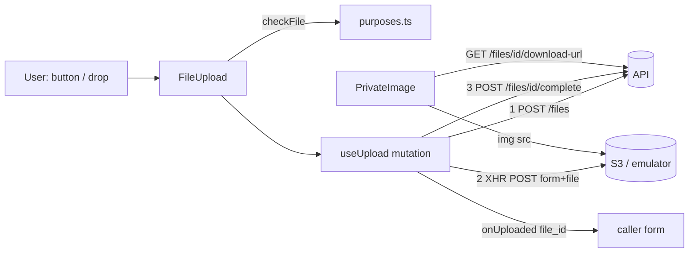

# Explanation — P3-06 Frontend upload component

> **PR:** #81 · **Source revision:** `f79d5ef` (pre-merge), the PR head this explanation was written from and
> checked against. **Reviewed:** yes. The final review round (3, Codex `gpt-6.1-sol`, high, a fresh session)
> reviewed `f79d5ef` and said `MERGE`, with one Medium and one Low finding left unfixed on purpose (§6, §7).
> **Merge commit:** not known when written; after the merge, `gh pr view 81 --json mergeCommit` gives it.
> Built and merged autonomously ([ADR-0014](../adr/0014-autonomous-agent-workflow.md)); no human reviewed it
> before merge. This describes the PR's changes at the source revision. Commits after it (bookkeeping) and
> the squash merge are not described here, and a rebase after it gives the same changes new SHAs.
> This is a snapshot: once merged, write a new explanation for later changes and do not update this one.
> **Reality check:** re-read at `f79d5ef` the PR diff (`git diff origin/main...HEAD`, 7 paths), in full
> `frontend/src/features/files/useUpload.ts`, `FileUpload.tsx`, `PrivateImage.tsx`, `purposes.ts`, the
> `compose.prodlike.yml` patch, the PR body (plan, decisions, three review rounds), and the assertions of every
> test cited. Ran `npx vitest run src/features/files --reporter=verbose`: `Tests 42 passed (42)`; full frontend
> `npm run test` after round 2: `Tests 355 passed`; lint, typecheck, build: exit 0; CI green on `f79d5ef`; the
> stack journeys on `:5173` and `:8080` re-run on `f79d5ef`. `make check DB_PORT=55432` last ran at `e1f5495`
> (exit 0); later commits change only frontend files under `src/features/files` and `compose.prodlike.yml`,
> which CI covered. Differences from the plan: see §2.
> Written by the implementing session after that check ([ADR-0017](../adr/0017-implementer-writes-the-explanation.md)).
> Form: full. Tier: 2. Walkthrough variant: B (UI interaction).

## 1. What was built and why

`src/features/files/` now has the reusable pieces the package (P5) and maintenance (P6) slices need for photos:

- `FileUpload`: choose (button or drop) one file, preview it, upload it to private S3 with progress, cancel and
  retry, and hand the caller a `file_id`.
- `useUpload`: the three-step upload behind it. `POST /files` signs a form, the browser POSTs the file to S3
  over `XMLHttpRequest`, then `POST /files/{id}/complete` verifies it.
- `PrivateImage`: shows a private file through its 60-second download URL. It refreshes the URL before it
  expires and shows a neutral "Image unavailable" box for a file the user may not see.

The server still decides everything that matters for security (who may upload, the type and size, what is
stored, who may download). The client only checks early, so a wrong file fails before any request. One
stack bug surfaced and was fixed: the prod-like stack had no S3 credentials, so presigned uploads there had
always been a 500 (D3).

## 2. Decisions

### D1. The upload runs as one React Query mutation, keyed by building

- **Problem or constraint:** three requests with progress, cancel and retry, plus P3-05's rule that a
  `building_not_found` from any request keyed `['b', id, …]` marks the building denied
  (`frontend/src/app/buildingDenial.ts::recordBuildingDenial`, called from the cache's `onError`).
- **Chosen:** `useMutation` with `mutationKey: ['b', buildingId, 'files', 'upload']`. One `mutationFn` runs
  the three steps from an `Attempt` (the file, the current form, whether S3 has the file) kept in a ref between
  attempts. Progress is component state. Each run has its own `AbortController`, aborted by `cancel()`, unmount
  and a building switch. `onUploaded` is a per-call `mutate` callback.
- **Alternatives rejected:** plain `useState` + `api.post` (the denial would need a hand call to
  `recordBuildingDenial`, which P3-05 moved into the cache); one mutation per step (three statuses to merge,
  and retry would need to know which one failed).
- **Tradeoffs and accepted limitations:** `onUploaded` depends on React Query calling per-call callbacks only
  for the latest `mutate` while the observer is mounted. That rule is what keeps a late result away from an
  unmounted form. The attempt ignores a later change of the `purpose` prop (R3-F1, §7).
- **Basis:** CLAUDE.md rule 12, P3-05 decision D4.
- **Source:** recorded (PR #81 D1).

### D2. What `retry()` reuses

- **Problem or constraint:** the ticket says retry restarts from `create` once the form has expired. Repeating
  steps that already worked wastes mobile data and leaves extra `pending` rows.
- **Chosen:** reuse the form unless its `expires_at` is under 30 s away (`EXPIRY_MARGIN_MS`) or S3 refused it
  (any non-2xx, `StorageError`). Skip the S3 POST if it already succeeded and only `complete` failed, except
  after a 409 `upload_incomplete`, which sends the file again.
- **Alternatives rejected:** always restart from `POST /files` (a new `pending` row per retry, and the whole
  file again); never restart (fails once the 5-minute form expires).
- **Tradeoffs and accepted limitations:** near expiry, a retry gets a new `file_id`. The old row is cleaned up by
  `files.cleanup` (P3-04c).
- **Basis:** ticket Scope; the 30 s margin is autonomous.
- **Source:** recorded (PR #81 D2).

### D3. The prod-like stack gets the S3 emulator's dummy keys

- **Problem or constraint:** the first prod-like run of criterion 1 failed at `POST /files` with a 500. The
  API log showed `AttributeError: 'NoneType' object has no attribute 'access_key'` from botocore while
  presigning. The dev stack gets `AWS_ACCESS_KEY_ID=test` from `backend/.env.dev`; `compose.prodlike.yml`
  inlines its env and never had the keys. The worker shares that env (`api-environment` anchor), so the
  P3-04c purge had no keys there either.
- **Chosen:** `AWS_ACCESS_KEY_ID: test` and `AWS_SECRET_ACCESS_KEY: test` in the shared anchor.
- **Alternatives rejected:** loading `backend/.env.dev` (its `GIT_SHA=local` would hide the image's build
  metadata, which is why the file is inlined).
- **Tradeoffs and accepted limitations:** no CI check presigns on the prod-like stack yet (the smoke script
  doesn't log in); see §7.
- **Basis:** ticket ("check the upload on `make prodlike`").
- **Source:** recorded (PR #81 D3).

### D4. The stack journey mounts the component with a harness

- **Problem or constraint:** criterion 1 needs the real component on both stacks. Every page is still a
  placeholder (P2-06a), so no route renders `FileUpload`.
- **Chosen:** a scratch harness, not committed, renders `FileUpload` and `PrivateImage` under the app's real
  providers. It is bundled with the repo's esbuild and evaluated in the app's own page after a real login, so
  the page's origin, cookies, Caddy CSP and S3 CORS all apply.
- **Alternatives rejected:** a hidden test route (it would ship); replaying the requests with `fetch` (it
  doesn't run the component).
- **Tradeoffs and accepted limitations:** the bundle is built from the branch's source, not from the served
  `dist/`.
- **Basis:** autonomous.
- **Source:** recorded (PR #81 D4).

### D5. `PrivateImage`'s refresh and recovery rules (shaped by review rounds 1 and 2)

- **Problem or constraint:** a URL lives 60 s (`backend/app/files/service.py::download_url`). The image must
  not blink when it is replaced, must not poll forever when nothing can help, and must not keep a broken
  `` on screen.
- **Chosen:**
  - `staleTime` is the refresh time (expiry − 10 s) minus `dataUpdatedAt`.
  - `refetchInterval` is the time from now to the refresh time, at least 1 s, and off after any failed request.
  - Focus refetches except after a 404.
  - The query is disabled once the image is given up on.
  - After an `` error, one new URL is fetched. Until a newer answer arrives, the loading or error state
    replaces the ``. A second image error is final ("Image unavailable").
- **Alternatives rejected:** keeping the failed `` while the new URL loads (round 1 F1: it stayed when the
  new request failed; round 2 F1: a repeated URL never reloaded). A `key` per recovery was added in round 2,
  then removed: probe `R2-F1-no-key` showed it changed nothing, because the pending state already removes the
  element.
- **Tradeoffs and accepted limitations:** after a failed background refresh, no automatic retry follows. The
  loaded image keeps showing until the user focuses the tab, presses Retry or the image errors. An identical
  recovery answer leaves it loading (R3-F2, §7).
- **Basis:** review rounds 1 and 2 (Codex), ticket criteria 4–5.
- **Source:** recorded (PR #81 "Independent review", rounds 1–2).

Smaller decisions:

| Decision | Alternative rejected | Why | Basis | Source |
|---|---|---|---|---|
| Client rules mirrored in `purposes.ts`, typed `Record<FilePurpose, …>` | an endpoint serving the rules | no such endpoint; the server enforces anyway | ticket | PR decisions table |
| `accept`/`maxBytes` props can only narrow the purpose's rule | props replace the rule | a wider client limit just moves the error to the server | autonomous | PR decisions table |
| XHR with `FormData` (a `connect-src` request) | `fetch` | `fetch` reports no upload progress | ticket | PR decisions table |
| HEIC with an empty `file.type` typed from `.heic`; `accept` adds `.heic` | reject it | desktop Chrome/Firefox give HEIC no type | autonomous | PR decisions table |
| Preview only JPEG/PNG/WebP | preview every image | most browsers can't draw HEIC | autonomous | PR decisions table |
| Empty file refused client-side | let the server 422 it | `FileCreate.size_bytes` must be ≥ 1 | server schema | PR decisions table |
| Live region announces quarter steps of progress | every percent | every percent floods a screen reader | review round 2 F3 | PR round 2 |
| No legacy `UploadFile` replaced | replace `NoticeAttachmentUpload.jsx` now | its parent stores a public URL; no notices API yet to attach a private file | ticket Frame notes (loosened, inbox) | ticket Frame notes |
| Tests mock `useBuildingId`, stub `XMLHttpRequest`, no jest-dom | render the shell; add a matcher library | the shell adds unrelated routes; no new dependency | convention (P3-05) | PR decisions table |

**Framing changes:** criteria 1–6 made testable (the exact signals, where each is proved); 3 split into "same
form while valid" and "new form once expired"; 5 adds the image load error; 7 (cancel and unmount), 8 (S3 or
`complete` failure) and 9 (a second file) added. **Loosened:** the Scope item "replace Base44 `UploadFile` in
shared components the demo slices will use" is deferred to the slices, with the reason in the Frame notes. That
reason: no legacy page renders since P2-06a, and `NoticeAttachmentUpload` needs a public URL.

**Plan versus final code:** compared at `f79d5ef`. Two deviations are noted below the PR's Plan:
`compose.prodlike.yml` changed (D3), and the stack run used the harness of D4 instead of the dev server's
module graph. The review rounds changed `PrivateImage` (D5) and `FileUpload`'s live text. Everything else
matches the Plan's files and interfaces.

## 3. How it is implemented

### Overview



### Walkthrough (variant B): a security guard attaches a package photo

1. **The action.** The future package page (P5-03) renders
   `<FileUpload purpose="package_photo" capture="environment" onUploaded={setPhotoId} />`
   (`frontend/src/features/files/FileUpload.tsx::FileUpload`). Tab reaches the "Choose file" `<button>`, and
   Enter clicks the hidden `<input type="file">` (`tabIndex={-1}`). On a phone, `capture="environment"`
   opens the back camera. A dropped file takes the same path.
2. **Client check.** `start(file)` runs `checkFile(file, rule)` (`frontend/src/features/files/purposes.ts::checkFile`)
   against `ruleFor(purpose, accept, maxBytes)`. On failure, the message goes in `role="alert"`, the hook is
   reset and nothing is sent. Otherwise it calls `upload(file)`.
3. **Hook.** `frontend/src/features/files/useUpload.ts::useUpload` stores a new `Attempt`, resets progress and
   calls `mutate` with the building ID and a fresh `AbortSignal`.
4. **API calls.** In the `mutationFn`:
   - `api.post('/api/buildings/{building_id}/files', …)` (`files_create`) declares the purpose, name, type
     (`contentTypeOf`) and size.
   - `postToS3` sends `fields` then `file` to the presigned URL; `xhr.upload.onprogress` drives the bar.
   - `api.post('…/files/{file_id}/complete')` (`files_complete`) answers the `ready` file.
5. **Response handling.** Success calls `onUploaded(file.id)`. A problem response becomes an `ApiError`, and
   `uploadErrorMessage` shows its `detail`. A refused S3 POST shows "The storage service refused the upload
   (HTTP n)", and a dropped connection shows "The connection was lost during the upload." A Retry button
   appears; `retry()` follows D2.
6. **Cache.** Nothing is invalidated: an upload creates no list anything shows. A `building_not_found` marks
   the building denied through the mutation key.
7. **States.**
   - Idle: the drop zone and the rule in words ("JPEG, PNG, WebP or HEIC, up to 10 MB").
   - Uploading: preview, `progressbar`, Cancel, and live text "Uploading parcel.jpg… 50%".
   - Ready: "Uploaded parcel.jpg."
   - Error: an alert and Retry.

   At phone width, the zone wraps (`flex-wrap`).

Showing it later: `<PrivateImage fileId={id} alt="…" />` asks `files_download_url`. It shows a skeleton
(`role="status"`, "Loading image"), then the ``, and swaps `src` in the background before expiry (D5).

### Data model changes

None.

## 4. The code

**Files changed**

| File | Change | Lines (+/−) |
|---|---|---|
| `frontend/src/features/files/useUpload.ts` | `postToS3`, `useUpload`, error messages | +198 |
| `frontend/src/features/files/FileUpload.tsx` | the component | +148 |
| `frontend/src/features/files/PrivateImage.tsx` | the component | +115 |
| `frontend/src/features/files/purposes.ts` | client mirror of the server rules | +82 |
| `frontend/src/features/files/files.test.tsx` | 42 tests | +779 |
| `compose.prodlike.yml` | S3 emulator keys (D3) | +4 |
| `docs/tickets/P3-06-frontend-upload-component.md` | framing | +71 / −13 |

`frontend/src/features/files/useUpload.ts::postToS3`

```ts
export function postToS3(
  upload: PresignedUpload,
  file: File,
  { signal, onProgress }: { signal: AbortSignal; onProgress: (fraction: number) => void },
): Promise<void> {
  return new Promise((resolve, reject) => {
    const aborted = () => (signal.reason instanceof Error ? signal.reason : new DOMException('Aborted', 'AbortError'));
    if (signal.aborted) {
      reject(aborted());
      return;
    }
    const xhr = new XMLHttpRequest();
    const abort = () => xhr.abort();
    const settle = (error?: Error) => {
      signal.removeEventListener('abort', abort);
      if (error) reject(error);
      else resolve();
    };
    xhr.open('POST', upload.url);
    xhr.upload.onprogress = (event) => {
      if (event.lengthComputable) onProgress(event.loaded / event.total);
    };
    xhr.onload = () => settle(xhr.status >= 200 && xhr.status < 300 ? undefined : new StorageError(xhr.status));
    xhr.onerror = () => settle(new UploadNetworkError());
    xhr.onabort = () => settle(aborted());
    signal.addEventListener('abort', abort, { once: true });
    const form = new FormData();
    for (const [name, value] of Object.entries(upload.fields)) form.append(name, value);
    form.append('file', file);
    xhr.send(form);
  });
}
```

- **What it does:** wraps one S3 form POST in a promise that reports progress and honours an `AbortSignal`.
- **Why:** `fetch` has no upload progress; XHR to the S3 origin is `connect-src`, which the CSP allows
  (`deploy/Caddyfile`), unlike a `<form action>` (`form-action 'self'`).
- **What breaks without a key line:**
  - Without the `signal.aborted` check, a cancel during `POST /files` still sends the file ("cancel while POST
    /files is in flight sends no XHR").
  - Without `form.append('file', file)` last, S3 rejects the POST (its rule: the file is the last field).

`frontend/src/features/files/useUpload.ts::useUpload` (the steps and their retry state)

```ts
    mutationKey: ['b', buildingId, 'files', 'upload'],
    mutationFn: async ({ attempt: current, buildingId: building, signal }: Run) => {
      const expired = (created: FileUploadOut) => Date.parse(created.expires_at) - Date.now() < EXPIRY_MARGIN_MS;
      if (current.created === null || expired(current.created)) {
        current.created = await api.post('/api/buildings/{building_id}/files', {
          // ...
        });
        current.sent = false;
      }
      const { file_id: fileId, upload } = current.created;
      if (!current.sent) {
        setProgress(0);
        try {
          await postToS3(upload, current.file, { signal, onProgress: setProgress });
        } catch (error) {
          // A refused form won't work next time either.
          if (error instanceof StorageError) current.created = null;
          throw error;
        }
        current.sent = true;
      }
      try {
        return await api.post('/api/buildings/{building_id}/files/{file_id}/complete', {
          params: { path: { building_id: building, file_id: fileId } },
          signal,
        });
      } catch (error) {
        // `upload_incomplete`: S3 has nothing for this form, so send the file again.
        if (error instanceof ApiError && error.status === 409) current.sent = false;
        throw error;
      }
    },
```

- **What it does:** each attempt skips the steps whose result is still valid (D2).
- **Why:** the ticket's retry rule, without re-sending 10 MiB needlessly.
- **What breaks without a key line:**
  - Without `current.created = null` on `StorageError`, retry re-sends a refused form (probe M3).
  - Without `current.sent = false` on 409, retry calls only `complete` forever (probe M7).
  - Without the `expired` check, retry after 5 minutes always fails (probe M2).

`frontend/src/features/files/useUpload.ts::useUpload` (start, cancel, cleanup)

```ts
  const start = useCallback(() => {
    if (attempt.current === null) return;
    controller.current?.abort();
    controller.current = new AbortController();
    mutate(
      { attempt: attempt.current, buildingId, signal: controller.current.signal },
      // Per-call callbacks run only for the latest call while this component is mounted.
      { onSuccess: (file) => onUploadedRef.current?.(file.id) },
    );
  }, [buildingId, mutate]);
  // ...
  const cancel = useCallback(() => {
    controller.current?.abort();
    controller.current = null;
    attempt.current = null;
    setProgress(0);
    reset();
  }, [reset]);

  // On unmount and on a building switch: a file of the old building must not reach a form of the new one.
  useEffect(() => cancel, [buildingId, cancel]);
```

- **What it does:** one live request at a time; cancel, unmount and a building switch abort it and reset
  the state.
- **Why:** a `file_id` from building A reaching a building-B form would fail its claim (404), and a late
  `onUploaded` on an unmounted form is a stale write.
- **What breaks without the effect:** "unmounting aborts the XHR and never completes" and "a building switch
  aborts the upload started in the old building" fail (probe M1).

`frontend/src/features/files/PrivateImage.tsx::PrivateImageFor` (query options and recovery)

```tsx
    enabled: !broken,
    staleTime: (query) => {
      const at = refreshAt(query);
      return at === null ? 0 : Math.max(0, at - query.state.dataUpdatedAt);
    },
    refetchInterval: (query) => {
      const at = refreshAt(query);
      return at === null || query.state.status === 'error' ? false : Math.max(1_000, at - Date.now());
    },
    refetchOnWindowFocus: (query) => !isNotFound(query.state.error),
  });

  // How many successful answers the query has had; the hook's result doesn't expose it.
  const answers = queryClient.getQueryState(queryKey)?.dataUpdateCount ?? 0;
  // ...
  if (isNotFound(query.error) || broken) return <div className={box}>Image unavailable</div>;
  // ...
  const waiting = failedAnswer !== null && answers <= failedAnswer;
  if (query.data && !waiting) {
    return (
       setFailedAnswer(null)}
        onError={() => {
          if (failedAnswer !== null) {
            setBroken(true);
            return;
          }
          setFailedAnswer(answers);
          void query.refetch();
        }}
      />
    );
  }
```

- **What it does:** keeps a working URL without polling needlessly, and never leaves a known-broken
  `` (D5).
- **Why:** each line is a review finding:
  - `staleTime` measured from `dataUpdatedAt`: round 1 F4.
  - No interval after an error: round 1 F2, round 2 F2a.
  - `enabled: !broken`: round 2 F2b.
  - `waiting`: round 1 F1, round 2 F1.
- **What breaks without a key line:** see the probes in §6. Without `waiting`, three tests fail, including "a
  recovery answer with the same URL loads the image again in a new element". `dataUpdateCount` rather than
  `dataUpdatedAt`, because two answers can share a millisecond.

`compose.prodlike.yml::AWS_ACCESS_KEY_ID`

```yaml
      # The emulator's dummy keys (as in backend/.env.dev). Without them boto3 finds no credentials and every
      # presigned upload is a 500 (found in P3-06).
      AWS_ACCESS_KEY_ID: test
      AWS_SECRET_ACCESS_KEY: test
```

- **What it does:** gives the prod-like api and worker credentials for the local emulator (D3).
- **What breaks without it:** `POST /files` is a 500 on `make prodlike` (seen in the first prod-like run).

## 5. Edge cases and tests

All tests are in `frontend/src/features/files/files.test.tsx`, run at `f79d5ef` (`42 passed`).

| What could go wrong | What the code does | Test that proves it |
|---|---|---|
| 15 MiB image, or a PDF as a photo | alert, no request | "refuses a 15 MiB image before any request", "refuses a type the purpose does not accept before any request" |
| a caller widens `maxBytes` | the purpose's limit still applies | "a narrower maxBytes prop applies, a wider one does not" |
| HEIC with no browser type | typed from `.heic` | "a HEIC file with no browser type is recognised by its extension" |
| client check bypassed | server `detail` shown | "shows the server's detail when the server refuses the file" |
| connection drops mid-upload | error, retry with the same `file_id` | "retries with the same file while the form is valid" |
| form expired / refused by S3 | retry starts from `POST /files` | "starts again from POST /files once the form has expired", "…when S3 refused the form" |
| `complete` fails (503 / 409 / 422) | error; retry only `complete` / re-sends / detail shown | "retries only complete when S3 already has the file", "a 409 from complete is retried with a new S3 POST, not only complete", "a 422 from complete is an error with the server detail and no onUploaded" |
| cancel, unmount, building switch | aborted, no `complete`, no `onUploaded` | the four tests under "criterion 7" |
| a second file while one uploads | chooser disabled, drop ignored | "replaces the previous error and preview, and the chooser is disabled while uploading", "a dropped file is ignored while an upload runs" |
| a second file after a finished one | progress starts at 0 | "a second file starts its progress at 0, while its POST /files is still in flight (review round 1, F3)" |
| a 404 file (no access, other building) | "Image unavailable", no ``, no polling, no focus refetch | "shows a neutral unavailable state and no image for a 404", "a cached image whose refresh answers 404 shows unavailable and stops polling (review round 1, F2)", "after a 404, returning to the tab does not ask again" |
| `building_not_found` | marks the building denied | "a building_not_found marks the building denied (key ['b', id, 'files', …])", "a building_not_found from POST /files marks the building denied" |
| URL near expiry | refreshed silently; fresh URLs kept on remount | "renders the presigned URL with its alt text, then swaps it before expiry without the skeleton", "asks again on remount once the cached URL is near its expiry", "a cached URL with time left stays fresh on remount (review round 1, F4)" |
| image load error | one new URL (even the same one), then unavailable | "fetches one new URL after an image load error, then gives up", "a recovery answer with the same URL loads the image again in a new element (review round 2, F1)" |
| new URL request fails after an image error | error state with Retry, not the broken image | "an image error whose new URL request fails shows the error state, not the broken image (review round 1, F1)", "after F1, Retry fetches a new URL and shows the image again" |
| background refresh fails (5xx) | no polling every second; a later success resumes | "a failed background refresh does not ask again every second (review round 2, F2)", "after a failed background refresh, a later successful answer (focus) starts the refreshes again" |
| image given up on | nothing more fetched | "after giving up on a broken image it fetches nothing more (review round 2, F2)" |
| `purpose` prop changes between failure and retry | **reuses the old form** | No test (R3-F1, accepted; §7) |
| identical recovery answer (same URL and expiry) | **stays on "Loading image"** | No test (R3-F2, accepted; §7) |

**Acceptance criteria → tests**

| # | Tests or evidence |
|---|---|
| 1 | "posts the form fields then the file to S3, shows progress, completes and reports the file id"; stack transcripts on `:5173` and `:8080` (2.04 MiB, `aria-valuenow` 0 → … → 100, one `onUploaded`) |
| 2 | the criterion 2 tests; transcripts: 0 requests for 15 MiB, bypass → `422 file_too_large` |
| 3 | the criterion 3 tests; transcripts: dropped S3 POST → Retry → one create, two S3 POSTs, one complete |
| 4 | the criterion 4 tests; transcripts: `naturalWidth: 1560` from the emulator |
| 5 | the criterion 5 tests; transcripts: unknown id → "Image unavailable", 0 `` |
| 6 | "the chooser is a button that opens the file picker; status is announced politely", "announces upload progress in quarter steps (review round 2, F3)", "passes accept and capture to the input"; transcripts: Tab → `<button> "Choose file"`, Enter → chooser |
| 7–9 | the criterion 7, 8 and 9 tests |

The PR records 11 mutation probes before review (each failed the named tests) and 10 after the review fixes:
9 failed the named tests, and one (`R2-F1-no-key`) passed, which showed that line was redundant, so it was
removed in `f79d5ef`.

## 6. Review log

| Round | Reviewer | Commit reviewed | Verdict | Findings | Outcome |
|---|---|---|---|---|---|
| 1 | Codex `gpt-6.1-sol`, high | `b33a471` | MERGE | F1 Medium: broken img kept when the new URL request fails; F2 Medium: polling every second after a 404 refresh; F3 Low: old 100% shown during the next create; F4 Low: `staleTime` counted elapsed time twice; gap: no 422-from-`complete` test | all fixed in `c5761c6` (tests `2152978`); 422 test added |
| 2 | Codex `gpt-6.1-sol`, high (new session) | `c5761c6` | MERGE | R2-F1 Medium: same recovery URL never reloads; R2-F2 Medium: polling after an exhausted 5xx refresh and after giving up; R2-F3 Low: no percentage in the live region | fixed in `bc635c2` (tests `489820a`), simplified in `f79d5ef` |
| 3 | Codex `gpt-6.1-sol`, high (new session) | `f79d5ef` | MERGE | R3-F1 Medium: `purpose` change before Retry reuses the old form; R3-F2 Low: identical recovery answer stays loading | accepted, not fixed (last round; §7) |

All rounds used Codex only, with no Claude reviewer (run-specific instruction from James).

The failures behind the fixes:

- **Round 1**
  - **F1:** an image error, then three 503s for the new URL. The broken `` stayed, with no retry control.
  - **F2:** a refresh answered 404. "Image unavailable" was shown, but the request count rose from 2 to 7
    in 5 s.
  - **F3:** a second file showed `aria-valuenow="100"` while its `POST /files` was pending.
  - **F4:** a URL with 30 s left was fetched again on remount.
- **Round 2**
  - **R2-F1:** the recovery returned the same URL; Codex's Chromium proof saw two URL requests, one image GET
    and a broken image.
  - **R2-F2:** 19 requests instead of 4 within 5 s after an exhausted 503 refresh.
  - **R2-F3:** the live text stayed "Uploading parcel.jpg…" at 50%.

Each proof was ported into `files.test.tsx` and failed before its fix: round 1 `4 failed | 30 passed`, round 2
`4 failed | 37 passed`. The fixes produced D5 and the quarter-step announcement.

## 7. Not verified, accepted risks and follow-ups

- **R3-F1 (Medium, accepted):** `useUpload` keeps the failed attempt's form when `purpose` changes, so a retry
  uploads with the old purpose. No caller changes `purpose` on a mounted `FileUpload`. Tracked: PR follow-ups;
  a carry note to `docs/tickets/P5-03-security-packages-page.md` and an inbox line, both to be added in the
  bookkeeping commit.
- **R3-F2 (Low, accepted):** an identical recovery answer leaves `PrivateImage` on "Loading image". The server
  computes `expires_at` from `clock.now()` per request (`backend/app/core/clock.py::now`), so this needs two
  answers in the same microsecond. Tracked: PR follow-ups and here.
- **Legacy `UploadFile` stays** in `NoticeAttachmentUpload.jsx`, `ParkingProofRequestSection.jsx` and the legacy
  pages; the Base44 baseline is unchanged (327). The P6 notices carry note will be added to
  `docs/tickets/P6-P7-backlog.md` in the bookkeeping commit.
- **No CI check presigns on the prod-like stack** (D3): `scripts/smoke.sh` doesn't log in. To be tracked in the
  inbox (bookkeeping commit); candidate home P4-09.
- **Not verified:**
  - Real XHR progress events are seen only in the stack transcripts (jsdom simulates them).
  - A real phone against real S3 is D-06.
  - No real screen reader was used; roles and `aria-live` text are asserted.
- **Messages:** `uploadErrorMessage` shows `detail` for any `ApiError`. A 422 with only `errors[]` shows "The
  upload failed. Try again." Tracked only here.
- **Not mounted anywhere yet:** no route renders these components until P5-03.

## 8. How to change this safely

- **A new purpose** on the server (`backend/app/files/purposes.py::PURPOSES`) regenerates `FilePurpose`, and
  `npm run typecheck` then fails at `frontend/src/features/files/purposes.ts::PURPOSE_RULES` until you add its
  rule. Keep the two in step; the criterion 2 tests show how the check behaves.
- **Using `FileUpload` in a slice:** pass a fixed `purpose`. If a form can switch purpose, render
  `<FileUpload key={purpose} …/>` until R3-F1 is fixed. Send the `file_id` to the record's endpoint, which
  claims it (`claim_file`, P3-04b).
- **Changing `PrivateImage`'s timing:** the criterion 4 and 5 tests use fake timers with a 60 s URL and
  will tell you if refresh, staleness or polling change.
- **Touching `postToS3`:** keep the file as the last form field, and keep the abort wiring; the criterion 7 tests
  cover it.

## 9. Must explain, then quiz

**1. Why does the browser talk to S3 directly, and what does the server still control?** The file never passes
through the API, so the API's workers and bandwidth don't carry 10 MiB uploads (ADR-0007). The server still
controls almost everything:

- **Who may upload which purpose, and the limits.** `create_file` checks roles, type and size, and signs a
  policy for exactly that size and type.
- **Where the file goes.** It picks the key; the client never names one (CLAUDE.md rule 9).
- **That the stored object matches.** `complete_file` checks size, type and the magic number of the stored
  version, and pins that version.
- **Who may download.** `download_url` authorizes, and its URL lasts 60 s.

`useUpload` only carries the form from `files_create` to S3 (`frontend/src/features/files/useUpload.ts::postToS3`).

**2. Why use XHR instead of `fetch` here?** `fetch` exposes no upload progress events; `XMLHttpRequest` has
`xhr.upload.onprogress`, which drives the `progressbar` (`postToS3`). Both are `connect-src` under the CSP. A
native `<form action="https://bucket…">` would be blocked by `form-action 'self'`.

**3. Why do client-side size checks not replace server enforcement?** Anyone can edit the page or call the API
directly; the transcript's bypass got `422 file_too_large` from the server. Two server checks still hold:
the signed policy makes S3 refuse a different size (`make s3-smoke`: "2 KiB upload rejected by a 1 KiB
policy"), and `complete` re-checks the stored object. The client
check (`frontend/src/features/files/purposes.ts::checkFile`) only saves a round trip and gives a clearer message.

Quiz:

1. A guard's upload fails at 60% because the Wi-Fi drops, and they press Retry two minutes later. Which requests
   are sent, and would the answer change after six minutes?
2. Why does `PrivateImage` read `dataUpdateCount` from the query cache instead of comparing `dataUpdatedAt`?
3. What would break if `useEffect(() => cancel, [buildingId, cancel])` were removed?
4. What would break if `postToS3` appended `file` before the policy `fields`?
5. How would you extend `FileUpload` to accept up to three photos for a maintenance request (multi-file is out
   of scope here)?

<details><summary>Answers</summary>

1. After two minutes the form is still valid (5 minutes, with a 30 s margin): only the S3 POST, then
   `complete`, with the same `file_id`. After six minutes `expired()` is true, so `POST /files` makes a new
   file, then the S3 POST and `complete`; `onUploaded` gets the new id. ("starts again from POST /files once the
   form has expired".)
2. Two successful answers can arrive within the same millisecond, so equal timestamps would hide a newer
   answer. The count always grows. The hook's result doesn't expose it, hence the cache read.
3. An upload would keep running after unmount or a building switch. A late success could still finish
   `complete` in the old building, though `onUploaded` would not reach an unmounted form. After a building
   switch, a mounted form could receive a `file_id` from the other building, which its claim would reject. The
   two tests under "criterion 7" fail (probe M1).
4. Inferred (not run against S3 here): S3 doesn't read form fields that come after the file, so the policy and
   signature would be missing and the POST refused. The test "posts the form fields then the file to S3…"
   asserts the order.
5. Keep `useUpload` per file. Render one hook instance per slot (a small child component per photo), collect the
   `file_id`s, disable adding a fourth, and keep each slot's cancel and retry separate. The server needs the
   record's endpoint to claim several files; `claim_file` already works per file.

</details>
