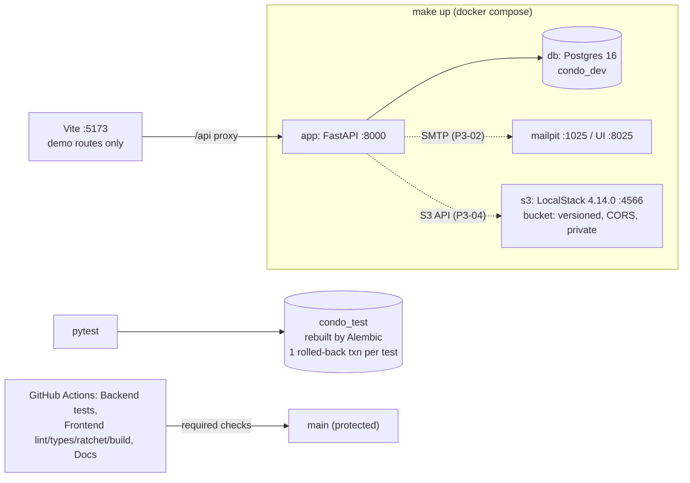

# Milestone Recap — P0 Reset and guardrails

Date: 2026-10-15 · Tickets: P0-01, P0-02, P0-03a, P0-03b, P0-03c, P0-04a, P0-04b, P0-05 · Drafted by the
agent at the phase gate ([playbook](../AI_AGENT_PLAYBOOK.md#phase-gates-automated)); sections 7–9 are
James's, optional.

## 0. Gate result

**Green.** P1 may start.

| Exit-gate item ([roadmap](../ROADMAP.md)) | Result | Evidence |
|---|---|---|
| CI fails on ruff | pass | Probe PR #12 (an unused import): run 38770064866, `Backend tests` failed at **Ruff lint** |
| CI fails on mypy | pass | Probe PR #13 (`def f() -> int: return "x"`): run 38771234841, failed at **Mypy** |
| CI fails on eslint | pass | Probe PR #15 (a conditional `useState` in `src/features/`): run 38771249446, failed at **Lint** |
| CI fails on tsc | pass | Probe PR #16 (`const n: number = "x"`): run 38771254659, failed at **Type check** |
| CI fails on pytest (against Postgres) | pass | Probe PR #14 (`assert 1 == 2`): run 38771242888, failed at **Run backend tests**. CI runs the suite against a `postgres:16` service (40 tests, including the transaction-isolation tests) |
| CI fails on `alembic check` | pass | P0-05 demo commit 87591ec (a model without a migration): run 38668824330, failed at **Alembic check (model/migration drift)**. Two heads (8ba17de): run 38668945831 failed at **Single migration head** |
| `make up` starts api, db, mailpit and the S3 emulator | pass | On `main` 7b0c81e: `make up DB_PORT=55432` → `app`, `db`, `mailpit`, `s3` all `running healthy`; Mailpit UI 200; `make migrate`; `make s3-smoke` → `all S3 emulator checks passed`; `make check` exit 0 (`40 passed`, `No new upgrade operations detected.`) |
| The old docs are archived | pass | `docs/archive/2026-10-legacy/` (7 files, with its README), done in P0-01 |
| _(P0-04b carry-overs)_ PR template and Dependabot work from `main` | pass | GitHub's community profile lists `.github/pull_request_template.md`; the "Dependabot Updates" runs succeed and opened PRs #17–#33 (see §5) |

All probe PRs (#12–#16) were closed and their branches deleted. A red required check also blocks merging:
`gh pr merge 12` was refused with "the base branch policy prohibits the merge" (P0-04b AC4).

## 1. What now works (demo script)

P0 has no user-facing journey; the demo shows the guardrails.

1. `git clone … && cd Condo-app-revised && make help`: lists the targets.
2. `make up` (add `DB_PORT=55432` if something else holds 5432), then `make migrate`. `docker compose ps`
   shows four healthy services, and http://localhost:8025 is Mailpit.
3. `make s3-smoke`: the S3 emulator rejects a 2 KiB upload against a 1 KiB presigned POST policy, rejects a
   wrong Content-Type, versions objects, and allows CORS only from the app origin.
4. `make check`: ruff, the format check, eslint, the Base44 fence self-test, mypy, tsc, 40 pytest tests
   against `condo_test`, `alembic check`, the Base44 ratchet and the Vite build.
5. `cd frontend && npm run dev`: the demo routes only, with `/api` proxied to `:8000`.
6. Try `git push origin HEAD:main`: rejected, because changes must go through a PR whose three CI jobs are
   green.

## 2. Architecture delta

Explanations: [P0-02](../explanations/P0-02-backend-quality-gates.md),
[P0-03a](../explanations/P0-03a-frontend-lint-and-type-gates.md),
[P0-03b](../explanations/P0-03b-same-origin-proxy-and-route-scope.md),
[P0-03c](../explanations/P0-03c-frontend-whitespace-and-pre-commit.md),
[P0-04a](../explanations/P0-04a-local-stack-and-makefile.md),
[P0-04b](../explanations/P0-04b-github-workflow.md),
[P0-05](../explanations/P0-05-database-test-infrastructure.md). P0-01 (docs adoption) has none.

## 3. Decisions made this phase

ADRs: [ADR-0014](../adr/0014-autonomous-agent-workflow.md) (autonomous agents) and
[ADR-0015](../adr/0015-typescript-eslint-for-new-code.md) (typescript-eslint and the Base44 fence), plus the
"Local emulator" section of [ADR-0007](../adr/0007-private-s3-presigned-uploads.md). The rest are in the
inbox's [Decisions to audit](../HUMAN_INBOX.md#decisions-to-audit). Later tickets lean hardest on these:

- **Test convention (P0-05):** each request gets its own session on the test's connection. Every endpoint
  test from P1 on uses it, so it gets harder to change after P1-05.
- **Branch protection enforced for admins (P0-04b):** no agent can push to `main` or merge a red PR.
- **LocalStack 4.14.0, pinned (P0-04a):** P3-04's uploads are built and tested against it.
- **Demo route allowlist (P0-03b):** `DEMO_PAGES`. Every later slice "restores" a page by adding it there.
- **Host-side migrations behind `db-guard` (P0-04a):** every `make` target that touches a database
  depends on the guard.

## 4. Agent performance

- **Review rounds per ticket:** P0-02 2, P0-03a 3, P0-03b 3 (Codex in rounds 1 and 3), P0-03c 1,
  P0-04a 2, P0-04b 1, P0-05 4 (median 2, max 4). Three tickets needed a round 3.
- **Blocked:** P0-05, once (stop rule 4: a High open after round 3). James answered B-1 with option A, and
  round 4 merged.
- **Findings:** [AGENT_MISTAKES_LOG.md](../AGENT_MISTAKES_LOG.md) has 20 P0 entries, of which 1 High
  (P0-05 round 3) and most others Medium. A recurring theme is that a fix covered only the reported case.
- **Rules added:** that theme became the `CLAUDE.md` lesson "test the fix on its neighbours" (P0-03b), and
  "don't claim an effect before running it" was added in P0-05. A third pattern, a gate or health signal that passes vacuously, appeared four times and is promoted
  to a `CLAUDE.md` lesson in this recap's PR (P0-03a's crashed fence,
  P0-03b's vacuous route check, P0-04a's LocalStack "completed" on ERROR, P0-05's first ORM regression test).
- **Strongest:** gates proven red before being trusted (the probe PRs, mutation checks on the test
  fixture), and measuring instead of guessing (the S3 emulator comparison).
- **Weakest:** first versions of fixes that covered only the reported case, and PR text drifting from the
  code (explainers caught stale counts, SHAs and plan lines three times).

## 5. Open risks and debt

| Risk / debt | Impact | Plan |
|---|---|---|
| **Dependabot opened 17 PRs at once (#17–#33).** They include majors that conflict with the pins: Python 3.14 (the project pins 3.12), Postgres 18 (CI tests 16), Tailwind 4, framer-motion 14, SQLAlchemy 2.1 | Noise. Merging the wrong one breaks the stack or puts CI and dev on different Postgres versions | James (inbox): close or keep them. Recommended config change: ignore semver-major for `python`/`postgres`, and group minor/patch updates |
| A stray `pgserver` Postgres from an earlier session holds 127.0.0.1:5432 on James's machine | Every local run needs `DB_PORT=55432` | James: PRE-5 (`pkill -f pgserver/pginstall`) |
| Parallel worktrees share `condo_test` (P0-05 round 1 L2) | Two agents testing at once drop each other's schema | Per-worktree `TEST_DATABASE_URL` or an advisory lock, before the two lanes run in parallel |
| No test fails if the conftest stops calling the test-DB guard (P0-05) | A refactor could silently allow dropping a non-test DB | Fitness test, P1-05 |
| The app's own engine still points at `DATABASE_URL` during tests (P0-05 round 1 L1) | Code using `AsyncSessionLocal()` directly in a test would hit `condo_dev` | Revisit in P1-05 |
| The S3 init script doesn't receive `S3_BUCKET_NAME`; the smoke script treats any 4xx as "rejected"; the public access block isn't asserted (P0-04a) | An override, or a wrong-reason rejection, would pass unnoticed | P3-04 |
| Mailpit and S3 host ports have no override or guard (P0-04a review L2) | A port clash makes `make up` fail (loudly) | Follow-up |
| The single-migration-head check runs only in CI, not in `make check` | Local `make check` passes with two heads | Small follow-up |
| Required checks must be updated whenever a CI job is renamed or added (P1-08 `prodlike`, P4-09 `e2e`) | A renamed job blocks every PR; a new job doesn't block until added | Playbook note added (P0-04b); P1-08 and P4-09 must do it |
| `CLAUDE.md` still says `make up` starts a worker (P3-01) | Misleading until P3-01 | Fixed by P3-01 |
| PRE-6: old `develop`/`staging`/`starting*` branches in the archived repo; "Automatically delete head branches" is off | Cosmetic / manual cleanup | James, optional |

## 6. Suggested reading order

The three that matter most come first:

1. [P0-05](../explanations/P0-05-database-test-infrastructure.md): how every backend test isolates its data.
   Every later test depends on it.
2. [P0-04b](../explanations/P0-04b-github-workflow.md): what now stops a bad change from reaching `main`.
3. [P0-04a](../explanations/P0-04a-local-stack-and-makefile.md): the local stack and why LocalStack.

Then [P0-02](../explanations/P0-02-backend-quality-gates.md),
[P0-03a](../explanations/P0-03a-frontend-lint-and-type-gates.md),
[P0-03b](../explanations/P0-03b-same-origin-proxy-and-route-scope.md) and
[P0-03c](../explanations/P0-03c-frontend-whitespace-and-pre-commit.md).

**"Must explain" questions no explanation answers directly.** The split dropped P0-04's questions 1 and 2
from P0-04b's ticket:

- Why is a long-lived `develop` branch harmful for a team (or a set of agents) that releases from `main`?
- What do required status checks enforce, and why are they the hard gate when no human approves PRs?

The P0-04b explanation touches both, but not as answers.

## 7. What I learned (James, own words, optional)

_Prompt: which gate surprised you most when you saw it fail, and why?_

## 8. Interview story (STAR, James, optional)

_Prompt: P0-05's block. An agent stopped itself on an open High after three review rounds, you chose
option A, and round 4 merged with mutation evidence._

- Situation:
- Task:
- Action (what *I* decided, including the trade-offs, and how I directed the agents):
- Result (numbers if possible):

## 9. Three interview questions (agent proposes; James answers in their own words)

1. Q: How do you make every test run against a real Postgres yet start each test from a clean database,
   even when the code under test calls `commit()`? A:
2. Q: With no human approving pull requests, what stops a broken change from reaching `main`? A:
3. Q: You needed a local S3 for presigned uploads. How did you choose an emulator, and what did moto get
   wrong? A:
