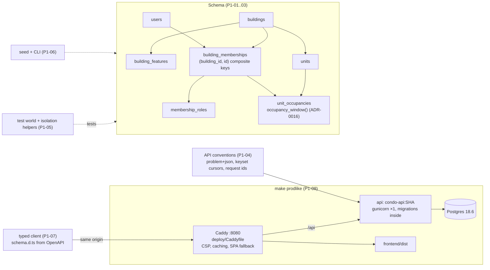

# Milestone Recap — P1 Data foundation and local walking skeleton

Date: 2026-10-16 · Tickets: P1-01, P1-02, P1-03, P1-04, P1-05, P1-06, P1-07, P1-08 · Drafted by the agent
at the phase gate ([playbook](../AI_AGENT_PLAYBOOK.md#phase-gates-automated)); sections 7–9 are James's,
optional.

## 0. Gate result

**Green.** P2 may start. Every item was run on `main` at `5d99cdd` (the P1-08 merge).

| Exit-gate item ([roadmap](../ROADMAP.md)) | Result | Evidence |
|---|---|---|
| Migrations run from empty to head | pass | Prod-like stack on a deleted volume: `make prodlike` ran `alembic upgrade head` **from the image** and applied `989e5bd83064` → `891dd631e5a1` (P1-01) → `2b2e5bcaf6b4` (P1-02) → `8887ac143e98` (P1-03). CI run 38971232665 on `main`: the same four revisions in **Apply migrations**, then `388 passed` |
| Constraint tests prove cross-building references are rejected by the database | pass | 10 tests passed at `5d99cdd` against Postgres 18. One is `test_composite_fk_to_units_rejects_a_unit_from_another_building` (units). Nine are selected by `-k "another_building and rejected"`: memberships/roles ×3, occupancies ×5 and `test_start_occupancy_of_another_buildings_unit_is_rejected`. Nine name the violated FK with `pytest.raises(IntegrityError, match="fk_…_building_id_…")`; the units test creates a probe table with a composite FK and matches on the probe table's name |
| `make seed` creates a realistic building | pass | The seed ran on the disposable prod-like stack via `python -m app.cli seed`, which is what `make seed` runs. It printed `seeded (APP_ENV=dev)`, twice, so it is idempotent. Row counts: 2 buildings (maple 40 units, birch 8), 12 users, 12 memberships, 12 roles, 7 occupancies, 4 features, which matches the README's table. It was not run on the dev database, because `seed` puts back seeded values James may have changed |
| `make prodlike` serves the built SPA through Caddy, and `/api/version` returns the current SHA | pass | `make prodlike-smoke` at `5d99cdd`: `ok /api/version reports git_sha 5d99cdd96246…`, all 33 smoke checks and 10 wiring checks passed (the P1-08 explanation, PR #54 and its handoff say 11; the script has 10 `check` calls, and CI run 38971232665 printed 10 `ok` lines) |
| CI's required `prodlike` job builds the image and runs the same smoke test on every PR | pass | `main`'s required checks are now `Backend tests`, `Frontend lint, types, ratchet and build`, `Docs links and explanation references` and `Prod-like stack smoke` (`strict: true`). The job ran green on PR #54 and on `main` (run 38971232665). It went red on the two probe commits of PR #54 (no migrations `COPY`: run 38967396917; broken Caddyfile: run 38967662510) |

**Tickets merged**

| Ticket | PR | Merge commit | Explanation |
|---|---|---|---|
| P1-01 | #43 | `fd276ec` | [P1-01](../explanations/P1-01-buildings-features-units-schema.md) |
| P1-02 | #44, #48 (expanded explanation) | `684514c`, `caf22ca` | [P1-02](../explanations/P1-02-users-memberships-roles-schema.md) |
| P1-03 | #45 (blocked once: #47) | `d033334` | [P1-03](../explanations/P1-03-unit-occupancies-schema.md) |
| P1-04 | #49 | `0ddca1c` | [P1-04](../explanations/P1-04-api-conventions.md) |
| P1-05 | #50 | `6953d1a` | [P1-05](../explanations/P1-05-test-world-and-isolation-helpers.md) |
| P1-06 | #51 | `60e966d` | [P1-06](../explanations/P1-06-seed-and-cli.md) |
| P1-07 | #52 | `84afaff` | [P1-07](../explanations/P1-07-openapi-types-and-api-client.md) |
| P1-08 | #54 | `5d99cdd` | [P1-08](../explanations/P1-08-production-like-local-stack.md) |

## 1. What now works (demo script)

There is still no login (P2), so the demo shows the data foundation and the built artifacts.

1. `make down` (if the dev stack runs), then `make prodlike`. This builds `condo-api:<sha>` and the SPA, migrates an empty database from the image, and starts everything behind Caddy.
2. Open http://localhost:8080/. The built SPA appears (the legacy account-type screen). http://localhost:8080/packages is a deep link and serves the same page.
3. `curl -s localhost:8080/api/version` returns `git_sha` equal to `git rev-parse HEAD`. `curl -sI localhost:8080/` shows the CSP with `frame-ancestors 'none'`, `nosniff`, `Referrer-Policy`, `Permissions-Policy` and HSTS.
4. `curl -s localhost:8080/api/nope` returns a problem+json 404 with a `request_id` (P1-04).
5. `make prodlike-smoke` runs 33 outside checks and 10 inside checks: no host ports on `api`/`db`, one gunicorn worker, and forwarded headers trusted from Caddy only.
6. `API_IMAGE_TAG=$(git rev-parse HEAD) docker compose -f compose.prodlike.yml exec api python -m app.cli seed` loads Maple Tower (40 units, 10 memberships including a pending one) and Birch Court. Then `… exec db psql -U postgres -d condo` and `select slug, count(*) from units join buildings b on b.id = building_id group by 1;`.
7. `make down` → `make up DB_PORT=55432`, then `make check DB_PORT=55432`. That runs 388 backend tests, including the constraint tests that reject a unit, membership or occupancy from another building.
8. `make prodlike-down` to stop it.

## 2. Architecture delta

Read the explanations linked in §0 for each part.

## 3. Decisions made this phase

ADRs:
- [ADR-0016](../adr/0016-occupancy-windows-and-writes.md): occupancy windows and writes (P1-03; the window function was James's choice in B-2).
- [ADR-0017](../adr/0017-implementer-writes-the-explanation.md): the implementer writes the explanation. This is a process change made between tickets (#53).

The phase added 31 rows to the inbox's [Decisions to audit](../HUMAN_INBOX.md#decisions-to-audit). Later tickets lean hardest on these, so they get harder to overturn:

- **Composite keys `(building_id, id)` and composite FKs (P1-01/02/03, ADR-0005).** Every tenant table from P3 on references units and memberships this way.
- **Half-open occupancy windows and the `occupancy_window()` function (P1-03, ADR-0016).** Every `visible_*` helper from P5 on uses it.
- **Problem+json with stable `code`s, and keyset cursors as a base64url uuid7 (P1-04).** The typed client (P1-07) and every list endpoint depend on them.
- **`User.email` lower-cased by the model, with a `lower(email)` unique index (P1-02).** P2-01's login lookup must use `func.lower`.
- **Test world personas and `assert_integrity_error(…, constraint=…)` (P1-05).** Every tenant test from P2-03 on uses them.
- **One 401 broadcast (`onUnauthenticated`) and `ApiError` for every failure (P1-07).** P2-06 builds the auth shell on them.
- **The proxy and headers (P1-08).** The API trusts forwarded headers from Caddy only. `client_ip` is the server-resolved peer, which P2-05 rate limiting should key on. The CSP is strict, and the `prodlike` job is required.

## 4. Agent performance

- **Review rounds per ticket:**

  | Ticket | Rounds |
  |---|---|
  | P1-01 | 3 |
  | P1-02 | 3 (Claude + Codex) |
  | P1-03 | 5 (Claude + Codex; blocked once) |
  | P1-04 | 3 |
  | P1-05 | 2 (Claude + Codex) |
  | P1-06 | 1 |
  | P1-07 | 3 |
  | P1-08 | 2 |

  Median 3, max 5. Five tickets needed a round 3. Reviewers ran on Sonnet 5.5 from P1-06 on.
- **Blocked:** P1-03, once, under stop rule 4: Codex and Claude disagreed on Highs after round 3. James answered B-2 (the database window function), and round 5 merged.
- **Findings:** [AGENT_MISTAKES_LOG.md](../AGENT_MISTAKES_LOG.md) has 35 P1 entries.
  - 5 High: P1-03 ×3, P1-04 round 1, and P1-05 round 1. The rest are Medium and Low.
  - P1-07 and P1-08 had no High or Medium beyond two P1-08 Mediums, both fixed in round 1.
- **Rules added:**
  - Two new `CLAUDE.md` lessons: "write in the PR only what is on the branch" (P1-04/05/07) and "commit before mutation probes" (P1-03/05).
  - This recap's PR widens the oldest lesson, because its pattern recurred twice more: P1-07 round 2 (L4, another caller option) and P1-08 round 1 (M2 and L4, another command or response path into the same state).
- **Strongest:**
  - Proving checks fail before trusting them. P1-08 ran eight local mutation probes and two CI probes, and every check was shown red.
  - Measuring instead of assuming: the CSP in a real browser, and forwarded headers read from the server's own logs.
- **Weakest:**
  - First versions verified only in a warm environment, which hid the clean-checkout failure in P1-08.
  - Fixes that cover the observed path only.
  - PR text running ahead of the branch (P1-04/05/07).

## 5. Open risks and debt

| Risk / debt | Impact | Plan |
|---|---|---|
| The CSP blocks sonner's injected toast CSS and the legacy Base44/Supabase logo and favicon (P1-08 D4) | Unstyled toasts and a broken logo image on prod-like and staging | P2-06 "Carried from P1-08" |
| A 500 logs two ERROR records: the second, from `uvicorn.error`, has `request_id: null`, and both carry the exception text (P1-04 D1, verified in P1-08) | Duplicate alerts or noise; the exception text in logs | D-04 "Carried from P1-08" |
| A `DomainError` raised from a middleware becomes a 500 (P1-04 round 3 residual) | P2-01's CSRF middleware must return `problem_response` itself | P2-01 "Carried from P1-04" |
| Logins must look users up with `func.lower(User.email)`; non-ASCII email normalisation is open (P1-02 L1, L2, L5) | Duplicate or unreachable accounts | P2-01 "Carried from P1-02" |
| The staging seed password (`DevPassword!2026`) in P2-01's scope contradicts P1-06's review (L3) | A known password on a reachable host | Inbox row (P1-06); P2-01 decides while framing |
| `onUnauthenticated` fires on a wrong-password 401; queries don't forward `signal`; an empty non-204 2xx resolves `undefined` (P1-07) | Auth-shell surprises | P2-06 "Carried from P1-07" |
| A backdated `at` could expose a previous occupant's records; raw SQL can write overlapping history (P1-03) | Visibility leak via bad callers | ADR-0016; P4-06 follow-up |
| `condo_test` is one per server, so concurrent full test suites collide (P1-05 D4) | Two lanes testing at once break each other | Tracked only in the P1-05 explanation; needed before lanes A and B run in parallel |
| `npm run build` after `make prodlike` leaves Caddy serving a stale mount (smoke hints); `npm ci` runs on every `make prodlike` | Confusing local failures; it can break a running `npm run dev` | Accepted (P1-08 §7) |
| Dependabot coverage of `compose.prodlike.yml` is unverified; Mailpit is pinned in two compose files | Drifting pins | Bump both by hand; check on the next Dependabot run |
| P1-06 flagged that P4-03 and P4-09 use `docker compose exec api` for the dev stack, whose service is `app`. P4-09 runs on the prod-like stack, where `api` is right | A wrong command in P4-03 | P4-03 framing |
| Everything that needs HTTPS or AWS (cookies, real S3 CORS, the real client IP behind host Caddy, `t3a.small` memory) | Unproven until staging | D-06 checklist |

## 6. Suggested reading order

The three that matter most come first:

1. [P1-03](../explanations/P1-03-unit-occupancies-schema.md): occupancy windows. Record visibility (rule 3) rests on it, and it is the ticket that blocked.
2. [P1-05](../explanations/P1-05-test-world-and-isolation-helpers.md): the test world and how cross-building isolation is proven.
3. [P1-08](../explanations/P1-08-production-like-local-stack.md): the walking skeleton, proxy trust and the CSP. What staging will run.

Then:
- [P1-01](../explanations/P1-01-buildings-features-units-schema.md) and [P1-02](../explanations/P1-02-users-memberships-roles-schema.md) (the schema under it)
- [P1-04](../explanations/P1-04-api-conventions.md) (errors and pagination)
- [P1-07](../explanations/P1-07-openapi-types-and-api-client.md) (the typed client)
- [P1-06](../explanations/P1-06-seed-and-cli.md)

**"Must explain" questions no explanation answers:** none. Each of the eight explanations answers every question in its ticket's "Must explain" list (counted per ticket).

## 7. What I learned (James, own words, optional)

_Prompt: P1-03's window function. What did Codex and Claude disagree about, and why did a database function settle it?_

## 8. Interview story (STAR, James, optional)

_Prompt: P1-08. A local "production" stack found two bugs that `make up` could never show: the request log believed a spoofed `X-Forwarded-For`, and a rebuild left the proxy serving deleted files._

- Situation:
- Task:
- Action (what *I* decided, including the trade-offs, and how I directed the agents):
- Result (numbers if possible):

## 9. Three interview questions (agent proposes; James answers in their own words)

1. Q: How does your schema make it impossible, not just unlikely, to attach a record in building A to a unit in building B? A:
2. Q: A resident moves out and a new one moves in. How do you decide which packages each of them may see, and why is that a database function? A:
3. Q: Your API sits behind a reverse proxy. How do you get the real client IP without letting clients spoof it? A:
