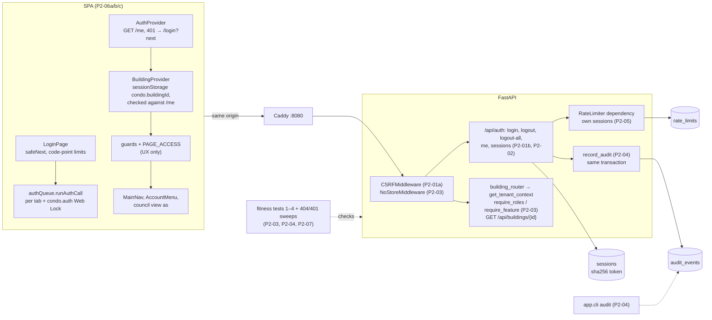

# Milestone Recap — P2 Identity, sessions and tenancy

Date: 2026-10-17 · Tickets: P2-01a, P2-01b, P2-02, P2-03, P2-04, P2-05, P2-06a, P2-06b, P2-06c, P2-07 ·
Drafted by the agent at the phase gate ([playbook](../AI_AGENT_PLAYBOOK.md#phase-gates-automated)); sections
7–9 are James's, optional.

## 0. Gate result

**Current status: green (2026-10-17).** The original report below was red on one item. James authorized the
wording change and the behavior is re-verified ([P2-gate-01](../tickets/P2-gate-01-login-rate-limit-gate.md)).
See the resolution below. The P3 hold is lifted once that PR merges.

### Original gate report (before James's decision; retained as history)

**Red on one item, as the roadmap words it.** Four of five items pass. The fifth ("the 6th failed login gets
429") fails as written: the 6th failed login gets 401, and the 429 comes at the 9th. The code does what its
ticket says. [P2-05](../tickets/P2-05-rate-limiting.md) has said "per normalized email 8 per 15 min" since
P0-01 (PR #1), and the roadmap's gate line has disagreed with it since the same commit. No fix ticket was
added, because the fix is a choice between two gates and that choice is James's (see the last row and §5).
Until it is made, the playbook says P3 does not start.

Every item was run on `main` at `5954517` (the P2-07 merge, PR #67) on 2026-10-18 UTC. The local runs were
on the dev stack (`make up`, `DB_PORT=55432`, Vite on :5173) and then on the prod-like stack (`make prodlike`,
Caddy on :8080, image `condo-api:5954517…`). CI run 39087927212 on `main` passed all four required checks:
`Backend tests` 840 passed, `Frontend lint, types, ratchet and build` 260 Vitest tests passed, `Prod-like
stack smoke` and `Docs links and explanation references`.

| Exit-gate item ([roadmap](../ROADMAP.md)) | Result | Evidence |
|---|---|---|
| Seeded users log in on the local stack (dev and prod-like) and see their role shell | pass | **API, both stacks:** `POST /api/auth/login` → 204 for `manager`, `security`, `council`, `resident1`, `pending`, `birch.manager`, `birch.resident` and `multi`. `/me` lists the expected building and role for each (`multi`: `birch:security; maple:resident`). **Browser, Chromium (Playwright 1.57, script outside the repo):** each user opened `/Packages`, went to `/login?next=%2FPackages`, signed in and got their shell. The nav per role: manager `Dashboard, My profile, Contacts, Residents, Package log, Daily notices, Maintenance`; security the same without Residents; council `Dashboard, My profile, Contacts, Daily notices, Maintenance`; resident1 `… My packages, Maintenance requests` on the Packages placeholder; birch.manager without notices or maintenance (Birch has packages only); `pending` "Waiting for approval"; `multi` "Choose a building". Staff opening `/Packages` (a resident page) get `/403`. Account menu logout → `/login`. The same script on prod-like (Caddy and the strict CSP, at 03:10 UTC) gave the same eight results: 0 page errors, 0 console errors (a CSP violation would show as one; the expected pre-login `/me` 401 is filtered out) and 0 cross-origin requests on both stacks |
| Fitness tests pass | pass | `tests/test_architecture.py`: 27 passed: the six static checks (API routes only, tenant guard, session or allowlist, allowlist entries real, commits only in services, no audit updates or deletes), the cross-building 404 and no-session 401 sweeps, and 16 meta-tests showing that each check can fail. `make check DB_PORT=55432` at `5954517` exited 0: ruff (no cache), format, eslint and the fence self-test, mypy (102 files), 840 backend tests, `alembic check` ("No new upgrade operations detected"), 260 Vitest tests. CI's `Backend tests` passed the same 840 |
| A building-B member gets 404 on every building-A route | pass | **Test:** `tests/test_architecture.py::test_another_buildings_member_gets_404_on_every_building_route` is parametrized over every route under `/api/buildings/{building_id}` (today one: `GET /api/buildings/{building_id}`). It passed, and so did the four 404 tests in `tests/tenancy/test_context.py` (inactive building, another building's manager on a role route, a membership suspended between requests, every caller without an active membership). **Both stacks:** `birch.resident` and `birch.manager` → 404 `building_not_found` on Maple; `resident1` → 404 on Birch; `pending` → 404 on Maple; unknown building id → 404; no session → 401; own building → 200 |
| Login, logout and logout-all write audit rows | pass | Rows written during each stack run, by action, identical on dev and prod-like: `auth.logged_in` 10 (8 users + resident5's two sessions), `auth.logged_out` 1 (resident1), `auth.logged_out_all` 1 (resident5, `{"count": 2}`, both sessions then 401), `auth.login_failed` 14 (8 for the probe email + 6 for resident6; the two rate-limited attempts write none, by design: the limit runs before the lookup). The audit CLI shows them (`python -m app.cli audit --since 1h --action auth.logged_out`). Tests: `tests/audit/test_audit.py` (login, failed login without the email, logout, expired logout, logout-all with count), in the 840 |
| The 6th failed login within the window gets 429 | **fail as worded** | Both stacks, ten wrong-password logins for one email with no account: attempts 1–8 → 401 `invalid_credentials`, attempts 9–10 → 429 `rate_limited` with `Retry-After` (184 s on dev, 751 s on prod-like). Six wrong passwords for a real account (`resident6`) → six 401s. This matches the ticket (criterion 1: "8 failed logins … a 9th attempt is 429"), `docs/ARCHITECTURE.md` and `backend/.env.example`, and is proven by `tests/test_rate_limit.py::test_ninth_login_for_one_email_in_15_minutes_is_429_even_with_the_right_password`. The per-IP limit works too: the first browser run started in the same 10-minute window as the curl run, and its last three logins got 429 (30 per 10 min per IP). The re-run in the next window passed. **To decide (James):** (a) *recommended:* change the roadmap line to "the 9th login attempt for one email within 15 minutes gets 429". That matches what was specified, reviewed and tested, but it loosens the gate's wording, so the agent did not make the change. (b) Add `P2-fix-01` to lower `RATE_LIMIT_LOGIN_EMAIL` to 5 per 15 min, which also changes P4-04's reset policy defaults |

Also run: `make prodlike-smoke`, 43 `ok` checks, including `/api/version reports git_sha
5954517227dac3c701e1ccc37a6499252b844a28`. `alembic current` on the prod-like database is `f2a180ecdeb7 (head)`,
the same as `alembic heads`. Its volume was already at head, so this run applied no migrations. The three P2
migrations ran from empty in CI's `Backend tests` and `Prod-like stack smoke` jobs.

### Resolution — 2026-10-17 (James's decision)

James explicitly chose to keep P2-05's current behavior and authorized changing the roadmap's P2 exit
criterion from blocking the sixth failed login to blocking the ninth attempt per normalized email in
the same fixed 15-minute window. All attempts count, including successful logins; an attempt blocked by
the independent IP limit does not reach the email counter. The IP quota remains 30 per fixed 10-minute
window. Windows reset at their aligned boundary, not 15 minutes after the last attempt.

This resolves a requirements disagreement. The old threshold would have blocked three attempts earlier;
James chose the implemented threshold rather than a `P2-fix-01` reducing the email quota to five. No code,
configuration or tests change. The accepted targeted-email lockout risk in §5 remains.

**Verification (2026-10-17, on `main` at `5954517` plus the documentation-only P2-gate-01 branch; no code,
configuration or test changed):**

- `uv run pytest tests/test_rate_limit.py`: 31 passed. They cover the ninth email attempt being 429 even with the
  right password, an unknown and a known email answering the same, a fixed-window reset (`Retry-After` 900 at the
  start, 1 at second 899, and 204 at the boundary), a successful login counting toward the email key,
  Unicode spellings of one email sharing a counter, another email from the same IP being unaffected, and the
  31st login from one IP in 10 minutes being 429.
- Live, dev stack (`make up`, `DB_PORT=55432`), ten wrong-password logins for one unknown email: attempts 1–8
  got 401, attempts 9 and 10 got 429 with `Retry-After` (23 s: the fixed window was about to roll over).
- `make check DB_PORT=55432`: exit 0. ruff and the ESLint fence clean, mypy 102 files, 840 backend tests,
  `alembic check` ("No new upgrade operations detected"), 260 Vitest tests, frontend build.
- `scripts/check-links.py`: 145 files, 0 broken. `scripts/check-explanation-refs.py`: 0 problems.

**Gate status:** item 5, as the roadmap now words it, passes. The original table above is unchanged and still
shows the first run's result; it is not a new stack run. Merge commit and CI run: see the P2-gate-01 PR.

Decision record: [Human Inbox, Resolved](../HUMAN_INBOX.md#resolved). Implementation of this documentation
change: [P2-gate-01](../tickets/P2-gate-01-login-rate-limit-gate.md).

**Tickets merged**

| Ticket | PR | Merge commit | Explanation |
|---|---|---|---|
| P2-01a | #56 | `2dcbb3a` | [P2-01a](../explanations/P2-01a-csrf-and-password-hashing.md) |
| P2-01b | #57 | `e18d92b` | [P2-01b](../explanations/P2-01b-sessions-login-logout.md) |
| P2-02 | #58 | `9d6c7df` | [P2-02](../explanations/P2-02-me-and-session-management.md) |
| P2-03 | #59 | `63d712d` | [P2-03](../explanations/P2-03-tenant-context-guards-fitness.md) |
| P2-04 | #60 | `9f031be` | [P2-04](../explanations/P2-04-audit-events.md) |
| P2-05 | #61 | `b976a03` | [P2-05](../explanations/P2-05-rate-limiting.md) |
| P2-06a | #62 (blocked once: #63, inbox B-3) | `457f437` | [P2-06a](../explanations/P2-06a-frontend-auth-core.md) |
| P2-06b | #64 | `b92609a` | [P2-06b](../explanations/P2-06b-building-context-guards.md) |
| P2-06c | #65 | `a16039d` | [P2-06c](../explanations/P2-06c-navigation-and-header-menu.md) |
| P2-07 | #67 | `5954517` | [P2-07](../explanations/P2-07-test-infrastructure-hardening.md) |

P2-01 and P2-06 were split while framing (P2-01a/b; P2-06a, then P2-06b/c); their parent ticket files remain as
split records. PR #66 is an open Dependabot PR, not a P2 ticket.

## 1. What now works (demo script)

Every page behind the shell is still a "being migrated" placeholder. The demo shows identity, sessions,
tenancy and the audit trail.

1. `make down`, then `make prodlike`. Then seed:
   `API_IMAGE_TAG=$(git rev-parse HEAD) docker compose -f compose.prodlike.yml exec api python -m app.cli seed`.
2. Open http://localhost:8080/Packages. You land on `/login?next=%2FPackages`. Sign in as
   `resident1@example.test` / `DevPassword!2026`: you are back on `/Packages` with the resident nav
   (Dashboard, My profile, Contacts, My packages, Maintenance requests).
3. Open the account menu (top right): "Signed in as …", then **Log out** returns to `/login`. Press Back: the
   page does not come back.
4. Sign in as `manager@example.test` and open `/Packages`: `/403` ("You can't open this page"), because the
   staff page is "Package log". Sign in as `pending@example.test`: "Waiting for approval". Sign in as
   `multi@example.test`: "Choose a building", then switch building from the account menu.
5. Sign in as `council@example.test` in one tab and `resident1` in another window to see role-specific navs.
   For council "view as", a member holding council and resident roles is needed; the seed has none, so see
   the P2-06c explanation's walkthrough.
6. Cross-building, from a shell (curl must send `Origin` and `X-Requested-With: fetch` on unsafe requests):

   ```bash
   H=(-H 'Origin: http://localhost:8080' -H 'X-Requested-With: fetch' -H 'Content-Type: application/json')
   curl -s -c b.txt "${H[@]}" -X POST localhost:8080/api/auth/login -d '{"email":"birch.resident@example.test","password":"DevPassword!2026"}'
   curl -s -b b.txt localhost:8080/api/auth/me            # Birch only
   curl -s -b b.txt localhost:8080/api/buildings/<maple id>   # 404 building_not_found
   ```

7. Rate limit: repeat a wrong-password login for one email. Attempts 1–8 get 401, the 9th gets 429 with
   `Retry-After`. Thirty attempts from one IP in 10 minutes also give 429. Remember this when demoing
   repeatedly.
8. Audit: `API_IMAGE_TAG=$(git rev-parse HEAD) docker compose -f compose.prodlike.yml exec api python -m app.cli audit --since 1h`.
9. Sessions: `GET /api/auth/sessions` lists your sessions, `DELETE /api/auth/sessions/{id}` revokes one, and
   `POST /api/auth/logout-all` ends all of them (every other tab is sent to `/login` on its next request).
10. `make prodlike-down`.

## 2. Architecture delta



- **New tables:** `sessions` (`e28660ad6da3`), `audit_events` (`91af698c06d2`), `rate_limits` (`f2a180ecdeb7`).
- **New endpoints:** `POST /api/auth/login`, `/logout`, `/logout-all`; `GET /api/auth/me`;
  `GET /api/auth/sessions`; `DELETE /api/auth/sessions/{id}`; `GET /api/buildings/{building_id}`.
- **New backend pieces:** argon2id hashing and the password policy (`app/core/security.py`); CSRF middleware
  (`app/core/csrf.py`); `app/tenancy/`; `app/audit/` and the `audit` CLI; `app/rate_limits/`; the auth
  allowlist; per-request `user_id`/`building_id` in logs; `/api/docs` off by default in staging and production.
- **Frontend:** a new TypeScript shell replaces `Layout.jsx`, and the Base44 Vite plugin is removed. The shell
  is English-only.
- **Tests:** per-run test databases (P2-07), so concurrent suites no longer collide (a P1 risk, now closed).

## 3. Decisions made this phase

**ADRs:** none new. [ADR-0015](../adr/0015-typescript-eslint-for-new-code.md) was updated in P2-06a to tighten
the gate: `recommendedTypeChecked` and `react-hooks/exhaustive-deps` as an error.

**Inbox:** the phase added 61 rows to [Decisions to audit](../HUMAN_INBOX.md#decisions-to-audit): P2-01a 5,
P2-01b 8, P2-02 3, P2-03 8, P2-04 7, P2-05 5, P2-06a 7, P2-06b 8, P2-06c 8, P2-07 2. One item was blocked and
resolved: **B-3** (P2-06a, review round 3 High). James chose option A, modified: one per-tab auth queue, and
a round 4 with a Sonnet reviewer only.

Later tickets lean hardest on these, so they get harder to overturn:

- **CSRF on every non-GET/HEAD/OPTIONS method and path, with `Origin` plus `X-Requested-With: fetch`
  (P2-01a).** Every write endpoint, every script and the P4-09 E2E harness rely on it.
- **Session cookie and lifetime (P2-01b):** persistent 30-day `Max-Age`; idle window recomputed per refresh;
  `__Host-session` + Secure in staging/prod. D-06 verifies it over HTTPS.
- **`/me` drops memberships in inactive buildings; sessions list is a standard `Page` (P2-02).** The SPA's
  building context is built on `/me`'s active list.
- **Tenant context (P2-03):** `building_router()`, `{building_id}` exactly, 404 for every non-member, an
  `AUTH_ALLOWLIST` with only real routes, and a zero-role membership that still gets a context (P4-06 decides).
  Every slice from P3 on is checked by these fitness tests.
- **Audit (P2-04):** `record_audit` in the caller's transaction; a failed login commits its own row; metadata
  rules; append-only by convention plus a grep, with no trigger. Every later write use-case calls it.
- **Rate limiting (P2-05):** every attempt counts, IP then email, before the lookup; 8/15 min per email,
  30/10 min per IP; default policies already set for reset, signup and join. P4-02, P4-04 and P4-05 apply
  them, and P4-09 must raise them for E2E.
- **Frontend (P2-06a/b/c):** guards read roles and features from `GET /api/buildings/{id}`, not `/me`; the
  tab's building lives in `sessionStorage`; `PAGE_ACCESS` drives both guards and nav; the `condo.auth` Web Lock
  orders login and logout across tabs; the shell is English-only; the Base44 Vite plugin is gone. Every
  migrated page from P3-05 on plugs into these.
- **Test infrastructure (P2-07):** a per-run database name derived from `TEST_DATABASE_URL`.

## 4. Agent performance

- **Review rounds per ticket.** Tier 1 means Claude with the security pass plus Codex, unless noted:

  | Ticket | Rounds |
  |---|---|
  | P2-01a | 3 |
  | P2-01b | 3 (one round-2 BLOCK: CI red, reported green) |
  | P2-02 | 1 (no finding changed the code) |
  | P2-03 | 2 |
  | P2-04 | 3 |
  | P2-05 | 1 (no finding changed the code) |
  | P2-06a | 4 (blocked after round 3, inbox B-3; round 4 Sonnet only, James's choice) |
  | P2-06b | 3 (round-1 BLOCK from both reviewers) |
  | P2-06c | 3 (round-1 BLOCK from Claude) |
  | P2-07 | 3 (Codex `gpt-6.1-sol` only, James's choice; round-1 BLOCK) |

  Median 3, max 4. Seven of ten tickets needed a round 3; P1 had five of eight.
- **Unfixed after the final round:** P2-04 (3 Lows → P4-01), P2-06b (1 Medium → P2-06c, fixed there by D7),
  P2-06c (4 Lows → P4-07), P2-07 (1 Low → P3-01).
- **Findings:** [AGENT_MISTAKES_LOG.md](../AGENT_MISTAKES_LOG.md) has 37 P2 rows.
  - By highest severity per row: 5 High, 13 Medium, 13 Low, and 6 caught by the implementer or CI.
  - The 5 Highs: P2-01b, CI reported green while red; P2-06a, an abandoned login replaces a newer session;
    P2-06b, a 404 refetch hidden by cached data; P2-06c, `/me` dropping council kept "view as"; P2-07, the
    migration scratch DB named by pid only.
  - Per ticket: P2-06c 9, P2-01b 5, P2-06b 5, P2-01a 4, P2-04 4, P2-06a 4, P2-03 3, P2-07 3, P2-02 0, P2-05 0.
- **Rules and tests added:**
  - `CLAUDE.md`: the "neighbours" lesson was widened with the list for state and concurrency fixes (P2-06c).
  - Fitness tests: P2-03 added checks 1–3 and the 404/401 sweeps, with meta-tests. P2-04 added the
    append-only grep. P2-07 added `NON_COMMITTING_HELPERS` with `ast` bodies and the quoted-SQL commit grep.
    P2-01b added `tests/test_app_imports.py` (a fresh interpreter maps every model).
  - Gates tightened: ADR-0015 lint rules, and `ruff --no-cache` in `make lint`.
- **Promotions that are due and were not done.** Each was written as "next ticket" in a step 8 note and then
  not picked up:
  - **"Network call hidden in a presentation component"** reached 2 occurrences in P2-06c (F2, round 2 L1). The
    rule says to promote it in the next PR; P2-07 didn't.
  - **A written neighbour list per fix before each review round,** as a line in
    `.claude/commands/build-ticket.md` step 4 (P2-06c and P2-07 notes).
  - **An input-class checklist for validators and sanitizers** in `docs/templates/REVIEW_PROMPT.md` (P2-04
    note).
  - **Extending the lesson to new gates,** not only fixes (P2-03 note).
- **Recurring pattern.** **Fix not tested on adjacent cases** recurred in eight of ten tickets, with its `CLAUDE.md`
  lesson in place throughout: P2-01a, P2-01b, P2-03, P2-04, P2-06a, P2-06b, P2-06c, P2-07. It is the phase's
  main cost in review rounds, and the lesson alone is not stopping it (see §5).
- **Blocked:** P2-06a, once, under stop rule 4. Codex rated a finding High and Claude rated it Low after
  round 3. James answered B-3 the same day.
- **Strongest:**
  - Proof-driven review. Codex reproduced the logout/login cookie races in real Chromium (P2-06a), and its proof
    tests became permanent (`authQueue.test.tsx`).
  - Measured fixes. P2-01b's held-connection fix was measured: a logout took 4.8 s before and 30 ms after.
  - Gates proven able to fail. P2-03's meta-tests (16 in the file now) show each check failing; P2-06c ran 20 mutation probes,
    all caught.
  - Two tickets passed review in one round.
- **Weakest:**
  - Neighbours of a fix, as above, especially server-driven changes (a `/me` refetch) and Back/Forward in the
    frontend tickets.
  - Step 8 follow-ups that say "next ticket" and then get dropped.
  - One status claim from truncated output (P2-01b H1).
  - Four PRs merged over the ~400-line guideline: P2-01b 462, P2-04 507, P2-06a 500, P2-06b 468, each recorded
    in the inbox.

## 5. Open risks and debt

| Risk / debt | Impact | Plan |
|---|---|---|
| **Resolved 2026-10-17:** gate item 5 wording ("6th failed login") disagreed with P2-05's specified and tested 8/15 min per email | Originally made the P2 gate red and held P3 | James authorized amending the roadmap to the ninth attempt in the same fixed 15-minute window; verification pending in P2-gate-01 (§0). Original gate report preserved above |
| Promoted lessons not stopping "fix not tested on adjacent cases" (eight tickets); four due promotions not done (§4) | Extra review rounds; Lows merged unfixed at round 3 | Do the four promotions in the next PR, starting with the neighbour-list line in `build-ticket.md` step 4. Untracked outside the mistakes log until then |
| Targeted lockout: 8 attempts from any IPs lock one email's login for 15 min (P2-05 D3) | Anyone can deny one user login | Accepted; tracked in the P2-05 explanation and PR #61 only |
| A `FORWARDED_ALLOW_IPS` that misses the real proxy puts every client in one IP bucket | One attacker locks out logins for everyone | D-06 checks staging; a startup warning is an untracked follow-up (PR #61) |
| Real client IP behind host Caddy, `__Host-session` + Secure over HTTPS, docs off in staging | Unproven until staging | D-06 checklist |
| The cross-tab `condo.auth` Web Lock is proven only with a fake lock manager; two real tabs never raced | A slow logout in one tab could still delete another tab's new session | P4-09 "Carried" note |
| Four account-menu Lows (Back reopens it, `/me` switch leaves it open, "View as" during 401/404, `mousedown` on iOS) | UX glitches | P4-07 "Carried from P2-06c" |
| Audit is append-only by convention (no trigger or hash chain); dev `seed --reset` truncates it; three sanitizer Lows (surrogate key → 500, falsy non-dict → `{}`, exponential walk); no total metadata bound | Tampering not detectable; trusted-caller edge cases | Inbox row (P2-04); P4-01 "Carried"; tamper-evidence left to pilot retention work |
| Expired and revoked sessions and old `rate_limits` rows are never purged | Unbounded growth | P3-01 (cleanup jobs, in its ticket) |
| An active membership with zero roles still gets a tenant context | Can read its building's root | P4-06 "Carried" |
| P2-07 round 3 Low: `test_the_session_database_is_this_runs_own` fails for a `TEST_DATABASE_URL` stem over ~39 bytes; `enqueue` not yet in `NON_COMMITTING_HELPERS` | A false test failure on a long DB name; rule 5 unguarded for `enqueue` | P3-01 "Carried from P2-07" |
| A SIGKILLed test run leaves its per-run database | Stray databases on the dev server | Accepted; cleanup query in `backend/tests/README.md` |
| No separate-connection concurrency tests for revocation, logout-all racing login, or a flood of more than 30 logins | Ordering claims rest on conditional `UPDATE`s, not tests | Tracked only in the P2-02, P2-04 and P2-05 explanations |
| The shell is English-only (`LanguageProvider` dropped, P2-06a D5) | Legacy i18n gone until a slice restores it | Inbox row (P2-06a) |
| Fitness test 3 has exercised only one `GET`; unsafe methods are untested until a building `POST` exists | The sweep's write path is unproven | Covered automatically once the first building write endpoint exists (the sweep is parametrized) |
| P1's "concurrent full test suites collide" risk | — | **Closed** by P2-07 |
| P1's CSP risk (sonner CSS, Base44 logo/favicon) | — | The new shell doesn't use them: the prod-like browser run (§0) had 0 console errors for all eight users. The legacy pages that used sonner are placeholders until migrated |
| Dependabot PR #66 (44 frontend updates, including `@base44/*`) is open | Drifting dependencies | Triage by James, as with PRE-7 |
| This checkout's `frontend/` had no `node_modules`, so `make check` failed with `eslint: not found` until `npm ci` | A confusing local failure, not a code defect | Worth a line in the README or a `make check` precondition; untracked |

## 6. Suggested reading order

The three that matter most come first:

1. [P2-03](../explanations/P2-03-tenant-context-guards-fitness.md): the tenant context and the fitness tests.
   Every slice from here on is checked by them, and the root-mount finding shows how a gate can be blind.
2. [P2-01b](../explanations/P2-01b-sessions-login-logout.md): how a cookie becomes a user, the dummy-hash timing
   defence, and the held-connection fix.
3. [P2-06a](../explanations/P2-06a-frontend-auth-core.md): the auth queue and the logout/login races, the ticket
   that blocked.

Then:
- [P2-01a](../explanations/P2-01a-csrf-and-password-hashing.md) (CSRF and argon2) and
  [P2-02](../explanations/P2-02-me-and-session-management.md) (`/me`, sessions)
- [P2-04](../explanations/P2-04-audit-events.md) (audit) and
  [P2-05](../explanations/P2-05-rate-limiting.md) (rate limits)
- [P2-06b](../explanations/P2-06b-building-context-guards.md) and
  [P2-06c](../explanations/P2-06c-navigation-and-header-menu.md) (building context, nav, Web Lock)
- [P2-07](../explanations/P2-07-test-infrastructure-hardening.md) (per-run test databases)

**"Must explain" questions no explanation answers:** none. Each of the nine Tier 1 explanations answers every
question in its ticket's "Must explain" list, counted per ticket (28 questions). P2-07 (Tier 3) has no
"Must explain" list.

## 7. What I learned (James, own words, optional)

_Prompt: P2-06a's block. Why did Codex call the abandoned-login race High while Claude called it Low, and what
does a per-tab queue fix that a Web Lock then had to finish in P2-06c?_

## 8. Interview story (STAR, James, optional)

_Prompt: P2-03. A fitness test meant to prove every building route is guarded passed while a sub-app mounted at
`/` served an unguarded `/api/buildings/…` route; a reviewer's proof test exposed it, and the check now judges
routes by what they can serve, not by their path string._

- Situation:
- Task:
- Action (what *I* decided, including the trade-offs, and how I directed the agents):
- Result (numbers if possible):

## 9. Three interview questions (agent proposes; James answers in their own words)

1. Q: Your app uses server-side session cookies. Walk through how you stop a CSRF attack from a sibling
   subdomain, and why `SameSite` alone isn't enough. A:
2. Q: How do you prove, in CI, that a new endpoint can't leak another tenant's data, even if the developer
   forgets to add a check? A:
3. Q: Your login is rate-limited per IP and per email. What attacks does each limit stop, what does the
   per-email limit make possible, and why does the counter commit separately from the login? A:
