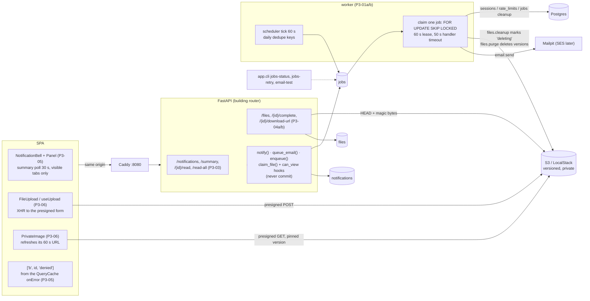

# Milestone Recap — P3 Platform services

Date: 2026-10-19 · Tickets: P3-01a, P3-01b, P3-02, P3-03, P3-04a, P3-04b, P3-04c, P3-05, P3-06 · Drafted by
the agent at the phase gate ([playbook](../AI_AGENT_PLAYBOOK.md#phase-gates-automated)); sections 7–9 are
James's, optional.

## 0. Gate result

**Green.** All three exit-gate items pass on both stacks, so P4 may start. No fix tickets were needed.

Every item was run on `main` at `4342a26` (the P3-06 fix merge, PR #82) on 2026-10-19 between 22:07 and 22:20
UTC. The dev stack was `make up DB_PORT=55432` with Vite on :5173. The prod-like stack was `make prodlike`:
Caddy on :8080, image `condo-api:4342a26accad04b1677cc15c51258de59c9f9990` (not `-dirty`), and
`alembic current` `f727e687ccf2 (head)`. Both were seeded first. CI run 39326049090 on `main` at `4342a26`
passed all four required checks: `Backend tests` (1350 passed), `Frontend lint, types, ratchet and build`
(359 Vitest tests passed), `Prod-like stack smoke` and `Docs links and explanation references`.
`make check` was not run locally for the gate; CI's run covers the same checks.

The scripts were scratch files outside the repo and are not committed. They used Playwright 1.57.0 with
Chromium.

| Exit-gate item ([roadmap](../ROADMAP.md)) | Result | Evidence |
|---|---|---|
| A test event produces a notification row and an email visible in Mailpit | pass | No domain event exists yet (packages come in P5), so the test event was a script in the API container. It calls `notify()` with `kind="package.arrived"` for `resident1` in Maple and commits, as a use-case would. **Dev:** the `notifications` row was written at 22:07:06.149, unread. Its `email.send` job succeeded on attempt 1 at 22:07:06.606. Mailpit received "Gate test dev-180702" for `resident1@example.test` at 22:07:06.6. As `resident1`, `GET /api/buildings/{maple}/notifications` lists the row with `read_at: null`, and `/notifications/summary` gives `{"unread_count":1}`. **Prod-like:** the same through Caddy (the row at 22:12:01.407, the job succeeded on attempt 1 at 22:12:01.769, Mailpit at 22:12:01.766). In Chromium, `resident1`'s bell reads "Notifications, 1 unread", and the panel shows "Gate test pl-181159" |
| Killing the worker mid-job and restarting it completes the job | pass | Scripted on each stack. `docker compose pause mailpit` makes the SMTP greeting hang, so the handler is in flight (the SMTP timeout is 20 s). Then `app.cli email-test` queues a job. When the job was `running` (attempt 1), the worker got `kill -s SIGKILL` and `ps` showed `Exited (137)`. The job stayed `running` with its lease. Then `unpause mailpit` and `start worker`. **Dev:** lease until 22:08:44.644; the new worker reclaimed the job when the lease expired; `succeeded`, attempts 2, at 22:08:45.594, `last_error` empty. **Prod-like:** lease until 22:13:06.787; `succeeded`, attempts 2, at 22:13:06.946. In both, Mailpit holds exactly one copy. The kill landed before SMTP `DATA`, so no duplicate was possible here (see §5, at-least-once). CI also covers reclaim: `test_expired_lease_is_reclaimed` and `test_reclaimed_job_past_max_attempts_is_dead_unrun` are among the 1350 |
| Uploading an image from the browser and fetching it back works through presigned URLs against the S3 emulator, on both the dev and prod-like stacks | pass | No route renders `FileUpload` until P5-03, so the run used the same approach as [P3-06 D4](../explanations/P3-06-frontend-upload-component.md#d4-the-stack-journey-mounts-the-component-with-a-harness). A harness that renders `FileUpload` (`package_photo`) and `PrivateImage` under the app's own `queryClient`, `AuthProvider`, `BuildingProvider` and `RequireActiveMembership` was bundled with the repo's esbuild from `4342a26`. It was evaluated in the app's page after a real login as `manager`, and Playwright chose a 64×64 PNG (7858 bytes) in the component's file input. **Both stacks, in order:** `POST …/files` 201, the browser's `POST` of the presigned form to `localhost:4566/condo-app-dev-files` 204, `POST …/files/{id}/complete` 200, `GET …/download-url` 200, then the `` `GET`s the signed URL (`X-Amz-Signature`, `X-Amz-Expires`) with 200. The image rendered at 64×64, and the bytes fetched back from that URL match the upload's SHA-256. On prod-like, Caddy's CSP was in force and the run had 0 CSP violations. On both stacks the only console error was the expected pre-login `/me` 401. The file row is `ready`, `image/png`, 7858 bytes, unattached. `download-url` for it as `security`, `resident1` and `birch.manager` → 404 (an unattached file is its uploader's alone, P3-04b) |

**Also run:** `make prodlike-smoke` exited 0, with 51 `ok` checks, including `/api/version reports git_sha
4342a26…`, and `prodlike-checks: all checks passed` (with P3-02's "Mailpit stopped, then back" check). The
demo's curl upload (§1, step 5) gave `S3 POST 204`, `ready` and "downloaded bytes match".

**Found while running the gate:** an *unsigned* `GET` of the uploaded object's key also returned 200, on both
stacks. The bucket is not public: the init script sets a public access block, the ACL is owner-only, and
there is no bucket policy. LocalStack 4.14.0 runs without IAM enforcement and doesn't check the request's
auth. So no local run can show the files bucket is private. Only real S3 can, and D-06's checklist didn't ask.
This PR adds the check to [D-06](../tickets/D-06-staging-verification-gate.md) (§5).

**Tickets merged**

| Ticket | PR | Merge commit | Explanation |
|---|---|---|---|
| P3-01a | #69 | `71bef62` | [P3-01a](../explanations/P3-01a-job-queue-and-worker.md) |
| P3-04a | #70 | `aa90046` | [P3-04a](../explanations/P3-04a-file-registry-and-uploads.md) |
| P3-01b | #71 | `4dba6b1` | [P3-01b](../explanations/P3-01b-scheduler-cleanup-and-cli.md) |
| P3-02 | #73 (blocked once: #74, inbox B-4) | `1f1012f` | [P3-02](../explanations/P3-02-transactional-email.md) |
| P3-03 | #76 | `8769f46` | [P3-03](../explanations/P3-03-notifications-api.md) |
| P3-04b | #77 | `681655c` | [P3-04b](../explanations/P3-04b-file-downloads-and-claim.md) |
| P3-04c | #78 | `2db35f9` | [P3-04c](../explanations/P3-04c-file-cleanup-job.md) |
| P3-05 | #79 (blocked once: #80, inbox B-5) | `5d09263` | [P3-05](../explanations/P3-05-frontend-notification-center.md) |
| P3-06 | #81, then the round-3 fix #82 | `0ba6655`, `4342a26` | [P3-06](../explanations/P3-06-frontend-upload-component.md), [fix](../explanations/P3-06-fix-round3-findings.md) |

P3-01 and P3-04 were split while framing (P3-01a/b; P3-04a/b/c). Their parent ticket files remain as split
records. PR #72 (workflow: write the explanation last, context hygiene) merged during the phase but is not a P3
ticket. The open PRs #75, #66, #41, #40, #39, #38 and #18 are Dependabot's.

## 1. What now works (demo script)

The visible parts are the notification bell (every member's header) and email in Mailpit. The job queue, the
daily cleanups and private files work end to end, but no page creates a notification or renders the upload
component yet: packages (P5) are the first slice to use them. Steps 2, 4 and 5 stand in for that slice.

1. `make down`, then `make prodlike`. Then, in the same shell:

   ```bash
   export API_IMAGE_TAG=$(git rev-parse HEAD)
   DC="docker compose -f compose.prodlike.yml"
   $DC exec api python -m app.cli seed
   ```

2. **A notification and its email.** Send `resident1` a test event:

   ```bash
   $DC exec -T api python - <<'EOF'
   import asyncio
   from sqlalchemy import select
   from app.models.registry import *  # noqa: F403  (maps every model)
   from app.buildings.models import Building
   from app.users.models import User
   from app.core.database import AsyncSessionLocal
   from app.notifications.service import notify

   async def main():
       async with AsyncSessionLocal() as db:
           b = (await db.execute(select(Building).where(Building.slug == "maple"))).scalar_one()
           u = (await db.execute(select(User).where(User.email == "resident1@example.test"))).scalar_one()
           await notify(db, building_id=b.id, recipient_user_ids=[u.id], kind="package.arrived",
                        title="Demo: a package arrived", body="Sent from the P3 demo.", link="/packages")
           await db.commit()
       print("notified resident1")

   asyncio.run(main())
   EOF
   ```

   Open http://localhost:8080 and sign in as `resident1@example.test` / `DevPassword!2026`. The bell says
   "Notifications, 1 unread". Open it to see the row; clicking it marks it read and follows its link. The
   email is in Mailpit at http://localhost:8025. Run the snippet again while the panel is closed: the badge
   updates within 30 s (the poll), and only while the tab is visible.
3. **The queue.** `$DC exec api python -m app.cli jobs-status` shows counts by status and the latest dead
   jobs. `$DC exec api python -m app.cli email-test --to you@example.test` queues one email; it reaches
   Mailpit within about a second.
4. **A worker crash.**

   ```bash
   $DC pause mailpit
   $DC exec api python -m app.cli email-test --to crash@example.test   # prints the job id
   $DC kill -s SIGKILL worker          # within ~20 s, while the job is running
   $DC unpause mailpit && $DC start worker
   $DC exec api python -m app.cli jobs-status   # the job finishes once its 60 s lease runs out
   ```

5. **A private file.** From a scratch directory holding a PNG named `photo.png` (at most 10 MiB):

   ```bash
   j() { python3 -c 'import json,sys
   d=json.load(sys.stdin)
   for k in sys.argv[1:]: d=d[int(k)] if isinstance(d,list) else d[k]
   print(d)' "$@"; }
   H=(-H 'Origin: http://localhost:8080' -H 'X-Requested-With: fetch' -H 'Content-Type: application/json')
   curl -s -c m.txt "${H[@]}" -X POST localhost:8080/api/auth/login \
     -d '{"email":"manager@example.test","password":"DevPassword!2026"}'
   B=$(curl -s -b m.txt localhost:8080/api/auth/me | j memberships 0 building id)
   curl -s -b m.txt "${H[@]}" -X POST localhost:8080/api/buildings/$B/files -o up.json \
     -d "{\"purpose\":\"package_photo\",\"filename\":\"photo.png\",\"content_type\":\"image/png\",\"size_bytes\":$(stat -c%s photo.png)}"
   F=$(j file_id < up.json)
   mapfile -t FORM < <(python3 -c 'import json
   for k,v in json.load(open("up.json"))["upload"]["fields"].items(): print("-F"); print(f"{k}={v}")')
   curl -s -o /dev/null -w 'S3 POST %{http_code}\n' "${FORM[@]}" -F file=@photo.png "$(j upload url < up.json)"
   curl -s -b m.txt "${H[@]}" -X POST localhost:8080/api/buildings/$B/files/$F/complete | j status   # ready
   URL=$(curl -s -b m.txt localhost:8080/api/buildings/$B/files/$F/download-url | j url)
   curl -s "$URL" | cmp - photo.png && echo "downloaded bytes match"
   ```

   Try the same with `size_bytes` one byte off: S3 refuses the form (the policy allows exactly the declared
   size). For the browser component (drop, preview, progress, cancel, retry), see the
   [P3-06 walkthrough](../explanations/P3-06-frontend-upload-component.md). No page renders it until P5-03.
6. **Daily cleanups.** The worker enqueues `sessions.cleanup`, `rate_limits.cleanup`, `jobs.cleanup` and
   `files.cleanup` once per UTC day, through a date-based dedupe key. Restarting the worker doesn't repeat
   them; `jobs-status` counts them under `succeeded`.
7. `make prodlike-down`.

## 2. Architecture delta



- **New tables:** `jobs` (`6155f8860fc1`), `files` (`478316869a1a`), `notifications` (`05c58ec89743`), and a
  `files` migration for the `deleting` status (`f727e687ccf2`).
- **New endpoints** (all under `/api/buildings/{building_id}`): `GET /notifications`,
  `GET /notifications/summary`, `POST /notifications/{notification_id}/read`, `POST /notifications/read-all`;
  `POST /files`, `POST /files/{file_id}/complete`, `GET /files/{file_id}/download-url`.
- **New process:** the `worker` container (same image, `python -m app.jobs.worker`, healthy while its
  heartbeat file is under 120 s old). Job kinds: `email.send`, `sessions.cleanup`, `rate_limits.cleanup`,
  `jobs.cleanup`, `files.cleanup`, `files.purge`.
- **New backend pieces:** `app/jobs/` (queue, worker, scheduler, report), `app/email/` (templates with
  autoescape, the SMTP handler, the allowlist), `app/notifications/` (`notify`, kinds),
  `app/files/` (purposes registry, presigning, storage, `claim_file`, `register_can_view`); CLI commands
  `jobs-status`, `jobs-retry` and `email-test`; `NON_COMMITTING_HELPERS` gained `enqueue`, `queue_email`,
  `notify` and the cleanup helpers.
- **Frontend:** `src/features/notifications/` (bell, panel, API hooks), `src/features/files/` (`FileUpload`,
  `useUpload`, `PrivateImage`, `purposes.ts`), and `src/app/buildingDenial.ts` (one lost-access state).
  P3-05 deleted three legacy notification files.
- **Stacks and CI:** the worker in both compose files; LocalStack in CI's backend job (per-run buckets); the S3
  emulator's keys in `compose.prodlike.yml` (P3-06, see §5); `scripts/prodlike-checks.sh` gained the worker
  and email checks.

## 3. Decisions made this phase

**ADRs:** [ADR-0018](../adr/0018-file-deletion-state.md) is new (P3-04c): files are deleted through a
committed `deleting` status, and it amends [ADR-0007](../adr/0007-private-s3-presigned-uploads.md) "Cleanup".
[ADR-0017](../adr/0017-implementer-writes-the-explanation.md) was updated by PR #72: the explanation is now
written last, after the final `MERGE`, the rebase and green CI.

**Inbox:** the phase added 40 rows to [Decisions to audit](../HUMAN_INBOX.md#decisions-to-audit): P3-01a 6,
P3-01b 5, P3-02 4, P3-03 5, P3-04a 4, P3-04b 5, P3-04c 4, P3-05 1, P3-06 6. Two tickets were blocked and
resolved by James on the day:

- **B-4** (P3-02): option B. The round-3 fix was accepted without a fourth review round.
- **B-5** (P3-05): option A, one shared building-denial state, then a round 4. That round's fixes were merged
  without a fifth round.

Every review in the phase was by Codex, at James's run-specific instruction (one inbox row per ticket).

Later tickets lean hardest on these, so they get harder to overturn:

- **The queue contract (P3-01a).**
  - One claim per job with `UPDATE … WHERE id = (SELECT … LIMIT 1 FOR UPDATE SKIP LOCKED)`.
  - A 60 s lease and a 50 s handler timeout.
  - At-least-once delivery.
  - The app clock, not Postgres `now()`.
  - `last_error` never holds database messages.
  - Every later handler (P4 emails, P5, P6) must be idempotent and fit in 50 s.
- **Retention (P3-01b).**
  - Ended sessions go after 30 days.
  - Succeeded jobs go after 14 days.
  - Dead jobs lose their sensitive keys after 7 days, and `jobs-retry` refuses them from then on.
  - Daily jobs use date-based dedupe keys.
- **`queue_email` (P3-02).**
  - It renders at queue time and raises `ValueError` for anything the jobs table would refuse.
  - Addresses are ASCII dot-atoms only.
  - SMTP reply text is never stored.
  - The allowlist is exact-domain.
  - P4-02 (invitations), P4-04 (password reset) and every P5/P6 email build on this.
- **`notify` (P3-03).**
  - One row per recipient, with a composite FK to the recipient's membership (of any status).
  - One generic `notification` email for the four starting kinds.
  - The `kind:entity:user` email dedupe key, and recipients sorted to avoid deadlocks.
  - Rows are kept forever for now.
- **Files (P3-04a/b/c).**
  - The purposes registry and who may upload each purpose.
  - The policy allows exactly the declared size.
  - The pinned S3 version.
  - A per-purpose `can_view` hook that fails closed. No purpose has one yet, so P5-01 must register `package_photo`'s.
  - "Staff purposes" in `claim_file`.
  - Deletion through `deleting` (ADR-0018).
- **Lost access is one shared state (P3-05).** A `404 building_not_found` on any `['b', id, …]` query or
  mutation marks `['b', id, 'denied']`. New building-scoped UI gets this only if it keys its requests that
  way (mutations need a `mutationKey`).
- **The upload contract (P3-06).**
  - `FileUpload` checks the file against `purposes.ts`, a client copy of the server registry; props can only narrow it.
  - It calls `onUploaded(file_id)` once per finished upload.
  - `PrivateImage` refreshes its URL 10 s before expiry.
  - Legacy `UploadFile` callers migrate with their slices (P5-03, P6).

## 4. Agent performance

- **Review rounds per ticket.** Each round was a fresh Codex session, `gpt-6.1-sol` (high) unless noted.
  None had a Claude reviewer (James's instruction for this run).

  | Ticket | Tier | Rounds |
  |---|---|---|
  | P3-01a | 1 | 2 (BLOCK, BLOCK) + a flaky-test diagnosis session (`gpt-6-astra` medium, BLOCK). Round 3 was waived by James; the diagnosis fixes (`2e46dd7`) were not reviewed |
  | P3-04a | 1 | 2 (MERGE, MERGE) |
  | P3-01b | 1 | 2 (MERGE, MERGE) |
  | P3-02 | 2 | 3 (BLOCK, MERGE, BLOCK). Blocked (B-4); round-3 fix accepted unreviewed |
  | P3-03 | 2 | 3 (MERGE ×3; findings fixed in rounds 1 and 2) |
  | P3-04b | 1 | 1 (MERGE, no findings) |
  | P3-04c | 1 | 2 (CHANGES, MERGE) |
  | P3-05 | 2 | 4 (BLOCK ×4). Blocked after round 3 (B-5); round 4 by `gpt-6-astra` medium; round-4 fixes unreviewed |
  | P3-06 | 2 | 3 (MERGE ×3), then a verify-only round on fix PR #82 (VERIFIED) |

  Median 3 review sessions, max 4 (median 2 if P3-01a's diagnosis session isn't counted as a round). Five of nine tickets needed a third session; P2 had seven of ten.
- **Unfixed after the final round:**
  - P3-03: a lone surrogate in `notify`'s text gives `DBAPIError`, not `ValueError` (Low, carried to P4-05 / P5-02a).
  - P3-04c: the mixed-version deploy 500 (Medium, accepted; rule in D-03).
  - P3-04b: the 60 s bearer URL with no rate limit (residual, accepted).
  - P3-06's R3-F1 (Medium) and R3-F2 (Low) were accepted in #81 and then fixed in #82.
- **Findings:** [AGENT_MISTAKES_LOG.md](../AGENT_MISTAKES_LOG.md) has 33 P3 rows.
  - By highest severity per row: 11 High, 13 Medium, 5 Low, and 4 caught by the implementer, an existing test
    or a stack run.
  - The Highs, by ticket:
    - **P3-01a ×5:** a shared batch lease let two workers run one job; cut SQL parameters leaked a token into
      `last_error`; round 1's fixes missed `PendingRollbackError` and a lease case; `IN (… LIMIT 1 …)` leased
      several rows under stale statistics.
    - **P3-02:** SMTP reply text carried a reset token into `last_error`.
    - **P3-04c ×2:** S3 deletes protected only by a row lock; a partial delete left the file claimable.
    - **P3-05 ×4:** a denied building's notifications stayed on screen, through successive neighbours. Round 1:
      the 404 itself. Round 2: a 5xx after it. Round 3: another endpoint, and a remount. Round 4: an
      unmounted shell, and callback order.
  - Per ticket: P3-01a 6, P3-04c 5, P3-05 5, P3-06 5, P3-02 4, P3-03 3, P3-04a 2 (+1 found in P3-06), P3-01b 2,
    P3-04b 0.
- **Rules and tests added:**
  - `CLAUDE.md`: the "validate caller input by what Postgres accepts" lesson (P3-02 ×2, P3-03; added in P3-04c's
    bookkeeping) and the "Context hygiene" section (#72).
  - `.claude/commands/build-ticket.md` step 4: a written neighbour list per fix before the next round (P3-04a).
    This was P2's top due promotion, and P3-01b, the first ticket after it, passed round 2 with nothing found.
  - Fitness tests: `NON_COMMITTING_HELPERS` gained `enqueue`, `queue_email`, `notify` and the cleanup helpers.
  - CI: LocalStack in the backend job; `prodlike-checks.sh` checks the worker and email.
- **Promotions that are due and were not done:**
  - **A fitness test for the lost-access rule:** every reader of `useBuilding({ passive: true })` also calls
    `useBuildingDenied()`. Asked for by P3-05's note; P3-06 didn't do it. It is now the first follow-up of the
    next lane-B ticket (noted in P5-03).
  - **A fitness test feeding every caller-input text field** of `enqueue`, `queue_email` and `notify` a lone
    surrogate, NUL, NaN and an over-length value. Only the `CLAUDE.md` lesson was done; the test is a candidate
    for P4-05 / P5-02a.
  - **Three of P2's four due promotions remain undone:** "network call hidden in a presentation component", an
    input-class checklist in `REVIEW_PROMPT.md`, and extending the neighbour lesson to new gates.
- **Recurring pattern.** "Fix not tested on adjacent cases" again cost the most rounds: P3-01a, P3-02, P3-05
  (every round of four) and P3-06. The neighbour-list step helped where the neighbours were other inputs or
  writers (P3-01b, P3-03). It didn't help for UI data lifecycles, where the missing classes were "another
  endpoint reaching the same state", "an answer while unmounted" and "the same answer again" (P3-05, P3-06
  notes).
- **Blocked:** P3-02 and P3-05, both under stop rule 4 (not converging after round 3). James answered B-4 and
  B-5 the same day.
- **Strongest:**
  - Proof-driven review. Codex reproduced every High with a failing test before any fix, and the proofs became
    permanent tests.
  - The flaky-test diagnosis traced a 1-in-10 failure to the planner re-running an `IN (subquery)`.
  - P3-04b passed in one round with no findings.
  - The implementers' own stack runs caught real bugs before review: P3-04c's dropped log fields, and P3-06's
    finding that presigned uploads had never worked on `make prodlike`.
- **Weakest:**
  - Neighbours of a fix, as above, especially in the frontend.
  - Three final fixes merged without any review (§5).
  - Due promotions dropped again.
  - The prod-like S3 keys bug was latent from P3-04a to P3-06, because nothing on that stack presigns.
  - Six PRs over the ~400 non-test line guideline, each stating its size in the PR: #69 (631), #70 (598),
    #73 (425 + 64 stack checks), #76 (489), #79 (403), #81 (410 + 4).

## 5. Open risks and debt

| Risk / debt | Impact | Plan |
|---|---|---|
| **Three final fixes were never reviewed:** P3-01a `2e46dd7` (the claim query and redaction order), P3-02 `87431ca` (ASCII-only addresses, UTF-8 dedupe keys), P3-05 `a29d345` + `8db132d` (denials recorded from the cache's `onError`). Each was James's decision (round 3 waived, B-4, B-5) | The worker, every email and lost-access UI rest on code no reviewer saw; tests and probes are its only evidence | Untracked outside the inbox and explanations. **Recommended:** a verify-only Codex pass over the three commits (as done for #82) before P4 and P5 build on them. James's call |
| The Tier 1 pair (Claude + security pass, plus Codex) was not used for any of P3's five Tier 1 tickets; all reviews were Codex only | One model family reviewed auth-adjacent code (jobs with secrets, file security, deletion) | Recorded per ticket in the inbox. P4 is mostly Tier 1 (invitations, bootstrap, reset, join), so decide whether the Codex-only instruction carries into P4 |
| **The S3 emulator doesn't enforce auth:** an unsigned `GET` of a private object returns 200 locally (found by this gate, §0) | A staging bucket left open by mistake would pass every local check; "private" is unproven until staging | This PR adds an unsigned-`GET` → 403 check to D-06's P3-04 line |
| No CI check presigns on the prod-like stack (`scripts/smoke.sh` doesn't log in); the missing S3 keys went unnoticed from P3-04a to P3-06 | A prod-like regression in uploads would stay silent | Inbox follow-up (P3-06); candidate home P4-09 (e2e on prod-like) |
| Real AWS not exercised: S3 IAM (`ListBucket` so a missing key's HEAD gives 404, not 403; `DeleteObjectVersion`, `ListBucketVersions`), `response-content-disposition`, expired-URL refusal, SES with STARTTLS and auth | Staging-only failures | D-01 (policy) and D-06 (checks) |
| A mixed-version deploy: the previous API returns 500 for a file the new worker marked `deleting` | A deploy-time 500 | Rule in [D-03](../tickets/D-03-cicd-deploy-staging.md) "Carried from P3-04c" |
| At-least-once delivery: a worker that dies after the SMTP server accepts sends the email twice; the gate's kill was before `DATA`, so it didn't show this | Duplicate emails, rarely | Accepted ([ADR-0006](../adr/0006-postgres-job-queue.md)) |
| `notify` lets a lone surrogate reach asyncpg (`DBAPIError`, not `ValueError`); no fitness test across `enqueue`/`queue_email`/`notify` caller input | A caller gets an undocumented exception type | Carried to P4-05 / P5-02a, whichever calls `notify` first |
| Notifications are kept forever; the email dedupe only lasts while the succeeded job exists (14 days) | Unbounded growth; a repeat `notify` after 14 days emails again | Inbox (P3-03). A retention period comes with a cleanup job |
| A broadcast `notify` runs in the caller's request (~550 ms for 600 recipients locally) | Slow announcements to large buildings | Inbox (P3-03); bulk enqueue if needed |
| Attached files are invisible until a domain registers its `can_view` hook | P5's photos 404 until then | P5-01's ticket |
| `FileUpload` and `PrivateImage` are mounted nowhere; the gate and P3-06 used a harness | No user path exercises them until P5-03 | P5-03 |
| Due promotions not done (§4): the `useBuildingDenied` fitness test, the caller-input fitness test, three from P2 | The main pattern keeps costing rounds | The first follow-up of the next lane-B ticket (P5-03 note); P4-05 / P5-02a |
| The queue uses the app clock and assumes one host; the worker's healthcheck means "loop alive", not "database reachable" | Wrong ordering across hosts; an outage looks healthy | Revisit with several workers; alerting is D-05's |
| No per-user cap on live sessions | A user can hold any number of sessions | Inbox (P3-01b), James to decide; it would be a lane-A ticket |
| Legacy `UploadFile` remains (`NoticeAttachmentUpload.jsx` needs a public URL) | Base44 baseline unchanged at 327 | P6 notices carry note |
| Dependabot PRs open: #75 (backend, 8), #66 (frontend, 44), #18 (Mailpit), #38–#41 | Drifting dependencies | Triage by James |
| P2's "expired sessions and old `rate_limits` rows are never purged" and P2-07's round-3 Low | — | **Closed** by P3-01b (`sessions.cleanup`, `rate_limits.cleanup`) and P3-01a (`assert_named_per_run`) |

P2's other open risks are unchanged: the targeted email lockout, `FORWARDED_ALLOW_IPS`, the cross-tab Web Lock,
the account-menu Lows, audit tamper-evidence, zero-role memberships and the English-only shell.

## 6. Suggested reading order

The three that matter most come first:

1. [P3-01a](../explanations/P3-01a-job-queue-and-worker.md): the claim query, leases and at-least-once. Every
   side effect from here on runs through it. Read the three review sessions; the planner bug is a good story.
2. [P3-04c](../explanations/P3-04c-file-cleanup-job.md) with [ADR-0018](../adr/0018-file-deletion-state.md):
   why an irreversible S3 delete can't sit inside a transaction that can roll back.
3. [P3-05](../explanations/P3-05-frontend-notification-center.md): polling, and how "lost access" became one
   shared state after four review rounds and a block.

Then:
- [P3-04a](../explanations/P3-04a-file-registry-and-uploads.md) (presigned POST, magic bytes, version pinning)
  and [P3-04b](../explanations/P3-04b-file-downloads-and-claim.md) (`can_view`, `claim_file`)
- [P3-02](../explanations/P3-02-transactional-email.md) (email through the worker) and
  [P3-03](../explanations/P3-03-notifications-api.md) (`notify`, dedupe, deadlock ordering)
- [P3-01b](../explanations/P3-01b-scheduler-cleanup-and-cli.md) (the scheduler, retention)
- [P3-06](../explanations/P3-06-frontend-upload-component.md) and its
  [fix](../explanations/P3-06-fix-round3-findings.md) (the upload component)

**"Must explain" questions no explanation answers:** none. Each explanation's §9 answers every question in its
ticket's "Must explain" list: 23 questions across eight tickets (P3-01a 4, P3-01b 2, P3-02 4, P3-03 3, P3-04a 3,
P3-04b 1, P3-05 3, P3-06 3). P3-04c's ticket has no list.

## 7. What I learned (James, own words, optional)

_Prompt: P3-05's block. Each round fixed the way a denied building's data had just been shown, and the next
round found another way. What changed when the denial became one shared state in the query cache instead of
a check in each component, and why did it take a fourth round to put it in the cache's `onError`?_

## 8. Interview story (STAR, James, optional)

_Prompt: P3-04c. The first cleanup design deleted S3 objects while holding the file's row lock. Codex showed
that the worker's timeout could cancel the handler and roll back, freeing the lock, while boto3's thread kept
deleting, so a claim could attach a file whose object was gone. The fix split the work: commit a `deleting`
status first, then purge in a separate job (ADR-0018)._

- Situation:
- Task:
- Action (what *I* decided, including the trade-offs, and how I directed the agents):
- Result (numbers if possible):

## 9. Three interview questions (agent proposes; James answers in their own words)

1. Q: You built a job queue on Postgres instead of Redis or SQS. How do two workers avoid running the same job,
   what happens to a job when its worker is killed mid-run, and why can a handler run twice? A:
2. Q: Users upload photos straight to S3 from the browser. What does your server still control, and how do
   you stop someone replacing the bytes behind a `file_id` you already accepted? A:
3. Q: A background job deletes files from S3 and their rows from Postgres. How do you make sure no record ever
   points at a deleted object, given that S3 deletes can't be rolled back? A:
