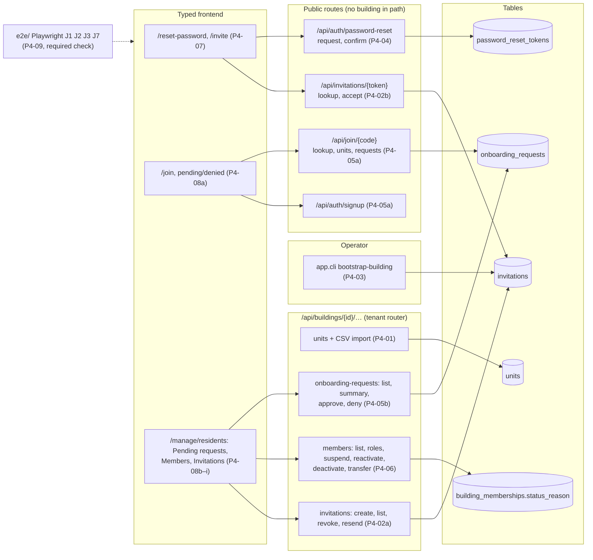

# Milestone Recap — P4 Account and onboarding journeys

Date: 2026-10-22 · Tickets: P4-01a, P4-01b, P4-02a, P4-02b, P4-03, P4-04, P4-05a, P4-05b, P4-06a, P4-06b, P4-07a,
P4-07b, P4-08a–P4-08i, P4-09 (22) · Drafted by the agent at the phase gate
([playbook](../AI_AGENT_PLAYBOOK.md#phase-gates-automated)); sections 7–9 are James's, optional.

## 0. Gate result

Exit gate ([roadmap](../ROADMAP.md), P4): *demo journeys 1, 2, 3 and 7 pass as Playwright tests locally and in CI
(against the prod-like stack).*

| Item | Result | Evidence |
|---|---|---|
| J1, J2, J3, J7 locally, prod-like stack | **pass** | `make e2e E2E_STACK=prodlike DB_PORT=55432` on `origin/main` at `2a277f7` (2026-10-22): `28 passed (11.3s)`. J1 bootstrap, J2 staff invite (through the Invitations screen since P4-08g), J3 join + approve and J3 deny, J7 password reset and J7 Web Lock, each in the `chromium` and `mobile` (Pixel 7) projects |
| J1, J2, J3, J7 in CI, prod-like stack | **pass** | `E2E journeys` job (runs `E2E_STACK=prodlike`, a required check since P4-09) green on `main`'s run 39867023916 at the merge commit `2a277f7` (the whole run `completed success`), and on PR #112's last head `974233a` |

**Gate: green.** No fix tickets; P5 may start. (P5-01 already merged in lane A, PR #109.)

**Tickets merged**

| Ticket | PR | Merge commit | Explanation |
|---|---|---|---|
| P4-01a | #84 | `f678104` | [P4-01a](../explanations/P4-01a-units-api.md) |
| P4-01b | #85 | `a1387a6` | [P4-01b](../explanations/P4-01b-units-csv-import.md) |
| P4-02a | #86 | `6f9cd47` | [P4-02a](../explanations/P4-02a-invitations-management.md) |
| P4-02b | #87 | `8fd6e51` | [P4-02b](../explanations/P4-02b-invitation-accept.md) |
| P4-03 | #89 | `70308fb` | [P4-03](../explanations/P4-03-bootstrap-building-command.md) |
| P4-04 | #90 | `1f3e296` | [P4-04](../explanations/P4-04-password-reset.md) |
| P4-05a | #91 | `308f9f4` | [P4-05a](../explanations/P4-05a-resident-signup-and-join.md) |
| P4-05b | #92 | `3f15cc1` | [P4-05b](../explanations/P4-05b-onboarding-decisions.md) |
| P4-06a | #93 | `7f20498` | [P4-06a](../explanations/P4-06a-members-roles-suspension.md) |
| P4-06b | #94 | `cb34dc1` | [P4-06b](../explanations/P4-06b-move-out-and-transfer.md) |
| P4-07a | #95 | `0c6e97c` | [P4-07a](../explanations/P4-07a-password-reset-screens.md) |
| P4-07b | #96 | `d7944e1` | [P4-07b](../explanations/P4-07b-accept-invite-screen.md) |
| P4-08a | #98 | `db94069` | [P4-08a](../explanations/P4-08a-join-flow-and-status-screens.md) |
| P4-08b | #99 | `1f1ff94` | [P4-08b](../explanations/P4-08b-manager-pending-requests.md) |
| P4-08c | #100 | `12f7c19` | [P4-08c](../explanations/P4-08c-members-administration.md) |
| P4-08d | #101 | `8f7fa19` | [P4-08d](../explanations/P4-08d-pending-badge-and-onboarding-follow-ups.md) |
| P4-09 | #102 | `91929aa` | [P4-09](../explanations/P4-09-playwright-harness-onboarding-e2e.md) |
| P4-08e | #107 | `3b483ed` | [P4-08e](../explanations/P4-08e-member-roles-and-transfer.md) |
| P4-08f | #108 | `fb9d2f7` | [P4-08f](../explanations/P4-08f-account-menu-and-notifications-follow-ups.md) |
| P4-08g | #110 | `ba8fede` | [P4-08g](../explanations/P4-08g-staff-invitations-screen.md) |
| P4-08h | #111 | `65c35cd` | [P4-08h](../explanations/P4-08h-header-panels-at-phone-width.md) |
| P4-08i | #112 | `2a277f7` | [P4-08i](../explanations/P4-08i-invitation-resend-revoke-and-residents.md) |

The roadmap's six P4 tickets became 22: P4-01, -02, -05, -06 and -07 split in two, and P4-08 into nine parts
(a–i). Bookkeeping PRs #88 (B-6), #97 (B-7) and #103 (B-8, closed unmerged once Actions ran again) are not tickets.

## 1. What now works (demo script)

On the local prod-like stack (`make down`, then `make prodlike`, then
`docker compose -f compose.prodlike.yml run --rm --no-deps api python -m app.cli seed`, as `make e2e-reset` does; the app is on
`http://localhost:8080`; mail goes to Mailpit on `http://localhost:8025`). Seed password: `DevPassword!2026`.

1. **Bootstrap a building (J1).** Run
   `docker compose -f compose.prodlike.yml run --rm api python -m app.cli bootstrap-building --slug demo-tower --name "Demo Tower" --address "1 Demo St, Toronto, ON" --timezone America/Toronto --manager-email first.manager@example.test --reason "demo"`.
   It prints the building, its join code and that the manager's invitation was queued. In Mailpit, open
   "You're invited to join Demo Tower", follow the link, choose a name and password: you land on Home as its
   property manager.
2. **Invite staff (J2).** Log in as `manager@example.test` (Maple Tower). Go to Residents → Invitations, type an
   email, tick Security, Send. "Invitation sent to …" appears and the row is listed. Accept from Mailpit in a private
   window: Home shows the Package log, not Residents.
3. **Resend, revoke, resident invite (P4-08i).** On the same tab: Resend a row (the message gives the new expiry; the
   old email's link now says the invitation is invalid); Revoke another; switch Show to Expired; tick Resident, pick
   a unit and "Owner", Send.
4. **Join and approve (J3).** In a private window open `http://localhost:8080/join/MAPLE-2026`, sign up, search a unit
   (`12…`), choose a relationship, submit: a "pending" screen. As the manager, the Residents nav shows a count;
   Pending requests → Approve. The resident's next page load reaches Home, with an in-app notification and an email.
   Deny another request with a reason: the resident sees the reason and "Submit again".
5. **Members administration (P4-06, P4-08c/e).** Residents → Members: filter by role/status, search; suspend (with a
   reason), reactivate, move out; edit roles (the last manager can't remove their own); transfer a resident to
   another unit.
6. **Password reset (J7).** Log out, "Forgot password?", any email gives the same answer. From Mailpit's link set a
   new password: other signed-in sessions of that account are ended.
7. **Isolation.** As `birch.manager@example.test`, none of Maple's people, requests or invitations appear; Maple's
   URLs under `/api/buildings/<maple-id>/…` answer 404.

## 2. Architecture delta

- **Migrations:** `87a5795f265e` invitations (P4-02a); `85cc5c7f420d` invitations' creator nullable (P4-03);
  `de8f8dbe23fb` password_reset_tokens (P4-04); `c0a262b1f7d1` onboarding_requests (P4-05a); `8c7f60239d84`
  membership status reason (P4-06a). Units came with P1's schema; P4-01 added their API.
- **Process:** P4-09's Playwright harness, one suite on two stacks (`E2E_STACK=dev|prodlike`), with `E2E journeys` a
  required status check on `main`.
- **Sessions:** idle deadlines are stored and capped when roles change, under a per-user lock (P4-02b, B-6). The SPA's
  `AuthProvider` has a session epoch, so a user change rebuilds the signed-in tree (P4-07b, B-7).

## 3. Decisions made this phase

ADR written: [ADR-0019](../adr/0019-sql-parameters-hidden-from-errors.md) (P4-04, autonomous). SQL parameters are
hidden from database error messages (`hide_parameters=True`), so a token in a statement can't reach a log.

From the inbox's "Decisions to audit" (85 P4 lines). These are the ones **later work depends on**, so they are the
hardest to overturn:

| Ticket | Decision | Depended on by |
|---|---|---|
| P4-02a | Invitation status is derived from timestamps, not stored; one pending invitation per (building, email) under the building lock | P4-02b, P4-08g/i (expired listed, resend) |
| P4-02b | Sessions follow role changes: stored idle deadlines, capped under a per-user lock (B-6, James chose A) | every later auth or role change |
| P4-06a | Last-manager invariant: every members write locks the building row `FOR NO KEY UPDATE`, then checks | P4-06b, P4-08c/e |
| P4-06b | A member who stops being an active manager loses the open invitations they created there | P4-08g/i |
| P4-07b | Session epoch in `AuthProvider`: code that sweeps a user's cache calls `useNewSession()` (B-7, James chose A) | every screen that changes who is signed in |
| P4-08b | Modal dialogs in typed code are hand-written (`role="dialog"`, Tab trap, Escape), not the legacy UI kit | P4-08c/e/i |
| P4-09 | E2E keeps production rate limits; personas log in once per run; the suite is a required check | every later PR |
| P4-08f / P4-08i | Fitness tests: building queries must be fresh on mount (`queryFreshness`); residents mutations refresh through one cancel-then-invalidate helper (`refresh.test.ts`) | every later query and residents mutation |
| P4-05a/b | Join requests: exact code match, per-IP and per-user rate limits, suspended/deactivated members rejoin only by invitation | P4-08a |

Accepted at merge and open: P4-06a's round 3 Medium (criterion 3 variant: 403, not 409 `last_manager`); no rate
limit on invitation create/resend (P4-02a); no operator command to recover a lost first-manager link (P4-03).

## 4. Agent performance

- **Review rounds per ticket:** median 2.5, max 5 (22 tickets).
  - 1 round: P4-04, P4-08h.
  - 2 rounds: P4-02a, P4-03, P4-05a, P4-05b, P4-06b, P4-08c, P4-08d, P4-08e, P4-08i.
  - 3 rounds: P4-01a, P4-01b, P4-06a, P4-07a, P4-08a, P4-08b, P4-09, P4-08f, P4-08g.
  - More than 3: P4-07b (4, the fourth a verification round after B-7) and P4-02b (5; rounds 4–5 verified fixes
    after B-6, as James authorised).

  11 of 22 reached round 3 or later. Most tickets were reviewed by Codex alone, at James's per-run instruction
  (`gpt-6.1-sol` high, and in P4-08i `gpt-6-astra` medium); see each PR's "Independent review".
- **Findings logged** in [AGENT_MISTAKES_LOG](../AGENT_MISTAKES_LOG.md): 84 P4 entries; the 59 with a recorded
  severity are 6 High, 31 Medium and 22 Low. The rest were caught by CI, by the implementer on the stack, or are
  pattern notes. The Highs were all in Tier 1 backend tickets (P4-02b sessions and locks, P4-05/06 races) and in
  P4-07b's user switch.
- **Recurring patterns:**
  - "List refresh defeated by another fetch" reached 5 (P4-08b R1–R3, P4-08d, P4-08g). It became a `CLAUDE.md` lesson
    (P4-08b), then code (P4-08i's helper and fitness test).
  - "Cached answer reused on remount" became a lesson (P4-08e), then a fitness test (P4-08f).
  - "Regex for a code pattern" (P4-09 F4, P4-08f) became a lesson (P4-08g).
  - "Don't write from a value read before a slow await" (P4-02b ×4) became a lesson.
- **New rules and fitness tests:**
  - `CLAUDE.md` lessons changed in P4-02b, P4-07b, P4-08b, P4-08d, P4-09, P4-08e and P4-08g.
  - Fitness test 6, no `printable` check after a strip (P4-05b).
  - `queryFreshness.test.ts` (P4-08f).
  - `frontend/src/features/residents/refresh.test.ts` (P4-08i).
  - P4-09's no-sleep lint for E2E.
  - `E2E journeys` made a required check (P4-09).
- **Blocks:** three.
  - B-6 (P4-02b): a High open after round 3. James chose option A.
  - B-7 (P4-07b): a High at round 3. James chose option A.
  - B-8 (P4-09): GitHub Actions stopped starting jobs over a billing limit. This was external and was resolved by
    James.
- **Strongest:** concurrency on the server (building and user locks, conditional updates); each race got a two-connection test once found. Splitting while framing kept PRs near 400 lines. **Weakest:** frontend
  async state. Late answers, cache reuse and focus under modals account for most frontend findings. They were
  caught by review, not by the first implementation, and five patterns had to be promoted.

## 5. Open risks and debt

| Risk / debt | Impact | Plan |
|---|---|---|
| Focus and phone layout (P4-07a…P4-08i) proved by Chromium runs recorded in PRs, not committed browser tests | a regression in focus or 375 px layout passes CI | tracked in each explanation §7; candidate: a committed Playwright layout/focus spec per screen |
| P4-07a F6, F7 (open Mediums): another user's sessions on the same browser after a reset; odd `/reset-password` paths show "Page not found" | confusing, not a leak | P4-07a explanation §7 |
| P4-08a open Medium: denial A, resubmit in another tab, denial B within 30 s shows A's reason | the wrong reason is shown briefly | P4-08a explanation §7 |
| P4-08b open Medium: after a failed refresh following a decision, "Show more" loads an older page | stale rows | P4-08b explanation §7 |
| P4-06a open Medium: 403 instead of 409 `last_manager` in one variant | a less precise message | inbox (accepted) |
| No rate limit on invitation create/resend; raw invitation link in `jobs.payload` until sent | abuse by a compromised manager account; link in DB for seconds | P4-02a accepted (inbox) |
| Password reset timing not constant; old token rows never cleaned | account enumeration by timing (weak); table growth | P4-04 explanation §7 |
| Race tests synchronise with `sleep` (P4-05b, P4-06) | slow or flaky on a loaded runner | explanations §7 |
| Only `en` email templates | `fr` users get English | P4-04 explanation §7 |
| P4-02b rounds 4–5 reviewed only the fixes | a new bug in the whole diff after round 3 has had no review | P4-02b explanation §7 |
| Chromium only in E2E (no WebKit/iOS Safari) | Safari-specific bugs (P4-08f/h touch) unseen | P4-09, P4-08h explanations §7 |
| `roles.test.tsx` "building_not_found on transfer" failed once locally (timing) | a possible flaky test | P4-08i ticket follow-ups |

## 6. Suggested reading order

The three that matter most first:

1. [P4-02b](../explanations/P4-02b-invitation-accept.md): sessions, locks and the five-round race story.
2. [P4-06a](../explanations/P4-06a-members-roles-suspension.md): the last-manager invariant and the building lock.
3. [P4-08b](../explanations/P4-08b-manager-pending-requests.md): the frontend list/refresh/dialog patterns every
   later screen reuses.

Then, in build order:
- Backend: [P4-01a](../explanations/P4-01a-units-api.md), [P4-01b](../explanations/P4-01b-units-csv-import.md),
  [P4-02a](../explanations/P4-02a-invitations-management.md), [P4-03](../explanations/P4-03-bootstrap-building-command.md),
  [P4-04](../explanations/P4-04-password-reset.md), [P4-05a](../explanations/P4-05a-resident-signup-and-join.md),
  [P4-05b](../explanations/P4-05b-onboarding-decisions.md), [P4-06b](../explanations/P4-06b-move-out-and-transfer.md).
- Frontend: [P4-07a](../explanations/P4-07a-password-reset-screens.md), [P4-07b](../explanations/P4-07b-accept-invite-screen.md),
  [P4-08a](../explanations/P4-08a-join-flow-and-status-screens.md), [P4-08c](../explanations/P4-08c-members-administration.md),
  [P4-08d](../explanations/P4-08d-pending-badge-and-onboarding-follow-ups.md), [P4-08e](../explanations/P4-08e-member-roles-and-transfer.md),
  [P4-08f](../explanations/P4-08f-account-menu-and-notifications-follow-ups.md), [P4-08g](../explanations/P4-08g-staff-invitations-screen.md),
  [P4-08h](../explanations/P4-08h-header-panels-at-phone-width.md), [P4-08i](../explanations/P4-08i-invitation-resend-revoke-and-residents.md).
- The harness: [P4-09](../explanations/P4-09-playwright-harness-onboarding-e2e.md).

**"Must explain" questions no explanation answers:** none. Every P4 part's questions are answered in its §9. The
split parents' questions (P4-01, -02, -05, -06, -07, -08) were carried into their parts and answered there. P4-08f
had none.

## 7. What I learned (James, own words, optional)

*Prompt: which race in this phase would you have missed yourself, and how did the test that caught it work? What
did "stored idle deadlines capped by role changes" (B-6) cost, and would you choose it again?*

## 8. Interview story (STAR, James, optional)

*Prompt: the onboarding phase, built by agents with Codex as the only reviewer. Pick B-6 or B-7: a High that stayed
open after three rounds, the options you were given, and what you chose.*

- Situation:
- Task:
- Action (what *I* decided, including the trade-offs, and how I directed the agents):
- Result (numbers if possible):

## 9. Three interview questions (agent proposes; James answers in their own words)

1. Q: Two managers approve the same join request at the same moment. Walk through what each request does in the
   database and what each one sees. A:
2. Q: Why does an invitation store only a hash of its token, and what else did this phase do to keep tokens out of
   logs, errors and URLs? A:
3. Q: A list in a React Query app shows stale data after a mutation even though you invalidate it. Name two ways that
   happens and how this codebase prevents each. A:
