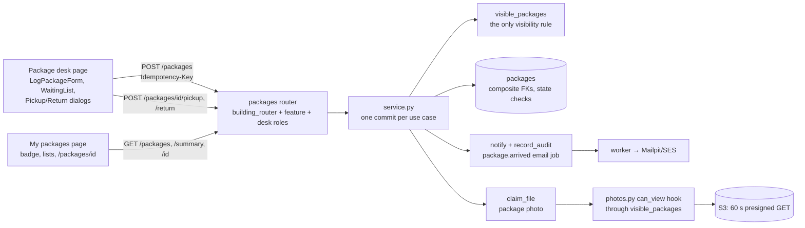

# Milestone Recap — P5 Packages reference slice

Date: 2026-10-23 · Tickets: P5-01, P5-02a, P5-02b, P5-03a, P5-03b, P5-03c, P5-03d, P5-04, P5-05 (9) · Drafted by the
agent at the phase gate ([playbook](../AI_AGENT_PLAYBOOK.md#phase-gates-automated)); sections 7–9 are James's, optional.

## 0. Gate result

Exit gate ([roadmap](../ROADMAP.md), P5): *Reference slice gate: packages E2E + concurrency tests, in CI and on the
prod-like stack.*

| Item | Result | Evidence |
|---|---|---|
| Packages E2E on the prod-like stack, locally | **pass** | `make e2e E2E_STACK=prodlike DB_PORT=55432` on `origin/main` at `0f3099f` (2026-10-23): `39 passed (12.0s)` — J1, J2, J3 ×2, **J4**, J7 ×2, the header panels and the **package desk checks** ×2, each in `chromium` and `mobile`, plus 7 setup logins |
| Packages concurrency tests, locally | **pass** | `make test DB_PORT=55432 PYTEST_ADDOPTS="-q tests/packages/test_concurrency.py tests/packages/test_create_concurrency.py tests/packages/test_transitions.py"` at `0f3099f`: `81 passed in 19.31s` |
| Both in CI, prod-like stack | **pass** | `main`'s run 40039359329 at the merge commit `0f3099f`: Backend tests, Frontend lint/types/ratchet/build, Prod-like stack smoke, E2E journeys, Docs links all `success`; PR #121's last head `ee7467e` (run 40038764041) the same (Backend tests runs every packages concurrency test; E2E journeys runs J4 on the prod-like stack) |

**Gate: green.** No fix tickets; P6 may start.

**Tickets merged** (from `git log origin/main --grep "P5-"`)

| Ticket | PR | Merge commit | Explanation |
|---|---|---|---|
| P5-01 | #109 | `2b45f96` | [P5-01](../explanations/P5-01-package-schema-state-machine.md) |
| P5-02a | #114 | `987b370` | [P5-02a](../explanations/P5-02a-package-create-and-read.md) |
| P5-02b | #115 | `ab34e6f` | [P5-02b](../explanations/P5-02b-package-pickup-and-return.md) |
| P5-03a | #116 | `a08be0f` | [P5-03a](../explanations/P5-03a-package-desk-read-fields.md) |
| P5-03b | #117 | `dc9453b` | [P5-03b](../explanations/P5-03b-package-desk-page-and-waiting-list.md) |
| P5-03c | #118 | `b6df305` | [P5-03c](../explanations/P5-03c-log-package-panel.md) |
| P5-03d | #119 | `8be9a62` | [P5-03d](../explanations/P5-03d-package-pickup-and-return-dialogs.md) |
| P5-04 | #120 | `9ca3de9` | [P5-04](../explanations/P5-04-resident-packages-page.md) |
| P5-05 | #121 | `0f3099f` | [P5-05](../explanations/P5-05-packages-e2e-and-slice-gate.md) |

## 1. What now works (demo script)

On the local prod-like stack, from a clean checkout: `make down`, then `make e2e E2E_STACK=prodlike` (it builds,
starts, resets and seeds the stack, then runs the journeys), or `make prodlike` and seed it as the P4 recap §1 says.
The app is on `http://localhost:8080`, Mailpit on `http://localhost:8025`; seed password `DevPassword!2026`.

1. **The desk logs a package.** Log in as `security@example.test` → "Package log" in the nav (the Package desk page). In "Log package": Unit `101`, pick
   it, carrier Other → type one, a description, "Choose photo" → any small image, wait for "Remove photo", Log
   package: "Logged ✓", and the package is first under Waiting.
2. **The resident is told.** In a private window, log in as `resident1@example.test`: the nav reads "My packages" with a
   count one higher; the bell lists "<carrier> delivered a package for unit 101."; Mailpit has "A package is waiting at
   the desk" with a link to `http://localhost:8080/packages/<id>`.
3. **The deep link.** Click the notification (or the email's link): the package opens over My packages with its photo
   and "Waiting at the front desk".
4. **Hand it out.** At the desk, "Hand out" on that row → the resident's name → Hand out: "Unit 101's package was
   handed to Alex Chen.", and the row leaves. The resident's count falls back and the package is in History.
5. **Return one.** Log another; "Return" → a reason → Return: "…was marked returned."
6. **Two desks.** Open the desk in two windows (security and `manager@example.test`), Hand out one package in both,
   confirm in one, then the other: the second says "Already picked up or returned by a colleague." and its row goes.
7. **Privacy.** As `resident2@example.test` (unit 102), `/packages/<id>` shows "Package not found"; as
   `birch.manager@example.test`, `GET /api/buildings/<maple-id>/packages/<id>` answers 404 `building_not_found`.

**Run:** steps 1–4 and 6–7 are what J4 and the desk checks do in Chromium and on a Pixel 7 viewport; they ran on the
prod-like stack at `0f3099f` for this gate (`39 passed`, §0). Steps 2's email and 3's photo URL were also checked by
hand with curl on that stack in PR #121 (the email's link; `GET` of the presigned URL → `200 image/png`,
`X-Amz-Expires: 60`). Step 5 is P5-03d's dialog, run in the desk checks with a 300-character reason. Not run by hand
for this recap: a person clicking through steps 1–7.

## 2. Architecture delta

- **New table** `packages` (P5-01): composite FKs to the unit and the recipient membership, checks that tie each
  status to its columns and every `*_at` to `received_at`, `UNIQUE (building_id, idempotency_key)`.
- **New endpoints** under `/api/buildings/{id}/packages` (P5-02a, P5-02b, P5-03a, P5-04): create (idempotent), list
  (filters: status (repeatable), unit, carrier), summary, get, pickup, return; `GET /units/{id}/occupants`.
- **New pages** `/security/packages` (P5-03b–d) and `/packages/:packageId?` (P5-04); legacy `SecurityPackages.jsx`
  and `Packages.jsx` deleted; `/SecurityPackages` redirects, and `/Packages` needs no redirect: routes match
  case-insensitively, so it already reaches the new page (`frontend/src/app/routes.tsx::sameLegacyPath`, P5-04 D2).
- **New journey and checks** J4, `packages-desk.spec.ts`, and the denial fitness test (P5-05); `docs/SLICE_RECIPE.md`.

## 3. Decisions made this phase

No ADR was written in P5 (`git log --diff-filter=A 2b45f96^..origin/main -- docs/adr`: none). The inbox's "Decisions
to audit" rows for P5, one line each (full text there):

- **P5-01:** status checks stricter than the ticket (each status's columns exclusive to it); the photo hook needs
  `attached_type = 'package'` and the package's own `photo_file_id`; `idempotency_key`/`request_hash` NOT NULL.
- **P5-02a:** the idempotent create pattern (key rules, look-up first, the hash of the *validated* body), later
  copied by P5-03c's form; one 422 `invalid_recipient` for every refused recipient; `package_arrived` template.
- **P5-02b:** the transition pattern P6 copies (visible read → `assert_transition` → conditional UPDATE); who may
  collect; exactly one of member id and typed name; `package.picked_up` in-app only.
- **P5-03a:** residents never see `recipient_name`; names from live lookups (two batched queries per response).
- **P5-03b:** the desk reuses `UnitPicker` (active units only) and a fixed carrier list; legacy paths redirect.
- **P5-03c:** one `Idempotency-Key` per form; submit refused while a photo uploads or after it failed.
- **P5-03d:** one "ended" message for both actions; pickup choices order; the shared `Modal` trap treats a radio
  group as one tab stop (changes every residents dialog).
- **P5-04:** `status` may repeat on `packages_list`; a case-only legacy path gets no redirect.
- **P5-05:** J4 on a different unit per Playwright project; criterion 3 corrected to ADR-0006's at-least-once email;
  the slice gate accepts the multi-role union on `/packages`.
- **Run-specific reviewer setups** (James's instructions): Codex alone in P5-01 to P5-04 (`gpt-6-astra` medium or
  `gpt-6.1-sol` high), Claude + Codex `gpt-6-astra-medium` in P5-05.

Depended on by later work, so harder to overturn: the transition and idempotent-create patterns (P5-02a/b) and
`visible_packages`' shape, which `docs/SLICE_RECIPE.md` now tells P6 to copy; the `Modal` radio-group trap (every
residents dialog).

## 4. Agent performance

- **Review rounds per ticket** (from each PR's "Independent review", and P5-03d's explanation §6 for its round 3):
  median 2, max 3 (9 tickets).
  - 1 round: P5-01, P5-02a, P5-02b (no findings).
  - 2 rounds: P5-03a, P5-03b, P5-03c.
  - 3 rounds: P5-03d (R3 no findings), P5-04 (R1 and R2 `BLOCK`, R3 `MERGE`), P5-05 (all `MERGE`; one Medium left open).
- **Findings logged** in [AGENT_MISTAKES_LOG](../AGENT_MISTAKES_LOG.md): 25 P5 rows, read one by one, counting each
  row once at the highest severity its "Caught by" column names: **2 High** (both P5-04: the badge-count/list race,
  R1 and R2), **13 Medium** (P5-03b 1, P5-03c 3, P5-03d 3, P5-04 1, P5-05 5), **6 Low**, 1 criteria gap (P5-05 AC6), and
  3 caught by the implementer (P5-03c at bookkeeping; P5-05 at verification and at bookkeeping). P5-01 to P5-02b have
  none.
- **Recurring patterns:**
  - "Overflow at 375 px with long text" reached 5 (P4-08a, P4-08c, P5-03b R1 F1, P5-03c R1 F3, P5-03d R1 F2): the 4th
    promoted it to a `CLAUDE.md` lesson, and the 5th came after it; P5-05 made it a check: `packages-desk.spec.ts`
    measures the desk with the API's longest values.
  - "A list read before the change it is compared with" reached 2 in P5-04 (R1 F1, R2 F1): a `CLAUDE.md` lesson in this
    PR (it was due in P5-05, whose framing missed it; see the mistakes log).
  - "A parser check misses a syntax shape" came back 5 times in P5-05's fitness test, after its lesson: the lesson now
    says to resolve names with the TypeScript checker, and P6-02's stub carries the rewrite as its first follow-up.
  - "Framed from a stale checkout" reached 2 (P5-03c, P5-05): each read the ticket in the main checkout, behind
    `origin/main`, and missed a "Carried from…" section. This PR adds to `.claude/commands/build-ticket.md` step 2:
    read the ticket from the new worktree.
- **New rules and fitness tests:** `frontend/src/test/buildingDenial.test.ts` (P3-05's, carried since P3);
  `e2e/tests/packages-desk.spec.ts`; two `CLAUDE.md` lessons and the `build-ticket.md` "read the ticket from the worktree" line (this PR); the recap command's "run the demo" and "facts
  from their source" steps (P5-05).
- **Tickets blocked:** none.
- **Strongest:** the backend half: P5-01 to P5-02b and P5-03a merged with no reviewer finding, and the patterns they set
  (transition, idempotent create, `visible_packages`) held through the UI tickets and J4 unchanged. **Weakest:**
  browser-state reasoning in the UI tickets (P5-04's two Highs on refresh ordering, P5-03d's focus findings) and, in
  P5-05, a fitness test grown rule by rule instead of on the checker. Also two tickets framed from a stale checkout.
- **Size:** P5-02a (506 non-test lines), P5-03d (417) and P5-04 (447) went over the ~400 guide, each recorded.

## 5. Open risks and debt

Selected from the P5 explanations' §7 (each explanation has the full list), checked against the later tickets that
closed some of them.

| Risk / debt | Impact | Plan |
|---|---|---|
| The denial fitness test doesn't resolve names by scope (P5-05 R3, open Medium) | a contrived alias or shadowing hides a passive reader without the denial | P6-02 stub, first follow-up: rewrite on the TypeScript checker |
| The S3 emulator serves presigned GETs after expiry | locally only the 60 s signing is proven | D-06 against real S3; optionally turn on LocalStack's signature checks (inbox) |
| At-least-once email: a worker crash can send one email twice (P5-05 D3) | a duplicate "package waiting" email | accepted (ADR-0006) |
| A resident who is also desk staff sees every package on `/packages` (P5-04, accepted in P5-05) | more than "my packages" on that page | inbox decision; a ticket if it should change |
| Occupants load above "Someone else" in the pickup dialog (P5-03d D2) | a mis-click as the list shifts | accepted Low |
| P5-04 R3 coverage gaps: a pickup time's own conversion, a non-English locale, the lists' loading messages, Load more after a failure | untested display paths | tracked here only |
| The Log package panel's keyboard flow and long file names have no committed browser test (P5-03c) | a regression shows only by hand | tracked here only; the desk checks cover the list and dialogs, not the panel |
| Focus drops to `body` during a photo upload: `FileUpload` disables its own button (P5-03c) | a screen reader loses its place | inbox |
| A package logged and picked up within one 30 s poll changes no count, so the resident's lists don't follow (P5-04) | an open page misses it in History until focus or remount | accepted (P5-04 explanation D3, §7) |
| The denial fitness test proves the denial is read, not that it gates rendering (P5-05) | a reader that reads and ignores it passes | tracked here only |
| The building-switch tests pin the outcome, not `usePackageSubmit`'s `mounted` guard (P5-05) | removing the guard stays green | tracked here only (React drops the late update) |
| Who collected a package and the return reason are not shown (P5-02b, P5-03d) | the desk can't see it after the fact | out of scope ("Out" in the tickets) |
| No `EXPLAIN` at scale for the resident query and the names lookups (P5-01, P5-03a) | cost unmeasured | measure when a building has real volume |
| Recipient move-out race on create; `FOR KEY SHARE` on the unit without a race test (P5-02a) | a recipient who moves out between the check and the commit still gets the package and notification | accepted in PR #114's follow-ups; no test |
| `backend/tests/packages/test_concurrency.py` fails now and then: the database clock steps back between the factory's `now()` and the transition's `clock_timestamp()`, tripping `ck_packages_picked_up_after_received` or `ck_packages_returned_after_received` (P5-03a; reproduced on `main` `ab34e6f`, 2 in 14 runs) | an occasional red run of a gate test file | open: P5-05's `_AFTER_RECEIVED` fix covered `test_api.py` and `test_desk_fields.py` only; apply it here in the next packages backend ticket |
| Flaky tests seen once: `backend/tests/memberships/test_members_concurrency.py::test_stale_clock_is_occupancy_changed`, `backend/tests/jobs/test_worker.py::test_database_error_keeps_no_parameters_in_last_error` (P5-01, P5-02a), `test_a_pickup_waits_for_a_held_transition_and_loses_after_its_commit[commits]` (P5-02b, output lost) | an occasional red run | not reproduced; tracked in those explanations; watch in CI |
| A real tablet was never used (P5-03b) | layout proven in Chromium only | D-06, if a device is available |
| `CLAUDE.md` is 158 lines against the ≤ 150 guide (it was 153 before this PR) | context cost | compact the lessons in a later docs PR |

Closed by later tickets: P5-01's "no endpoint yet" and empty-string checks (P5-02a/b); "`PackageOut` has no unit
label or recipient name" (P5-03a); P5-02b's host-clock `_picked_up` (P5-05, also `test_desk_fields.py`); P5-03b's
P3-05 fitness test (P5-05); P5-03d's layout proven only by hand and the return building-switch test (P5-05); P5-04's
"no photos on the stack" (J4 uploads one).

## 6. Suggested reading order

The three that matter most first:

1. [P5-02b](../explanations/P5-02b-package-pickup-and-return.md): the transition pattern (conditional UPDATE, one
   winner), which P6 copies.
2. [P5-02a](../explanations/P5-02a-package-create-and-read.md): the idempotent create, notify and audit in one commit.
3. [P5-05](../explanations/P5-05-packages-e2e-and-slice-gate.md): the whole slice through J4, and the recipe.

Then in build order: [P5-01](../explanations/P5-01-package-schema-state-machine.md) (schema, `visible_packages`),
[P5-03a](../explanations/P5-03a-package-desk-read-fields.md), [P5-03b](../explanations/P5-03b-package-desk-page-and-waiting-list.md),
[P5-03c](../explanations/P5-03c-log-package-panel.md), [P5-03d](../explanations/P5-03d-package-pickup-and-return-dialogs.md),
[P5-04](../explanations/P5-04-resident-packages-page.md). Then [SLICE_RECIPE](../SLICE_RECIPE.md).

Every "Must explain" question of the phase's tickets is answered in its explanation's §9 (P5-03d's ticket has none).

## 7. What I learned (James, own words, optional)

_Prompts:_ What does `visible_packages` protect that the router's role guard doesn't? Which P5-04 High would you
have caught in review, and how? What would you change in the recipe before P6?

## 8. Interview story (STAR, James, optional)

- Situation:
- Task:
- Action (what *I* decided, including the trade-offs, and how I directed the agents):
- Result (numbers if possible):

## 9. Three interview questions (agent proposes; James answers in their own words)

1. Q: Two desk staff hand out the same package at the same moment. Walk through what the database does and what each
   of them sees. A:
2. Q: Why does every building-owned row carry `building_id`, and why are its foreign keys composite? What attack or
   bug does that stop that a `WHERE building_id = …` in each query doesn't? A:
3. Q: Your residents' badge polls every 30 s and the lists don't poll. What went wrong when the lists refreshed on the
   badge's change, and how would you design that refresh again? A:
